# 1. Portada

| Campo | Valor |
|---|---|
| Institución | Universidad Libre |
| Asignatura | Arquitectura Empresarial, Taller final |
| Docente | Mgs. Maria del Pilar Niño Campos |
| Autor | Johel Santiago Arias |
| Organización analizada | LIRN (proyectada LIRN S.A.S.), producto TORNS |
| Fecha | 2 de noviembre de 2026 |
| Versión | 1.0 |

## Marcas de evidencia

| Marca | Significado |
|---|---|
| Observado | Hecho verificado en el código, la documentación o la evidencia del proyecto. |
| Observado por declaración del dueño (1 de noviembre de 2026) u Observado por declaración del dueño (2 de noviembre de 2026) | Hecho declarado por el dueño de LIRN, sin otra evidencia documental. |
| Diseñado AS-IS | Modelado del estado actual hecho por el autor a partir de lo observado. |
| Objetivo TO-BE | Estado futuro propuesto; no existe hoy. |
| NO CONFIRMADO | Dato que no se ha podido verificar; no se rellena. |

# 2. Introducción

<!-- reescribir Santiago -->

LIRN es una microempresa de una sola persona que desarrolla TORNS, un prototipo que mide la demanda de pasajeros en estación con visión por computador y propone al centro de control un plan de despacho. Este informe integra los cinco puntos del taller final siguiendo el Método de Desarrollo de Arquitectura (ADM) de TOGAF (The Open Group, 2022): la visión y el negocio (fases A y B), los sistemas de información en datos y aplicaciones (fase C), la tecnología (fase D) y la transformación (fases E y F, con criterios de gobierno para G y H).

La pregunta que guía el documento es: ¿cómo ayuda la Arquitectura Empresarial propuesta a que la organización alcance sus objetivos estratégicos y sea más eficiente durante los próximos cinco años? El capítulo 9 la responde.

Los entregables de los Puntos 1 a 5 son anexos de este informe y forman parte de la entrega: «Arquitectura de Negocio (Punto 1)», «Arquitectura de Datos (Punto 2)», «Arquitectura de Aplicaciones (Punto 3)», «Arquitectura Tecnológica (Punto 4)» con su «Anexo Punto 4. Comparativo de nube Azure y GCP para TORNS», y «Arquitectura de Transformación (Punto 5)».

<!-- reescribir Santiago -->

# 3. Descripción de la organización

| Aspecto | Descripción | Marca |
|---|---|---|
| Razón social | LIRN (proyectada LIRN S.A.S.), sociedad por acciones simplificada que se constituiría según la Ley 1258 de 2008 (Congreso de la República de Colombia, 2008) | Diseñado AS-IS |
| Sector económico | Software e ITS para movilidad y transporte masivo (CIIU 6201 / 6202) | Diseñado AS-IS |
| NIT y matrícula mercantil | Sin NIT ni matrícula; no hay registro ante Cámara de Comercio | Observado por declaración del dueño (2 de noviembre de 2026) |
| Tamaño | Microempresa unipersonal; el Decreto 957 de 2019 (Presidencia de la República de Colombia, 2019) clasifica por ingresos, que no están confirmados, por lo que la clasificación es una hipótesis de diseño | Observado (equipo), Diseñado AS-IS (marco) |
| Equipo | Un autor y responsable único, Johel Santiago Arias | Observado por declaración del dueño (1 de noviembre de 2026) |
| Producto | TORNS: detección y conteo de pasajeros con YOLO11s (Ultralytics, s. f.) y recomendación determinista de despacho | Observado |
| Clientes | Ninguno; no hay piloto ni contrato | Observado |
| Caso de estudio | El sistema TransMilenio y el SITP de Bogotá se usan como caso de estudio, no como cliente | Observado |
| Evidencia de mercado | Encuesta del 17 de agosto de 2026 (n=20, formulario anónimo en Google Forms, que sigue en uso) y entrevista a un controlador del SITP, citado por su rol. El 80 % dejó pasar buses llenos dentro del último mes, al 65 % le pasa varias veces por semana y el 40 % se identifica con el desbalance entre oferta y demanda (Equipo TORNS, 2026) | Observado (cifras agregadas); uso del formulario: Observado por declaración del dueño (1 de noviembre de 2026) |

**Misión y visión.** Las declaraciones estratégicas están aprobadas como línea base de gobierno (Observado, proceso P-01).

**Misión actual**

> Hacer que el transporte masivo ajuste su oferta a la demanda real de cada estación, midiendo quién espera ahora y no solo lo que el horario predijo.

**Visión actual**

> Que cada estación de un sistema masivo opere con la demanda que ocurre, no con la que se supuso.

Los objetivos estratégicos OE-01 a OE-05 están en el entregable «Arquitectura de Negocio (Punto 1)». En síntesis: OE-01 convertir TORNS en un producto demostrable y controlado para un centro de control; OE-02 abrir un canal comercial honesto hacia operadores B2B y B2G; OE-03 proteger datos personales y evidencia según la Ley 1581 de 2012 (Congreso de la República de Colombia, 2012); OE-04 cerrar la brecha entre demanda medida y oferta recomendada; OE-05 preparar la firma para un primer piloto pagado.

# 4. Arquitectura de Negocio

Fase B del ADM. El entregable «Arquitectura de Negocio (Punto 1)» documenta el organigrama, los activos de información AI-01 a AI-07, el mapa de procesos BPMN 2.0 (Object Management Group, 2014), el mapa de capacidades y las partes interesadas.

**Estructura.** La Dirección General concentra las cinco unidades funcionales, una por proceso. Ver «Organigrama: vista jerárquica de la planta actual».

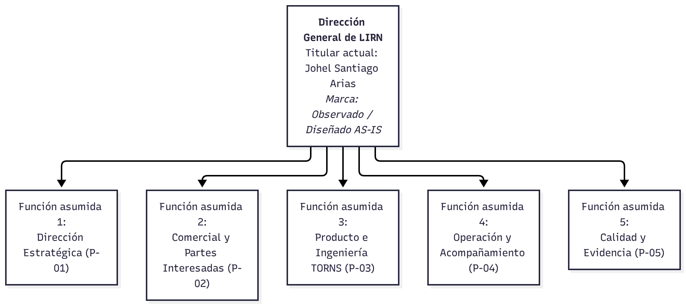

**Procesos.** Cinco procesos AS-IS: P-01 Dirección estratégica de LIRN (estratégico), P-02 Relación comercial y partes interesadas, P-03 Realización del producto TORNS y P-04 Acompañamiento al uso del prototipo (misionales), y P-05 Evidencia, calidad y mejora (apoyo). Se muestran la cadena de valor y los diagramas BPMN de los cinco procesos.

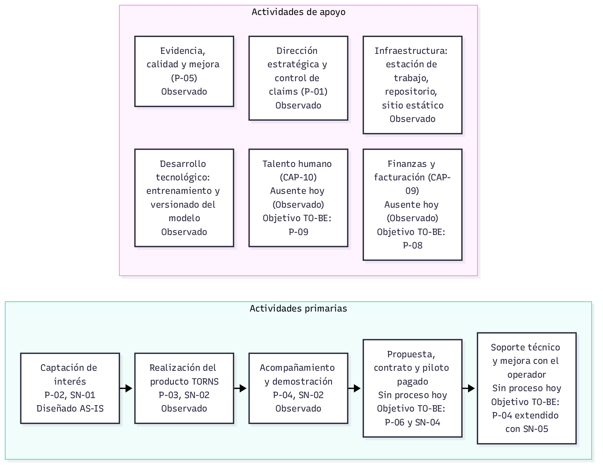

**P-01. Dirección estratégica de LIRN (estratégico)**

**P-02. Relación comercial y partes interesadas (misional)**

**P-03. Realización del producto TORNS (misional)**

**P-04. Acompañamiento al uso del prototipo (misional)**

**P-05. Evidencia, calidad y mejora (apoyo)**

**Capacidades.** De diez capacidades, CAP-04 Detección y conteo y CAP-05 Recomendación de despacho son funcionales en prototipo; CAP-07 Integración en vivo con el operador, CAP-09 Gestión financiera y facturación y CAP-10 Gestión de talento humano están ausentes y son brechas hacia el Objetivo TO-BE.

**Activos de información.** Siete activos, desde el registro de leads (AI-01), que contiene datos personales sujetos a la Ley 1581 de 2012 (Congreso de la República de Colombia, 2012), hasta facturación y contratos (AI-07), hoy inexistente.

| ID | Activo | Clasificación de seguridad | Datos personales | Marca |
|---|---|---|---|---|
| AI-01 | Registro de solicitudes y prospectos (leads) | Confidencial | Sí | Observado / Diseñado AS-IS |
| AI-02 | Evidencia de validación del problema | Interno. La síntesis estadística autorizada es pública en la página de TORNS. | No, en el activo consolidado | Observado |
| AI-03 | Video de estaciones y métricas de conteo | Interno / Confidencial | Potencialmente sí (imagen de personas) | Observado |
| AI-04 | Pesos del modelo y dataset curado | Reservado | No, en los pesos. Imagen curada en el dataset de entrenamiento. | Observado |
| AI-05 | Código fuente de las cuatro superficies | Interno / Reservado | No | Observado |
| AI-06 | Gobierno, fichas de proceso y registro de empresa | Interno. El diagrama BPMN está publicado para evaluación. | Sí, mínimos | Observado |
| AI-07 | Facturación, contabilidad y contratos | No existe hoy | No existe hoy | Observado (ausencia) / Brecha |

**Partes interesadas.** Una parte interesada es cualquier persona, grupo, área u organización que puede afectar, ser afectada o tener interés en una decisión de esta arquitectura. La clasificación incluye el nivel de influencia.

| ID | Parte interesada | Categoría | Relación con LIRN y TORNS | Interés principal | Influencia | Marca |
|---|---|---|---|---|---|---|
| **SH-01** | Johel Santiago Arias, fundador y director general | Interna. Cubre Dirección, Comercial, Producto, Operación y Calidad | Único integrante actual y autor del prototipo y de los procesos. | Viabilidad de TORNS, rigor de los no-claims y preparación hacia un primer piloto pagado. | **Alta** | Observado / Diseñado AS-IS |
| **SH-02** | Universidad Libre y docente del taller | Externa. Academia | Evalúa el plan bajo TOGAF. | Coherencia entre negocio, datos, aplicaciones, tecnología y roadmap, con trazabilidad verificable. | **Alta** | Observado |
| **SH-03** | Operadores concesionarios, incluido el rol de controlador operativo entrevistado en el SITP | Externa. Segmento B2B. No son clientes actuales | Ejecutan rutas y sufren desajuste de frecuencia y multas operativas. | Conteo oportuno en estación y recomendación de despacho, en lugar de coordinación reactiva por radio. | **Alta** sobre requisitos del producto. **Media** en la operación actual, porque no hay contrato. | Observado / Diseñado AS-IS |
| **SH-04** | Administradores y supervisores de estaciones | Externa. Segmento B2B secundario | Vigilan la saturación de plataforma (código TP 19). | Alerta temprana de acumulación de pasajeros. | **Media** | Diseñado AS-IS |
| **SH-05** | Entes gestores y sistemas ferroviarios. TransMilenio S.A. como referente público. Sistema Metro de Bogotá como segmento B2G | Externa. No son clientes actuales | Planifican el sistema, supervisan el servicio y pueden aplicar multas a concesionarios. | Estándares de servicio, protección de datos e interoperabilidad futura. | **Media** en el AS-IS. **Alta** en un piloto B2G futuro. | Observado / Diseñado AS-IS |
| **SH-06** | Visitantes del sitio y prospectos del formulario | Externa. Canal comercial | Consultan la propuesta y dejan datos de contacto. | Información veraz sobre el prototipo, respuesta a la solicitud y protección de datos. | **Media** | Observado |
| **SH-07** | Pasajeros, incluida la muestra n=20 del 17 de agosto de 2026 | Externa. Beneficiarios indirectos | Padecen esperas y sobrecostos cuando el vehículo pasa lleno. | Menor espera en estación. No compran el software. | **Baja** en la decisión de compra. **Media** como evidencia del problema. | Observado |
| **SH-08** | GitHub, Google, Roboflow y Ultralytics | Externa. Proveedores técnicos | Alojan el sitio y el código, reciben el formulario y aportan la base de visión. | Continuidad del servicio y cumplimiento de licencias. | **Media** | Observado |

Lectura de poder e interés:

- **Cercanía de gestión.** SH-01 y SH-02 deciden el diseño y la aceptación de este taller. SH-03 aporta los requisitos de dominio.
- **Alineación.** SH-05, SH-06 y SH-08 condicionan el marco legal, el canal de contacto y la continuidad técnica.
- **Evidencia.** SH-04 y SH-07 sustentan el problema de negocio custodiado en P-05. Lead no es cliente.

**Hallazgo principal.** Toda la operación descansa en una persona y en un equipo de cómputo. El negocio TO-BE agrega P-06 Piloto, P-07 Integración con el centro de control, P-08 Gestión financiera y P-09 Talento humano, este último condicional a que exista personal que vincular.

# 5. Arquitectura de Datos

Fase C, datos. El entregable «Arquitectura de Datos (Punto 2)» contiene el inventario D-01 a D-23, los modelos conceptual y lógico AS-IS y TO-BE, tres flujos de información y los problemas PI-01 a PI-18.

**Inventario de datos.**

| Código | Conjunto de datos | Origen o sistema | Clasificación | Dato personal | Marca |
|---|---|---|---|---|---|
| D-01 | Lead (solicitud de contacto). Un lead no es un cliente | Hoja de cálculo de Google mediante Apps Script (según el registro) | Confidencial | Sí | Observado (formulario) / Observado por declaración del dueño (1 de noviembre de 2026): hoja y Apps Script en cuenta personal de Google |
| D-02 | Evidencia de validación: encuesta del 17 de agosto de 2026 (n=20) | AP-13 Google Forms y resumen estático en el sitio | Interno (resumen público) | No en el consolidado | Observado (registro y sitio) / NO CONFIRMADO (respuestas individuales) |
| D-03 | Evidencia de validación: entrevista a controlador SITP | Documento de evidencia | Interno | Sin dato personal identificable declarado | Observado (registro) / NO CONFIRMADO (soporte de las notas) |
| D-04 | Fuente de video | Cuatro archivos mp4 de demostración, cámara USB o fuente RTSP | Interno | Posible (imagen de personas) | Observado (código); Observado por declaración del dueño (1 de noviembre de 2026): videos de Pexels; Observado por declaración del dueño (2 de noviembre de 2026): pruebas con usb0 y usb1 los días 16, 17, 18 y 20 de noviembre de 2025, en varios portátiles y PC con cámaras externas; resultados NO CONFIRMADO |
| D-05 | Fotograma procesado | Memoria y flujo MJPEG | Interno | Posible (imagen de personas) | Observado (código) |
| D-06 | Métrica de detección | Memoria de AP-03 y WebSocket | Interno | No (agregado) | Observado (código) |
| D-07 | Estación | Constantes en el código de AP-03 | Interno | No | Observado (código) / Diseñado AS-IS (datos de demostración) |
| D-08 | Cámara | Configuración y variables de entorno | Interno | No | Observado (código) |
| D-09 | Modelo de tren | Constantes en el código de AP-03 | Interno | No | Observado (código y registro) / Diseñado AS-IS (parámetros del prototipo) |
| D-10 | Estado de estación | Memoria del proceso | Interno | No | Observado (código) |
| D-11 | Plan de despacho | Memoria y respuesta de la API | Interno | No | Observado (código) |
| D-12 | Modelo entrenado (pesos) | Archivo de pesos en el repositorio de AP-04 | Reservado | No | Observado (código) |
| D-13 | Dataset y anotaciones | Carpeta de la herramienta de etiquetado dentro del repositorio de AP-04 | Reservado | Posible (imágenes) | Observado (código y cuaderno de entrenamiento: 3.694 imágenes de entrenamiento y 1.000 de validación; el dataset no existe en el repositorio) / Observado por declaración del dueño (1 de noviembre de 2026): origen coco-person de Roboflow Universe, licencia MIT y fecha de entrenamiento |
| D-14 | Cuenta de anotador y credenciales de la herramienta de etiquetado | Base SQLite dentro del repositorio público | Confidencial | Sí | Observado (código) |
| D-15 | Registros de ejecución | Salida estándar del proceso | Interno | No en el contenido observado | Observado (código) / NO CONFIRMADO (retención) |
| D-16 | Código fuente de AP-01 a AP-04 | GitHub (repositorio público) | Interno o Reservado | No | Observado (registro y repositorio) |
| D-17 | Documentación de procesos y gobierno | Repositorio, Lucidchart, SharePoint | Interno | Mínimo (nombre público del fundador) | Observado (registro) |
| D-18 | Clientes | Ninguno | No aplica | No aplica | Observado (no existen clientes firmados) |
| D-19 | Proveedores comerciales y técnicos | Ninguno | No aplica | No aplica | Observado (proveedores técnicos sin contrato; no existe registro de proveedores comerciales) |
| D-20 | Facturación y contabilidad | Ninguno | No aplica | No aplica | Observado (no existe facturación) |
| D-21 | Empleados | Ninguno | Confidencial (Objetivo TO-BE) | Sí, en Objetivo TO-BE. Sensibles los atributos de salud (Ley 1581 de 2012, art. 5); la afiliación a seguridad social es obligatoria para quien tenga contrato de trabajo y el empleador responde por el pago de los aportes (Ley 100 de 1993, arts. 15 y 22); para teletrabajadores, los aportes se pagan mediante PILA (Decreto 1072 de 2015, art. 2.2.1.5.7); su clasificación como dato sensible queda NO CONFIRMADO | Observado (un integrante; no existe CAP-10 Gestión de talento humano) |
| D-22 | Contratos y acuerdos de servicio | Ninguno | No aplica | No aplica | Observado (no existen contratos) |
| D-23 | Identificación legal de la firma (NIT y matrícula mercantil) | Ninguno | No aplica | No aplica | Observado (no existen NIT ni matrícula; la formalización registral no se ha ejecutado) |

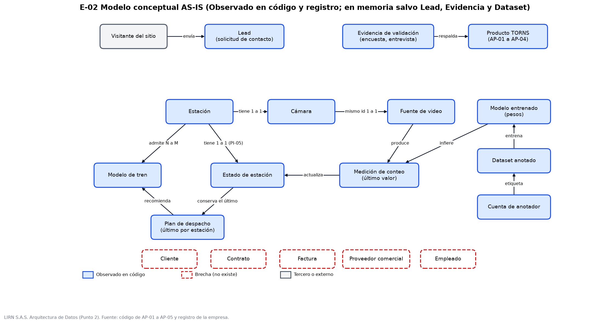

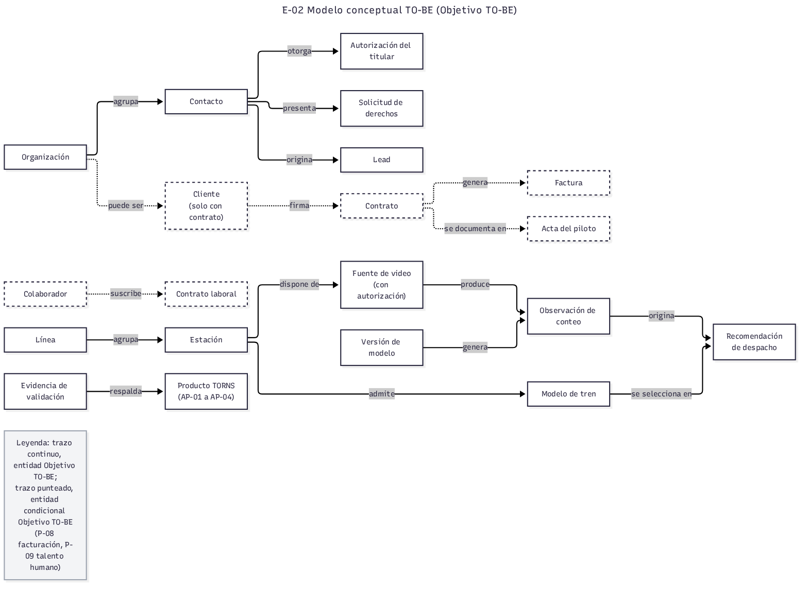

Los flujos son el técnico (FL-T: video, inferencia, conteo y plan), el comercial (FL-C: formulario hacia la hoja de cálculo) y el de evidencia (FL-E).

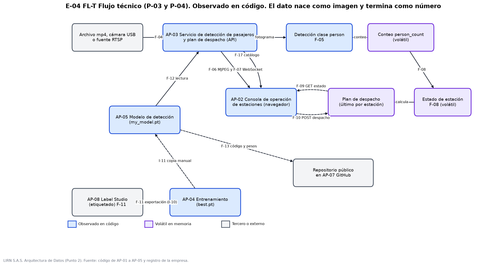

**Problemas centrales.** Los conteos y planes no se guardan, por lo que no hay historial ni forma de medir; los leads se capturan sin política de tratamiento ni la autorización previa que exigen los artículos 5 a 7 del Decreto 1377 de 2013 (Presidencia de la República de Colombia, 2013); los pesos del modelo, el dataset y los videos no tienen respaldo. Marca: Observado por declaración del dueño (1 de noviembre de 2026). Las imágenes de personas en estación exigen tratar con cuidado los datos que pueden ser sensibles en el sentido del art. 5 de la Ley 1581 de 2012 (Congreso de la República de Colombia, 2012).

**Propuesta.** Modelo TO-BE con persistencia de conteos y planes por estación y fecha, registro versionado del modelo, gestor de leads con autorización y entidades de piloto, factura y contrato.

# 6. Arquitectura de Aplicaciones

Fase C, aplicaciones. El entregable «Arquitectura de Aplicaciones (Punto 3)» inventaría AP-01 a AP-13, mapea las integraciones, registra los problemas PR-01 a PR-17 y los riesgos RA-01 a RA-07, y propone la interoperabilidad con las aplicaciones nuevas N-01 a N-07 y las interfaces IT-01, IT-02, IT-04, IT-05, IT-06 e IT-07.

**Inventario de aplicaciones.**

| Código | Nombre | Función | Área usuaria | Marca |
|---|---|---|---|---|
| AP-01 | Sitio web comercial de LIRN y TORNS (lirn-web-main) | Presenta la firma y el producto TORNS y recibe mensajes de interés mediante un formulario de contacto | Visitantes externos; rol Comercial (fundador) | Observado |
| AP-02 | Consola de operación de estaciones (tro-frontend) | Muestra video con detecciones, métricas por cámara, estado de estaciones y plan de despacho | Rol de Operación y de Producto (fundador) en demostración; sin usuarios de operador | Observado; sin despliegue; Observado por declaración del dueño (1 de noviembre de 2026) |
| AP-03 | Servicio de detección de pasajeros y plan de despacho, API (tro-backend) | Ejecuta la detección sobre video, publica métricas por WebSocket y aplica la regla determinista de despacho. | Consumido por AP-02; rol de Producto | Observado |
| AP-04 | Entrenamiento del modelo de detección (yolo-train-routes-optimization) | Prepara el conjunto de datos, entrena y exporta el modelo de detección de personas. | Rol de Producto y de Calidad (fundador) | Observado |
| AP-05 | Modelo de detección (my_model/my_model.pt, en yolo-train-routes-optimization) | Artefacto de IA de una clase (person) consumido por AP-03 como archivo local | Consumido por AP-03 | Observado |
| AP-06 | Hoja de cálculo con Apps Script (hoja de Google; endpoint configurado en VITE_CONTACT_ENDPOINT) | Recibe y guarda los mensajes del formulario con las columnas timestamp, nombre, email, organizacion, mensaje y origen; la consulta solo el dueño. | Rol Comercial (fundador, único consultor) | Observado por declaración del dueño (1 de noviembre de 2026); código del script NO CONFIRMADO en repositorios |
| AP-07 | GitHub: repositorios, Pages y Actions (github.com/5arSanti) | Control de versiones, pruebas y publicación del sitio | Rol de Producto (fundador) | Observado |
| AP-08 | Label Studio (en Docker; exportaciones en mydata/) | Etiquetado de imágenes del conjunto de datos del modelo de visión. | Rol de Producto (fundador) | Observado (instrucciones y árbol); uso confirmado por el dueño (1 de noviembre de 2026) |
| AP-09 | Lucidchart (SaaS) | Diagramación de arquitectura y procesos | Rol de Dirección (fundador) | Diseñado AS-IS |
| AP-10 | SharePoint (Microsoft 365) | Almacenamiento de documentos de apoyo; no compromete la operación del producto | Rol de Dirección y Calidad (fundador) | Diseñado AS-IS |
| AP-11 | Correo electrónico | Comunicación y resguardo de algunos documentos; no compromete la operación del producto. | Todos los roles (fundador) | Diseñado AS-IS |
| AP-12 | Google Fonts (fonts.googleapis.com y fonts.gstatic.com, enlazados en AP-01) | Entrega la tipografía Manrope al navegador del visitante; al cargar el sitio, el navegador envía la IP del visitante a Google (flujo F-03 de Datos) | Visitantes externos (consumo indirecto) | Observado |
| AP-13 | Google Forms (formulario de la encuesta de validación) | Recoge las respuestas de la encuesta de validación (flujo F-14 de Datos); formulario «Tu experiencia diaria en el transporte masivo de Bogotá». | Rol de Dirección y Producto (fundador) | Observado por declaración del dueño (1 de noviembre de 2026) |

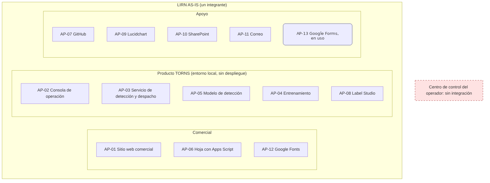

**Situación AS-IS.** AP-01 Sitio web comercial de LIRN y TORNS, AP-02 Consola de operación de estaciones y AP-03 Servicio de detección de pasajeros y plan de despacho funcionan como prototipo; AP-02 y AP-03 no tienen autenticación; la inferencia está acoplada a la apertura del flujo de video; una hoja de cálculo con Apps Script (AP-06) sustituye al CRM; no hay integración con ningún centro de control ni aplicación de facturación.

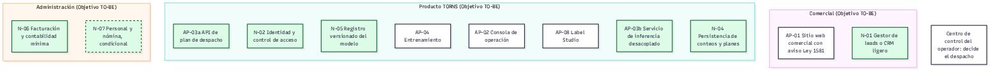

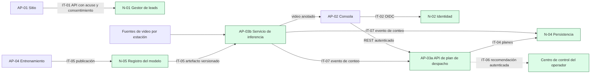

**Propuesta.** AP-06, la hoja de cálculo que hace de CRM, se elimina y la reemplaza el gestor de leads N-01 con autorización de tratamiento (RA-01). AP-03 se divide en AP-03a, API de despacho, y AP-03b, servicio de inferencia; se añaden identidad y roles (N-02), persistencia (N-04), registro de modelos (N-05) y facturación (N-06). Estas dos últimas responden a la necesidad DF-08 de la Arquitectura de Datos: el registro versionado del modelo y la facturación como necesidades de aplicación. La interfaz con el centro de control (IT-06) entrega una recomendación; la decisión de despacho sigue siendo del operador (principio PN-04).

# 7. Arquitectura Tecnológica

Fase D. El entregable «Arquitectura Tecnológica (Punto 4)» contiene el inventario tecnológico, los diagramas AS-IS y TO-BE, los riesgos RT-01 a RT-13 y la propuesta de entornos.

**Inventario tecnológico.**

| Código | Tipo | Descripción | Marca |
|---|---|---|---|
| IT-EQ-01 | Servidores y equipos | Estación del fundador: Intel Core i5-10400 a 2,90 GHz, 48 GB de RAM, NVIDIA GeForce GTX 1050 Ti de 4 GB, 1,14 TB de almacenamiento con 975 GB usados (cerca del 85 %), Windows de 64 bits | Observado por declaración del dueño (1 de noviembre de 2026) |
| IT-EQ-02 | Servidores y equipos | GPU de entrenamiento: La misma GTX 1050 Ti; la salida del cuaderno registra PyTorch 2.7.1 con CUDA 11.8 y Ultralytics 8.3.228 | Observado |
| IT-EQ-03 | Servidores y equipos | Cámaras: Cámara integrada usb0 y cámara USB externa usb1 | Observado por declaración del dueño (1 de noviembre de 2026) |
| IT-EQ-04 | Servidores y equipos | Pruebas con cámaras: Se han hecho pruebas con cámaras USB integradas en portátiles (usb0) y con cámaras USB externas (usb1) | Observado por declaración del dueño (2 de noviembre de 2026): pruebas con usb0 y usb1 los días 16, 17, 18 y 20 de noviembre de 2025, en varios portátiles y PC con cámaras externas; resultados NO CONFIRMADO |
| IT-EQ-05 | Servidores y equipos | Servidores de producción: No existen | Observado |
| IT-EQ-06 | Servidores y equipos | GPU de producción: No existe | Observado |
| IT-RD-01 | Redes | Red local de la estación: La consola llama a la API en localhost por defecto (http://localhost:8000/api/v1) | Observado |
| IT-RD-02 | Redes | Puertos del contenedor: Puerto de la API por variable PORT y puerto de depuración 5678 publicado | Observado |
| IT-RD-03 | Redes | Puerto de etiquetado: 8080 para Label Studio | Observado |
| IT-RD-04 | Redes | Transporte de video y métricas: MJPEG sobre HTTP y métricas por WebSocket, sin cifrado propio | Observado |
| IT-RD-05 | Redes | Fuente RTSP: Soportada por el backend; no hay cámara de campo instalada | Observado |
| IT-RD-06 | Redes | Segmentación, firewall o VPN: No existen actualmente segmentación de red, firewall ni VPN | Observado por declaración del dueño (1 de noviembre de 2026) |
| IT-SW-01 | Plataformas y software base | Contenedor del backend: Python 3.11 slim, FastAPI, Uvicorn con recarga automática, Ultralytics y OpenCV; paquetes de desarrollo incluidos | Observado |
| IT-SW-02 | Plataformas y software base | Docker Compose: Un servicio, verificación de salud cada 30 segundos, depuración activa por defecto; nombre de contenedor y red residual de otro proyecto | Observado |
| IT-SW-03 | Plataformas y software base | Consola de operación: React 19 con Vite, ejecución local | Observado |
| IT-SW-04 | Plataformas y software base | Sitio comercial: React con Vite; pruebas y publicación con GitHub Actions en GitHub Pages | Observado |
| IT-SW-05 | Plataformas y software base | Entrenamiento: Anaconda, Python 3.13, Ultralytics YOLO11, cuaderno | Observado |
| IT-SW-06 | Plataformas y software base | Etiquetado: Label Studio en Docker con volumen local | Observado |
| IT-BD-01 | Bases de datos y almacenamiento | Base de datos de producción: No existe | Observado |
| IT-BD-02 | Bases de datos y almacenamiento | Estado del backend: Conteos y plan de despacho solo en memoria; se pierden al reiniciar | Observado |
| IT-BD-03 | Bases de datos y almacenamiento | Base SQLite de Label Studio: Dentro del repositorio de entrenamiento, con cuenta de anotador | Observado |
| IT-BD-04 | Bases de datos y almacenamiento | Pesos, imágenes, exportes y videos: Versionados en repositorios; videos duplicados entre backend y entrenamiento | Observado |
| IT-BD-05 | Bases de datos y almacenamiento | Dataset preprocesado: Vive en la estación, fuera del repositorio, sin respaldo | Observado por declaración del dueño (1 de noviembre de 2026) |
| IT-BD-06 | Bases de datos y almacenamiento | Leads: Hoja de Google alimentada por Apps Script en la cuenta personal del dueño | Observado por declaración del dueño (1 de noviembre de 2026) |
| IT-NB-01 | Nube y servicios de terceros | GitHub, Pages y Actions: Repositorios y publicación del sitio comercial | Observado |
| IT-NB-02 | Nube y servicios de terceros | Google Apps Script y Sheets: Recepción de leads por POST desde el formulario | Observado |
| IT-NB-03 | Nube y servicios de terceros | Google Fonts: Tipografía del sitio comercial | Observado |
| IT-NB-04 | Nube y servicios de terceros | Lucidchart, SharePoint y correo: Apoyo documental | Diseñado AS-IS |
| IT-NB-05 | Nube y servicios de terceros | Nube de cómputo: Solo como idea, sin despliegue | Observado por declaración del dueño (1 de noviembre de 2026) |

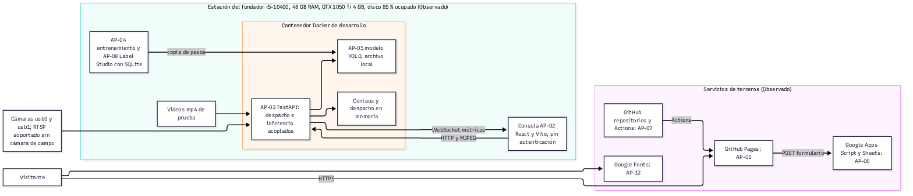

**Situación AS-IS.** Todo corre en una sola estación de trabajo, con disco cerca de su capacidad y sin respaldos ni separación de entornos. Marca: Observado por declaración del dueño (1 de noviembre de 2026). Hoy no existen segmentación de red, firewall ni VPN. Marca: Observado por declaración del dueño (1 de noviembre de 2026). Sobre las cámaras: Observado por declaración del dueño (2 de noviembre de 2026): pruebas con usb0 y usb1 los días 16, 17, 18 y 20 de noviembre de 2025, en varios portátiles y PC con cámaras externas; resultados NO CONFIRMADO.

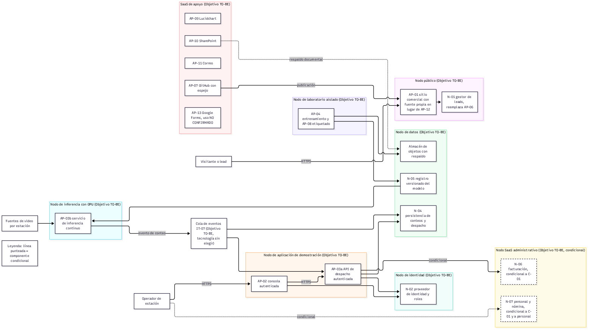

<!-- reescribir Santiago -->

**Propuesta.** Cinco entornos (Desarrollo, Laboratorio, Demostración, Piloto y Público), almacén de objetos para modelos y videos, gestor de secretos, respaldo verificado y GPU bajo demanda para la inferencia. Azure y GCP se mantienen como alternativas de nube (Objetivo TO-BE). El anexo «Anexo Punto 4. Comparativo de nube Azure y GCP para TORNS» estima la operación en São Paulo (Azure Brazil South y GCP southamerica-east1), única ubicación donde ambas ofrecen la GPU T4, con precios de lista de pago por uso de la Azure Retail Prices API (Microsoft, 2026) y de las páginas de precios de Google Cloud (Google, 2026), consultados el 2 de noviembre de 2026. Es una estimación y no una cotización.

| Escenario | Azure (USD/mes) | GCP (USD/mes) | Diferencia |
|---|---|---|---|
| Piloto (1 a 3 cámaras) | 755,45 | 650,11 | GCP 105,34 menos (14 %) |
| Escala (15 cámaras) | 3.096,77 | 2.864,32 | GCP 232,45 menos (8 %) |

Fuente: anexo «Anexo Punto 4. Comparativo de nube Azure y GCP para TORNS». Los totales excluyen los rubros marcados NO CONFIRMADO y no aplican descuentos. El equipo recomienda GCP southamerica-east1 por costo y por disponibilidad de T4 en tres zonas; Azure publica niveles de SLA iguales o superiores en VPN, secretos y base de datos sin alta disponibilidad. Marca: Objetivo TO-BE; la decisión es de Santiago y sigue pendiente. En ambas nubes los datos personales saldrían a Brasil, por lo que antes de cargarlos debe firmarse el contrato de transmisión con el proveedor como Encargado (Presidencia de la República de Colombia, 2013); Brasil no figura en la lista de países con nivel adecuado de protección de la SIC (Circular Externa 005 de 2017, modificada por la Circular Externa 002 de 2018; Superintendencia de Industria y Comercio [SIC], 2017, 2018). Los nodos administrativos de facturación y nómina, condicionales a la formalización, se rigen por la Resolución 000165 de 2023 (Dirección de Impuestos y Aduanas Nacionales [DIAN], 2023), la Resolución 000013 de 2021 (DIAN, 2021), la Ley 100 de 1993 (Congreso de la República de Colombia, 1993) y el Decreto 1072 de 2015 (Presidencia de la República de Colombia, 2015).

<!-- reescribir Santiago -->

**Riesgos principales.** Los entregables de Aplicaciones y Tecnología registran 20 riesgos; se resumen así:

| Riesgo | Descripción breve |
|---|---|
| RA-01 | Hoja de cálculo usada como CRM, sin control |
| RA-02 | Identidad TRO residual en descripciones y nombres |
| RA-03 | Textos sin respaldo en consola y sitio |
| RA-04 | Identificadores de estación inconsistentes |
| RA-05 | Middleware no activado y detecciones simuladas |
| RA-06 | Base de Label Studio con datos personales en repositorio público |
| RA-07 | Google Fonts transfiere la IP del visitante sin aviso |
| RT-01 | Dependencia de una sola persona |
| RT-02 | Sin respaldos de pesos, dataset ni videos |
| RT-03 | Disco cerca de su capacidad |
| RT-04 | Modelo sin evaluación en estación |
| RT-05 | Consola y API sin autenticación |
| RT-06 | Configuración de desarrollo expuesta |
| RT-07 | Backend sin pruebas ni integración continua |
| RT-08 | Conteos solo en memoria |
| RT-09 | Datos personales en el laboratorio |
| RT-10 | Dependencia de cuentas de GitHub y Google |
| RT-11 | Cámara USB distinta de una cámara de campo |
| RT-12 | Gestión de secretos sin evidencia (NO CONFIRMADO) |
| RT-13 | Equipos obsoletos en la única estación |

# 8. Roadmap de Transformación

Fases E y F del ADM. El detalle está en los entregables de la Arquitectura de Transformación (Punto 5): resumen del negocio TO-BE, análisis de brechas, portafolio de proyectos, matriz de priorización, hoja de ruta, indicadores de éxito, registro de requisitos RQ-01 a RQ-20, gobierno de la implementación y gestión del cambio.

## 8.1 Situación objetivo TO-BE

<!-- reescribir Santiago -->

LIRN, formalizada como S.A.S., ofrece TORNS a un operador B2B o una entidad B2G mediante un primer piloto pagado, con medición de demanda en estación, recomendación de despacho que decide el centro de control, datos personales tratados conforme a la ley y una operación que ya no depende de un solo equipo ni de una sola persona. Todo lo anterior es Objetivo TO-BE.

<!-- reescribir Santiago -->

## 8.2 Análisis de brechas

Se identifican 26 brechas en cuatro series: negocio (B-N), datos (B-D), aplicaciones (B-A) y tecnología (B-T). Las más críticas son la falta de formalización legal (B-N01), el formulario sin autorización de tratamiento (B-D02), la ausencia de respaldos (B-D06) y el disco casi lleno con equipos obsoletos en la única estación (B-T06).

| ID | Qué existe hoy | Marca | Qué hace falta | Qué debe cambiar |
|---|---|---|---|---|
| B-N01 | No hay registro ante Cámara de Comercio; sin NIT ni matrícula mercantil | Observado por declaración del dueño (2 de noviembre de 2026) | S.A.S. formalizada | Registro ante Cámara de Comercio y DIAN |
| B-N02 | Banda pública de tres nombres frente a equipo de una persona (Johel Santiago Arias); identificadores tro-* residuales | Observado | Comunicación alineada al equipo vigente | Actualizar banda y retirar residuos TRO |
| B-N03 | Leads recopilados en hoja sin respuesta ni seguimiento | Observado por declaración del dueño (1 de noviembre de 2026) | Embudo con atención y seguimiento (CAP-03) | Incorporar paso de atención al proceso comercial |
| B-N04 | Sin evaluación del modelo en estación; recall 0,55 es métrica de entrenamiento de la última época sobre 1.000 imágenes del COCO Person Dataset de Roboflow, no de estación | Observado | Evaluación con video de estación acordado con operador | Definir protocolo de evaluación en campo |
| B-N05 | CAP-07, CAP-09 y CAP-10 ausentes | Observado | Capacidades con proceso (P-07, P-08, P-09) | Diseñar interoperabilidad, facturación y talento |
| B-N06 | Sin proceso de contratación ni piloto | Observado | P-06 y SN-04 | Diseñar proceso de piloto pagado |
| B-N07 | Dependencia de una sola persona para las cinco áreas | Observado | Roles futuros (Comercial, Ingeniería, Operación, Calidad) | Plan de talento ligado a CAP-10; documento de recuperación y segundo custodio |
| B-D01 | Conteos y planes solo en memoria | Observado | Historial comparable por estación | Persistencia gestionada |
| B-D02 | Formulario sin política Ley 1581 ni casilla de autorización; datos en cuenta personal de Google | Observado por declaración del dueño (1 de noviembre de 2026) | Política, aviso y autorización publicados | Formalizar tratamiento de datos personales |
| B-D03 | Sin diccionario, propietario de dato ni retención | Observado (ausencia) | Gobierno de datos mínimo | Catálogo y política de retención |
| B-D04 | Cuenta de anotador con datos personales en repositorio público | Observado | Datos personales fuera del repositorio | Retirar y controlar base de Label Studio (AP-08) |
| B-D05 | Inconsistencias de identificadores y datos de demostración legibles como reales | Observado | Catálogo de estaciones único y datos de demo rotulados | Corregir y rotular |
| B-D06 | Sin respaldos de pesos, dataset, base de etiquetado ni videos | Observado por declaración del dueño (1 de noviembre de 2026) | Respaldo fuera de la estación con prueba de restauración | Política de respaldo y almacén de objetos versionado |
| B-A01 | AP-06 (hoja con Apps Script) como sustituto de CRM, sin acuse ni reintento | Observado | Gestor estructurado de leads (N-01) | Reemplazar AP-06 con integración IT-01 |
| B-A02 | AP-02 y AP-03 sin autenticación; CORS abierto | Observado | Identidad y roles (N-02) | Autenticación y CORS restringido |
| B-A03 | Inferencia ligada a la apertura del stream en AP-03 | Observado | AP-03a API de despacho y AP-03b inferencia desacoplada (N-03) | Partición lógica y cola de conteos |
| B-A04 | AP-05 copiado a mano, deriva de versiones entre AP-04 y AP-03 | Observado | Registro versionado del modelo (N-05) | Publicación de artefacto con metadatos |
| B-A05 | Sin integración con centro de control | Observado (ausencia) | Interfaz autenticada IT-06 | Acordar contrato de interfaz con operador |
| B-A06 | Sin aplicación de facturación y contabilidad | Observado (ausencia) | Facturación electrónica SaaS (N-06) | Adoptar servicio |
| B-A07 | Código sin uso, textos sin respaldo, sin pruebas | Observado | Código limpio, textos alineados, pruebas | Saneamiento |
| B-T01 | Un solo entorno (desarrollo en la estación del fundador) | Observado | Entornos de laboratorio, demostración y piloto separados según la tabla de entornos del Punto 4 | Contenedores separados para AP-03a, AP-03b, laboratorio y demostración |
| B-T02 | Configuración de desarrollo expuesta: CORS abierto, depuración y recarga activas, puerto publicado | Observado | Imagen de ejecución mínima y perfiles de entorno | Endurecer imágenes; pruebas e integración continua del backend |
| B-T03 | Plantilla de secretos presente; manejo real sin evidencia | NO CONFIRMADO | Gestor de secretos por entorno y registro de accesos | Adoptar gestor de secretos |
| B-T04 | Solo cámaras USB usb0 y usb1; GPU de la estación obsoleta; inferencia acoplada al video | Observado | Fuente de campo definida con un operador; AP-03b continuo con cola IT-07; GPU bajo demanda | Evaluación de infraestructura de campo y cola de eventos (producto NO CONFIRMADO) |
| B-T05 | Publicación y leads en cuentas de GitHub y Google | Observado | Espejo de repositorios y N-01 | Plan de continuidad |
| B-T06 | Disco de la única estación cerca de su capacidad y equipos obsoletos | Observado por declaración del dueño (1 de noviembre de 2026) | Almacén de objetos fuera de la estación y GPU bajo demanda | Retiro de duplicados y migración de artefactos |

## 8.3 Portafolio de proyectos

| Proyecto | Nombre | Objetivo | Beneficio esperado | Prioridad |
|---|---|---|---|---|
| PY-01 | Formalización legal de LIRN S.A.S. | Obtener matrícula mercantil y NIT ante la Cámara de Comercio de Bogotá y la DIAN | Habilita contratar, facturar e identificar al Responsable del tratamiento de datos | 1 |
| PY-02 | Alineación de la identidad pública de TORNS | Ajustar la banda pública de tres nombres y retirar residuos tro-* de los textos públicos | Comunicación coherente con el autor único | 2 |
| PY-03 | Canal comercial conforme a la Ley 1581 | Publicar política y aviso, capturar autorización y reemplazar la hoja por un gestor de leads con respuesta | Cumplimiento legal y leads atendidos | 1 |
| PY-04 | Historial de conteos y despacho | Persistir conteos, estado y planes por estación y fecha | Comparabilidad y auditoría de recomendaciones; base de indicadores | 2 |
| PY-05 | Inferencia desacoplada y evaluación en estación | Separar AP-03a y AP-03b, versionar el modelo y evaluarlo con video de estación | Evidencia de desempeño en plataforma, hoy inexistente | 2 |
| PY-06 | Interoperabilidad con el centro de control | Implantar P-07 e IT-06 con interfaz autenticada; el operador decide | Recomendación usable por el operador sin perder la decisión humana | 3 |
| PY-07 | Seguridad, respaldo y separación de entornos | Respaldo verificado, gestión de secretos, autenticación con roles (N-02), retiro de datos personales del repositorio público y entornos de demostración, laboratorio y piloto separados | Continuidad y menor exposición | 1 |
| PY-08 | Primer piloto pagado B2B o B2G | Ejecutar P-06 y prestar SN-04 con un operador | Primera validación comercial y técnica en campo | 3 |
| PY-09 | Gestión financiera y facturación | Implantar P-08 con facturación electrónica y contabilidad mínima (N-06) | Poder cobrar y registrar el piloto | 1 |
| PY-10 | Gestión del talento humano | Implantar P-09 (vinculación, nómina, seguridad social, desvinculación) con N-07 y tratamiento Ley 1581 de datos de empleados | Vinculación conforme cuando la capacidad lo exija | Condicional |

## 8.4 Matriz de priorización

Cada proyecto se valoró por impacto, complejidad y costo relativo, y por las dependencias que habilita. PY-01 tiene impacto alto y complejidad baja y habilita PY-03, PY-08, PY-09 y PY-10, por lo que va primero. PY-06 queda en prioridad 3 porque requiere un operador real. La matriz completa, con la justificación de cada valoración, está en el entregable «Matriz de priorización».

| Proyecto | Impacto | Complejidad | Costo relativo | Prioridad |
|---|---|---|---|---|
| PY-01 | Alto | Baja | Bajo | 1 |
| PY-03 | Alto | Media | Bajo | 1 |
| PY-07 | Alto | Media | Medio | 1 |
| PY-09 | Alto | Media | Medio | 1 |
| PY-02 | Medio | Baja | Bajo | 2 |
| PY-04 | Alto | Media | Medio | 2 |
| PY-05 | Alto | Alta | Alto | 2 |
| PY-08 | Alto | Alta | Alto | 3 |
| PY-06 | Medio | Alta | Medio | 3 |
| PY-10 | Medio | Media | Alto | Condicional |

## 8.5 Hoja de ruta

| Horizonte | Proyectos |
|---|---|
| 0 a 1 año | PY-01, PY-03, PY-07, PY-09, PY-02, PY-04 |
| 1 a 3 años | PY-05, PY-08 |
| 3 a 5 años | PY-06 |
| Sin fecha | PY-10, condicional a que haya personal que vincular |

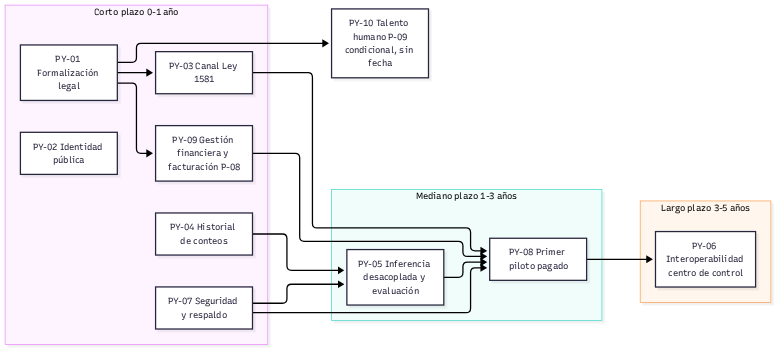

## 8.6 Indicadores de éxito

| Categoría | Indicadores |
|---|---|
| Reducción de tiempos | IN-01 primera respuesta a un lead; IN-02 restauración tras pérdida del equipo; IN-03 espera en andén durante el piloto |
| Disminución de costos | IN-04 pasos manuales para publicar el modelo; IN-05 despachos sin respaldo de demanda observada |
| Incremento de ventas | IN-06 conversión de leads; IN-07 piloto pagado firmado; IN-08 pilotos facturados |
| Satisfacción de usuarios | IN-09 satisfacción del controlador; IN-10 solicitudes de titulares atendidas en plazo |
| Calidad técnica | IN-11 recall en video de estación; IN-12 coincidencia con la decisión del operador; IN-13 activos con respaldo verificado |

Las metas no fijan cifras que no estén sustentadas. El recall de 0,55 corresponde a la última época del entrenamiento del 15 de noviembre de 2025 (precisión 0,73, mAP50 0,64), no a operación; IN-11 mide el recall sobre video real de estación, que hoy no existe.

# 9. Conclusiones

<!-- reescribir Santiago -->

**Respuesta a la pregunta del taller.** La Arquitectura Empresarial propuesta ayuda a LIRN a alcanzar sus objetivos estratégicos en cinco años porque ordena la transformación según dependencias reales y no según preferencias técnicas.

1. En el primer año la arquitectura elimina los dos riesgos que hoy pueden detener la empresa: la dependencia de un solo equipo, con respaldo y entornos separados (PY-07), y la operación sin existencia legal ni tratamiento conforme de datos personales (PY-01 y PY-03). Sin esto ningún operador podría contratar a LIRN.
2. En ese mismo primer año, el historial de conteos (PY-04) deja medir el prototipo y la facturación (PY-09) permite cobrar el futuro piloto.
3. Entre el primer y el tercer año, la inferencia desacoplada (PY-05) hace medible el modelo con video real de estación, que es la condición para el primer piloto pagado (PY-08).
4. Entre el tercer y el quinto año, la interoperabilidad con el centro de control (PY-06) lleva la recomendación de despacho al operador, que mantiene la decisión.
5. La eficiencia se mide con los indicadores IN-01 a IN-13, que parten de líneas base observadas y no de cifras supuestas.

La organización resultante sigue siendo pequeña, pero deja de depender de una sola máquina y de una sola persona, y cada paso queda trazado desde un objetivo OE hasta una brecha, un proyecto y un indicador.

<!-- reescribir Santiago -->

# 10. Recomendaciones

<!-- reescribir Santiago -->

1. Iniciar PY-01, la formalización ante la Cámara de Comercio y la DIAN, porque habilita casi todo el portafolio.
2. Publicar la política y el aviso de tratamiento de datos antes de seguir recibiendo leads.
3. Hacer y probar el respaldo de pesos, dataset y videos de inmediato.
4. Conseguir video de estación con un acuerdo que respete la Ley 1581 de 2012 antes de anunciar cualquier métrica de desempeño.
5. Mantener la regla de comunicar solo lo evidenciado (PN-02) y no presentar a TransMilenio como cliente.
6. Decidir entre Azure y GCP con la estimación del anexo de nube del Punto 4 (GCP recomendado por el equipo; decisión de Santiago) y firmar el contrato de transmisión con el proveedor antes de cargar datos personales. <!-- reescribir Santiago -->
7. Revisar la hoja de ruta cada año, según la fase H del ADM.

<!-- reescribir Santiago -->

# 11. Bibliografía

Congreso de la República de Colombia. (1993, 23 de diciembre). *Ley 100 de 1993, por la cual se crea el sistema de seguridad social integral y se dictan otras disposiciones*. Función Pública, Gestor Normativo. https://www.funcionpublica.gov.co/eva/gestornormativo/norma.php?i=5248

Congreso de la República de Colombia. (2008, 5 de diciembre). *Ley 1258 de 2008, por medio de la cual se crea la sociedad por acciones simplificada*. Función Pública, Gestor Normativo. https://www.funcionpublica.gov.co/eva/gestornormativo/norma.php?i=34130

Congreso de la República de Colombia. (2012, 17 de octubre). *Ley Estatutaria 1581 de 2012, por la cual se dictan disposiciones generales para la protección de datos personales*. Función Pública, Gestor Normativo. https://www.funcionpublica.gov.co/eva/gestornormativo/norma.php?i=49981

Dirección de Impuestos y Aduanas Nacionales. (2021, 11 de febrero). *Resolución 000013 de 2021, por la cual se implementa y desarrolla en el sistema de facturación electrónica la funcionalidad del documento soporte de pago de nómina electrónica y se adopta el anexo técnico*. https://www.dian.gov.co/normatividad/Normatividad/Resoluci%C3%B3n%20000013%20de%2011-02-2021.pdf

Dirección de Impuestos y Aduanas Nacionales. (2023, 1 de noviembre). *Resolución 000165 de 2023, por la cual se desarrolla el sistema de facturación, los proveedores tecnológicos, se adopta la versión 1.9 del anexo técnico de factura electrónica de venta, se expide el anexo técnico 1.0 del documento equivalente electrónico, y se dictan otras disposiciones en materia del sistema de facturación*. https://www.dian.gov.co/normatividad/Normatividad/Resoluci%C3%B3n%20000165%20de%2001-11-2023.pdf

Equipo TORNS. (2026). *Guía Actividad 2, Ingeniería Aplicada* [Documento interno no publicado].

Google. (2026). *Accelerator-optimized VM pricing* [Página de precios de Google Cloud]. Recuperado el 2 de noviembre de 2026, de https://cloud.google.com/products/compute/pricing/accelerator-optimized

Microsoft. (2026). *Azure Retail Prices API* [Interfaz de precios de lista]. Recuperado el 2 de noviembre de 2026, de https://prices.azure.com/api/retail/prices

Object Management Group. (2014). *Business Process Model and Notation (BPMN), Version 2.0.2*. https://www.omg.org/spec/BPMN/2.0.2/

Presidencia de la República de Colombia. (2013, 27 de junio). *Decreto 1377 de 2013, por el cual se reglamenta parcialmente la Ley 1581 de 2012*. Función Pública, Gestor Normativo. https://www.funcionpublica.gov.co/eva/gestornormativo/norma.php?i=53646

Presidencia de la República de Colombia. (2015, 26 de mayo). *Decreto 1072 de 2015, Decreto Único Reglamentario del Sector Trabajo*. Función Pública, Gestor Normativo. https://www.funcionpublica.gov.co/eva/gestornormativo/norma.php?i=72173

Presidencia de la República de Colombia. (2019, 5 de junio). *Decreto 957 de 2019, por el cual se adiciona el capítulo 13 al Título 1 de la Parte 2 del Libro 2 del Decreto 1074 de 2015*. Función Pública, Gestor Normativo. https://www.funcionpublica.gov.co/eva/gestornormativo/norma.php?i=94550

Superintendencia de Industria y Comercio. (2017, 10 de agosto). *Circular Externa 005 de 2017, adicionar un Capítulo Tercero al Título V de la Circular Única*. Diario Oficial 50.321. https://sedeelectronica.sic.gov.co/transparencia/normativa/circular-05-12

Superintendencia de Industria y Comercio. (2018, 23 de marzo). *Circular Externa 002 de 2018, por medio de la cual se modifica el numeral 3.2 del Capítulo Tercero del Título V de la Circular Única*. Diario Oficial 50.544. https://sedeelectronica.sic.gov.co/transparencia/normativa/circular-02-14

The Open Group. (2022). *The TOGAF Standard, 10th Edition*. https://www.opengroup.org/togaf

Ultralytics. (s. f.). *Ultralytics YOLO11* [Documentación]. Recuperado el 1 de noviembre de 2026, de https://docs.ultralytics.com/models/yolo11/
