```{=openxml}
<w:p><w:r><w:br w:type="page"/></w:r></w:p>
```

# Capítulo 1. Introducción

## 1.1 Presentación de la organización y del producto

Este documento presenta el Plan de Transformación Empresarial de LIRN, una firma que aún no está constituida legalmente y que hoy está conformada por una sola persona, su fundador y autor de este informe. LIRN ofrece un único producto, TORNS (Train Optimization Routes and Navigation System), un prototipo que emplea visión por computador para contar las personas que esperan en una estación y que, a partir de ese conteo, recomienda al centro de control el tipo de vehículo y el número de unidades que conviene despachar. Y es por ello que considero importante precisar desde un inicio lo que TORNS no es, y es que no se trata de un piloto firmado y no cuenta con clientes de tal forma que el sistema TransMilenio y el SITP de Bogotá se abordan principalmente como casos de estudio y no como clientes.

## 1.2 Método de trabajo

Para la elaboración del plan se aplicó el Método de Desarrollo de Arquitectura (ADM) de TOGAF (The Open Group, 2022) sobre el estado real de la organización. En consecuencia, el informe describe primero la visión y el negocio (fases A y B); a continuación examina los datos y las aplicaciones (fase C) y, posteriormente, la tecnología que los soporta (fase D). Con esa base, las fases E y F orientan la transición del estado actual al estado objetivo, mientras que las fases G y H aportan el gobierno de la implementación y la gestión del cambio de la arquitectura a lo largo del tiempo. Dicho de manera sencilla, el ADM funciona como los planos de una obra: antes de construir, se dibuja por etapas lo que existe, lo que se quiere levantar y el orden en que conviene hacerlo.

## 1.3 Pregunta orientadora

El hilo conductor del documento es la pregunta planteada por el taller dada por ¿cómo ayuda la Arquitectura Empresarial propuesta a que la organización alcance sus objetivos estratégicos y sea más eficiente durante los próximos cinco años? La respuesta se desarrolla en el capítulo 8 y se sustenta en las brechas, el portafolio de proyectos, la hoja de ruta y los indicadores construidos en los capítulos anteriores, y no en cifras de impacto comercial que todavía no existen.

## 1.4 Estructura del documento y anexos

El documento se organiza en nueve capítulos. Tras esta introducción, el capítulo 2 describe la organización; los capítulos 3 a 6 desarrollan, en su orden, las arquitecturas de negocio, datos, aplicaciones y tecnología; el capítulo 7 presenta el roadmap de transformación; y, por último, los capítulos 8 y 9 recogen las conclusiones y las recomendaciones. Al final se incluyen un glosario con los términos técnicos explicados de forma breve, la bibliografía y la relación de anexos.

Todo el plan se desarrolla en este único documento: los cinco puntos del taller corresponden a los capítulos 3 a 7, de modo que no es necesario consultar otro texto para comprenderlo. Como apoyo, se adjuntan cinco anexos en hoja de cálculo que amplían el detalle de los inventarios, los flujos, las integraciones y los costos de nube; su contenido se describe al final del documento.

```{=openxml}
<w:p><w:r><w:br w:type="page"/></w:r></w:p>
```


# Capítulo 2. Descripción de la organización


## 2.1 Ficha de la organización

A continuación, la Tabla 1 reúne los datos generales que solicita el taller: razón social, sector económico, tamaño, producto, clientes y evidencia de mercado.

**Tabla 1**  
*Ficha general de LIRN y su producto TORNS*


| Aspecto                   | Descripción                                                                                                                                                                                                                                                                                                                                                                                                                                                                                                                                                          |
| ------------------------- | -------------------------------------------------------------------------------------------------------------------------------------------------------------------------------------------------------------------------------------------------------------------------------------------------------------------------------------------------------------------------------------------------------------------------------------------------------------------------------------------------------------------------------------------------------------------- |
| Razón social | LIRN (proyectada LIRN S.A.S.), sociedad por acciones simplificada que se constituiría según la Ley 1258 de 2008 (Congreso de la República de Colombia, 2008) |
| Sector económico | Software e ITS para movilidad y transporte masivo (CIIU 6201 / 6202) |
| NIT y matrícula mercantil | Sin NIT ni matrícula; no existe un registro oficial ante Cámara de Comercio |
| Tamaño | Microempresa unipersonal; el Decreto 957 de 2019 (Presidencia de la República de Colombia, 2019) clasifica las empresas por ingresos; como LIRN todavía no factura, se ubica en la categoría de microempresa |
| Equipo | Un autor y responsable único, Johel Santiago Arias |
| Producto | TORNS: detección y conteo de pasajeros con YOLO11s (Ultralytics, s. f.) y recomendación determinista de despacho |
| Clientes | Ninguno; no hay piloto ni contrato |
| Caso de estudio | El sistema TransMilenio y el SITP de Bogotá se usan como caso de estudio, no como cliente |
| Evidencia de mercado | Encuesta del 17 de agosto de 2026 (n=20, formulario anónimo en Google Forms (Equipo TORNS, 2026b), que sigue en uso: [https://forms.gle/uEEiodW6xn7VL5K69](https://forms.gle/uEEiodW6xn7VL5K69)) y entrevista a un controlador del SITP, citado por su rol. El 80 % dejó pasar buses llenos dentro del último mes, al 65 % le pasa varias veces por semana y el 40 % se identifica con el desbalance entre oferta y demanda (Equipo TORNS, 2026a). Según la entrevista, el despacho se coordina hoy de forma manual por radio |


*Nota.* Elaboración propia con datos de Equipo TORNS (2026a, 2026b).

## 2.2 Misión y visión

**Misión:**

> Hacer que el transporte masivo ajuste su oferta a la demanda real de cada estación, midiendo quién espera ahora y no solo lo que el horario predijo.

**Visión:**

> Que cada estación de un sistema masivo opere con la demanda que ocurre, no con la que se supuso.


## 2.3 Objetivos estratégicos

De la misión y la visión se desprenden cinco objetivos estratégicos. El primero (OE-01) busca convertir TORNS en un producto demostrable y controlado para un centro de control. El segundo (OE-02) apunta a abrir un canal comercial honesto hacia operadores privados (B2B) y entidades públicas (B2G). El tercero (OE-03) exige proteger los datos personales y la evidencia conforme a la Ley 1581 de 2012 (Congreso de la República de Colombia, 2012). Por su parte, el cuarto (OE-04) se propone cerrar la brecha entre la demanda medida y la oferta recomendada y, finalmente, el quinto (OE-05) consiste en preparar a la firma para un primer piloto pagado.

```{=openxml}
<w:p><w:r><w:br w:type="page"/></w:r></w:p>
```


# Capítulo 3. Arquitectura de Negocio

Este capítulo corresponde a la fase B del ADM y documenta el organigrama, los activos de información AI-01 a AI-07, el mapa de procesos modelado en BPMN 2.0 (Object Management Group, 2014), el mapa de capacidades y las partes interesadas.

## 3.1 Estructura organizacional

La Dirección General concentra cinco unidades funcionales, cada una asociada a un proceso. Sin embargo, estas unidades representan roles y no cargos ocupados, puesto que en la actualidad una sola persona las ejerce todas.

En la Ilustración 1 se observa el organigrama de LIRN. En la parte superior se ubica la Dirección General, cuyo titular actual es Johel Santiago Arias, y de ella dependen cinco funciones, cada una ligada a un proceso (P-01 a P-05); todas son roles que hoy ejerce la misma persona.

**Ilustración 1**  
*Organigrama de LIRN: Dirección General y funciones asumidas*

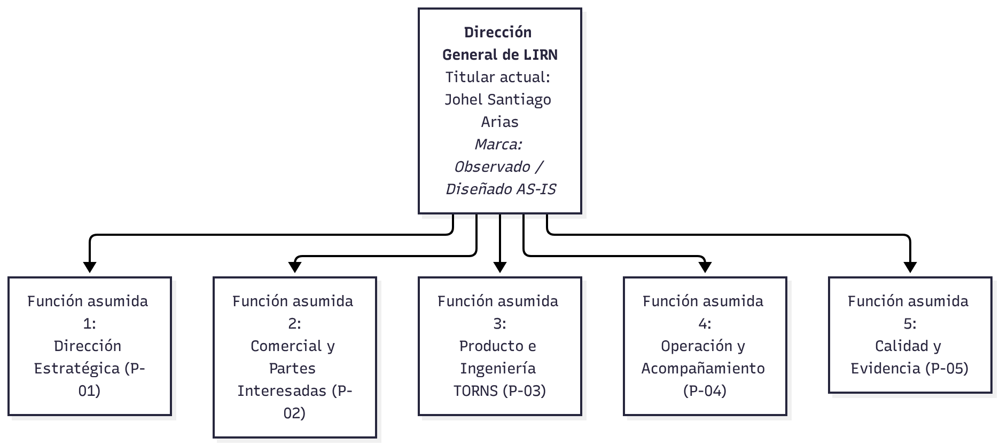

*Nota.* Elaboración propia.

## 3.2 Mapa de procesos

La operación actual se organiza en cinco procesos. En el nivel estratégico se ubica P-01 Dirección estratégica de LIRN; en el nivel misional, P-02 Relación comercial y partes interesadas, P-03 Realización del producto TORNS y P-04 Acompañamiento al uso del prototipo; y, como proceso de apoyo, P-05 Evidencia, calidad y mejora. A continuación se presentan la cadena de valor y el diagrama de cada proceso, elaborado en BPMN, una notación gráfica estándar que funciona como un diagrama de flujo con reglas comunes, de modo que cualquier lector entrenado lo interpreta de la misma manera.

### 3.2.1 Cadena de valor

La Ilustración 2 presenta la cadena de valor de LIRN. En la franja inferior aparecen las actividades primarias, desde la captación de interés hasta el soporte técnico con el operador, y en la superior, las actividades de apoyo. Se aprecia, además, que las dos últimas actividades primarias, al igual que el talento humano y las finanzas, todavía no tienen proceso y forman parte del estado objetivo.

**Ilustración 2**  
*Cadena de valor de LIRN*

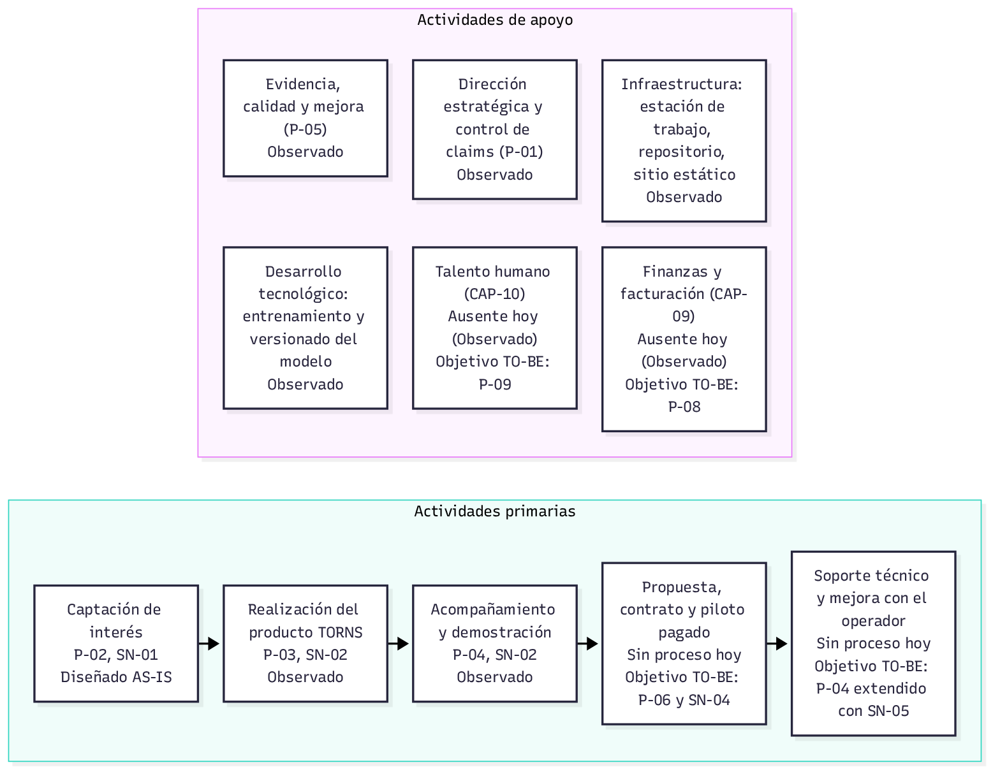

*Nota.* Elaboración propia.

### 3.2.2 P-01 Dirección estratégica de LIRN (proceso estratégico)

En la Ilustración 3 se observa el proceso estratégico P-01 (Dirección estratégica). La Dirección revisa la misión, la visión y la decisión de ofrecer un solo producto, y contrasta el mensaje público con lo que la empresa no puede afirmar. Si ese mensaje menciona un cliente, un contrato, un piloto firmado o una alianza, Calidad registra una no conformidad y Comunicación pública lo corrige antes de cerrar la revisión.

**Ilustración 3**  
*Diagrama BPMN del proceso P-01 Dirección estratégica de LIRN*


*Nota.* Elaboración propia en notación BPMN 2.0 (Object Management Group, 2014).

### 3.2.3 P-02 Relación comercial y partes interesadas (proceso misional)

La Ilustración 4 muestra el proceso misional P-02 (Relación comercial). Cuando llega una solicitud, el canal de contacto verifica que tenga nombre, correo y mensaje, y que el canal esté disponible; luego, Comercial califica el interés y responde sin afirmar que existe un cliente o un piloto. Si el envío falla, el proceso informa el error en lugar de simular un envío exitoso.

**Ilustración 4**  
*Diagrama BPMN del proceso P-02 Relación comercial y partes interesadas*


*Nota.* Elaboración propia en notación BPMN 2.0 (Object Management Group, 2014).

### 3.2.4 P-03 Realización del producto TORNS (proceso misional)

En la Ilustración 5 se presenta el proceso misional P-03 (Realización del producto). Producto acota lo que se va a entregar y descarta los pedidos que exigen instalar equipos en campo o integrarse con el control real de un operador. Después prepara la solución en el entorno de demostración y verifica que muestre la demanda medida y una recomendación de oferta; si no está lista, Calidad devuelve el caso y, si lo está, Operación programa el acompañamiento.

**Ilustración 5**  
*Diagrama BPMN del proceso P-03 Realización del producto TORNS*


*Nota.* Elaboración propia en notación BPMN 2.0 (Object Management Group, 2014).

### 3.2.5 P-04 Acompañamiento al uso del prototipo (proceso misional)

La Ilustración 6 describe el proceso misional P-04 (Acompañamiento al uso). Operación comprueba que la solución esté disponible, explica a la persona interesada la demanda medida por estación y la oferta que TORNS propone, y recoge sus observaciones. Además, si el discurso llega a afirmar que se muestra la ocupación en vivo de un operador, Calidad registra una no conformidad.

**Ilustración 6**  
*Diagrama BPMN del proceso P-04 Acompañamiento al uso del prototipo*


*Nota.* Elaboración propia en notación BPMN 2.0 (Object Management Group, 2014).

### 3.2.6 P-05 Evidencia, calidad y mejora (proceso de apoyo)

En la Ilustración 7 se observa el proceso de apoyo P-05 (Evidencia, calidad y mejora). Calidad clasifica cada hallazgo según afecte el mensaje público, la solución TORNS o solo la custodia de la evidencia, y abre una no conformidad asignada a Dirección o a Producto. Asimismo, conserva la encuesta de veinte respuestas como investigación y verifica que la comunicación presente a TransMilenio como caso de estudio y no como piloto firmado.

**Ilustración 7**  
*Diagrama BPMN del proceso P-05 Evidencia, calidad y mejora*


*Nota.* Elaboración propia en notación BPMN 2.0 (Object Management Group, 2014).

## 3.3 Mapa de capacidades

El mapa identifica diez capacidades de negocio. De ellas, el núcleo técnico, compuesto por la detección y conteo de pasajeros (CAP-04) y la recomendación de despacho (CAP-05), ya funciona en prototipo. En cambio, la integración en vivo con el operador (CAP-07), la gestión financiera y la facturación (CAP-09) y la gestión del talento humano (CAP-10) no existen todavía, por lo que constituyen brechas hacia el estado objetivo. Cabe señalar que las cinco capacidades que menciona el enunciado del taller corresponden a ventas (CAP-03), atención al cliente (CAP-06), gestión financiera (CAP-09), gestión de inventarios (CAP-08) y talento humano (CAP-10). Para entender la diferencia entre capacidad y proceso, puede pensarse en un restaurante: la capacidad es «saber cocinar», mientras que el proceso es la receta que se sigue cada día.

A continuación, la Tabla 2 presenta el catálogo de capacidades con su categoría, su estado actual y el proceso que las soporta.

**Tabla 2**  
*Mapa de capacidades de negocio de LIRN*


| Código | Capacidad | Categoría | Estado actual | Proceso |
|---|---|---|---|---|
| CAP-01 | Dirección de producto único y gobierno de marca | Estratégica | Presente (básica) | P-01 Dirección estratégica |
| CAP-02 | Gestión de evidencia, calidad y cumplimiento normativo | Apoyo | Presente (básica) | P-05 Evidencia, calidad y mejora |
| CAP-03 | Ventas: captación y calificación de interés B2B y B2G | Misional | Presente (incipiente, manual en hoja de cálculo) | P-02 Relación comercial |
| CAP-04 | Detección y conteo de demanda en estación | Misional, núcleo técnico | Presente (funcional en prototipo) | P-03 Realización del producto |
| CAP-05 | Recomendación de oferta y cálculo de despacho | Misional, núcleo técnico | Presente (funcional en prototipo) | P-03 Realización del producto |
| CAP-06 | Atención al cliente: acompañamiento al interesado en el prototipo | Misional | Presente, acotada a demostraciones | P-04 Acompañamiento al uso |
| CAP-07 | Integración y despacho en vivo con el centro de control | Misional futura | Ausente | Ninguno |
| CAP-08 | Gestión de inventarios: catálogo de fuentes digitales y modelos | Apoyo | Parcial (digital presente, físico ausente) | P-03 Realización del producto |
| CAP-09 | Gestión financiera, contable y facturación | Apoyo | Ausente | Ninguno |
| CAP-10 | Gestión de talento humano | Apoyo | Ausente como proceso formal | Ninguno |


*Nota.* Elaboración propia.

## 3.4 Activos de información

El inventario reúne siete activos de información. Abarca desde el registro de solicitudes de contacto (AI-01), que contiene datos personales sujetos a la Ley 1581 de 2012 (Congreso de la República de Colombia, 2012), hasta la facturación y los contratos (AI-07), un activo que todavía no existe pero que el estado objetivo requiere.

La Tabla 3 presenta estos activos con su clasificación de seguridad y la indicación de si contienen datos personales.

**Tabla 3**  
*Inventario clasificado de activos de información*


| ID | Activo | Clasificación de seguridad | Datos personales |
|---|---|---|---|
| AI-01 | Registro de solicitudes y prospectos (leads) | Confidencial | Sí |
| AI-02 | Evidencia de validación del problema | Interno. La síntesis estadística autorizada es pública en la página de TORNS. | No, en el activo consolidado |
| AI-03 | Video de estaciones y métricas de conteo | Interno / Confidencial | Potencialmente sí (imagen de personas) |
| AI-04 | Pesos del modelo y dataset curado | Reservado | No, en los pesos. Imagen curada en el dataset de entrenamiento. |
| AI-05 | Código fuente de las cuatro superficies | Interno / Reservado | No |
| AI-06 | Gobierno, fichas de proceso y registro de empresa | Interno. El diagrama BPMN está publicado para evaluación. | Sí, mínimos |
| AI-07 | Facturación, contabilidad y contratos | No existe hoy | No existe hoy |


*Nota.* Elaboración propia.

## 3.5 Partes interesadas

Se entiende por parte interesada cualquier persona, grupo, área u organización que puede afectar una decisión de esta arquitectura, verse afectada por ella o tener interés en su resultado. Por ello, la clasificación que sigue incluye, además de la relación con la firma, el nivel de influencia de cada una.

En la Tabla 4 se listan las ocho partes interesadas identificadas, con su categoría, su relación con la firma, su interés principal y su nivel de influencia.

**Tabla 4**  
*Partes interesadas y nivel de influencia*


| ID | Parte interesada | Categoría | Relación con LIRN y TORNS | Interés principal | Influencia |
|---|---|---|---|---|---|
| **SH-01** | Johel Santiago Arias, fundador y director general | Interna. Cubre Dirección, Comercial, Producto, Operación y Calidad | Único integrante actual y autor del prototipo y de los procesos. | Viabilidad de TORNS, rigor para no afirmar lo que no está demostrado y preparación hacia un primer piloto pagado. | **Alta** |
| **SH-02** | Universidad Libre y docente del taller | Externa. Academia | Evalúa el plan bajo TOGAF. | Coherencia entre negocio, datos, aplicaciones, tecnología y roadmap, con trazabilidad verificable. | **Alta** |
| **SH-03** | Operadores concesionarios, incluido el rol de controlador operativo entrevistado en el SITP | Externa. Segmento B2B. No son clientes actuales | Ejecutan rutas y sufren desajuste de frecuencia y multas operativas. | Conteo oportuno en estación y recomendación de despacho, en lugar de coordinación reactiva por radio. | **Alta** sobre requisitos del producto. **Media** en la operación actual, porque no hay contrato. |
| **SH-04** | Administradores y supervisores de estaciones | Externa. Segmento B2B secundario | Vigilan la saturación de los andenes. | Alerta temprana de acumulación de pasajeros. | **Media** |
| **SH-05** | Entes gestores y sistemas ferroviarios. TransMilenio S.A. como referente público. Sistema Metro de Bogotá como segmento B2G | Externa. No son clientes actuales | Planifican el sistema, supervisan el servicio y pueden aplicar multas a concesionarios. | Estándares de servicio, protección de datos e interoperabilidad futura. | **Media** en el AS-IS. **Alta** en un piloto B2G futuro. |
| **SH-06** | Visitantes del sitio y prospectos del formulario | Externa. Canal comercial | Consultan la propuesta y dejan datos de contacto. | Información veraz sobre el prototipo, respuesta a la solicitud y protección de datos. | **Media** |
| **SH-07** | Pasajeros, incluida la muestra n=20 del 17 de agosto de 2026 | Externa. Beneficiarios indirectos | Padecen esperas y sobrecostos cuando el vehículo pasa lleno. | Menor espera en estación. No compran el software. | **Baja** en la decisión de compra. **Media** como evidencia del problema. |
| **SH-08** | GitHub, Google, Roboflow y Ultralytics | Externa. Proveedores técnicos | Alojan el sitio y el código, reciben el formulario y aportan la base de visión. | Continuidad del servicio y cumplimiento de licencias. | **Media** |


*Nota.* Elaboración propia.

Al cruzar poder e interés se distinguen tres grupos. En primer lugar, el fundador (SH-01) y la universidad (SH-02) deciden el diseño y la aceptación de este trabajo, de modo que requieren una gestión cercana; a ellos se suman los operadores (SH-03), que aportan los requisitos del dominio. En segundo lugar, los entes gestores (SH-05), los prospectos del sitio (SH-06) y los proveedores técnicos (SH-08) condicionan el marco legal, el canal de contacto y la continuidad técnica, razón por la cual conviene mantenerlos alineados. Finalmente, los supervisores de estación (SH-04) y los pasajeros (SH-07) sustentan con su experiencia el problema de negocio que custodia el proceso P-05 (Evidencia, calidad y mejora). En todos los casos se mantiene una distinción clave: quien deja sus datos en el formulario es un prospecto, no un cliente.

## 3.6 Hallazgo principal del dominio de negocio

La conclusión más relevante del dominio de negocio es que toda la operación descansa en una sola persona y en un único equipo de cómputo. Para superar esa fragilidad, el negocio objetivo incorpora cuatro procesos nuevos: P-06 Contratación y piloto, P-07 Integración con el centro de control, P-08 Gestión financiera y facturación y P-09 Gestión del talento humano; este último queda condicionado a que exista personal que vincular.

## 3.7 Arquitectura de Negocio (AS-IS)

La Arquitectura de Negocio AS-IS describe cómo opera hoy LIRN desde las cuatro perspectivas de TOGAF. En el negocio, una sola persona ejerce las cinco unidades funcionales y ejecuta los procesos P-01 a P-05, sin clientes, contratos ni piloto. Esa misma concentración se refleja en los datos, ya que los conteos y los planes de despacho permanecen en memoria y las solicitudes de contacto se guardan en una hoja de cálculo personal, sin autorización de tratamiento ni copias de respaldo. En el plano de las aplicaciones, el sitio comercial está publicado, mientras que la consola y el servicio de detección funcionan como prototipo local, sin autenticación ni conexión con un centro de control. Por último, toda la tecnología se reduce a una estación de trabajo con el disco cerca de su capacidad, sin servidores, base de datos ni medidas de red como firewall o VPN.

En conjunto, esta línea base sí permite cumplir la misión en su fase de demostración, pues TORNS ya mide la demanda y recomienda una oferta. No obstante, todavía no permite sostenerla frente a un operador real, y esa distancia es la que el roadmap del capítulo 7 se propone cerrar.

La Tabla 5 resume esa misma lectura por dominio.

**Tabla 5**  
*Estado actual de LIRN en los cuatro dominios de arquitectura*


| Dominio | Estado actual |
|---|---|
| Negocio | Una persona ejerce las cinco unidades funcionales; cinco procesos P-01 a P-05; sin clientes, contratos ni piloto; CAP-07 (Integración con el centro de control), CAP-09 (Gestión financiera) y CAP-10 (Talento humano) ausentes |
| Datos | Conteos y planes solo en memoria; leads en una hoja de cálculo personal sin autorización de tratamiento; sin respaldos |
| Aplicaciones | Sitio comercial publicado; consola y servicio de detección como prototipo local sin autenticación; hoja de cálculo como sustituto de CRM; sin integración con un centro de control |
| Tecnología | Una sola estación de trabajo con disco cerca de su capacidad; sin servidores, base de datos ni GPU de producción; sin segmentación, firewall ni VPN |


*Nota.* Elaboración propia.

```{=openxml}
<w:p><w:r><w:br w:type="page"/></w:r></w:p>
```


# Capítulo 4. Arquitectura de Datos

Este capítulo corresponde a la fase C del ADM en su componente de datos. En él se presentan el inventario de datos D-01 a D-23, los modelos conceptual y lógico tanto del estado actual como del objetivo, tres flujos de información y los problemas de información PI-01 a PI-18.

## 4.1 Inventario de datos

Las seis categorías de datos que pide el taller se ubican en el inventario así: clientes (D-18); productos (D-12 a D-14, D-16 y D-17), que en LIRN son el modelo, el dataset, la herramienta de etiquetado, el código y la documentación; proveedores (D-19); facturación (D-20); empleados (D-21) y contratos (D-22). Los cuatro últimos, junto con clientes, todavía no existen porque la empresa no opera comercialmente.

La Tabla 6 presenta el inventario completo, con el origen de cada conjunto de datos, su clasificación y la indicación de si contiene datos personales.

**Tabla 6**  
*Inventario de datos de LIRN*


| Código | Conjunto de datos | Origen o sistema | Clasificación | Dato personal |
|---|---|---|---|---|
| D-01 | Lead (solicitud de contacto). Un lead no es un cliente | Hoja de cálculo de Google, alimentada por Apps Script, en la cuenta personal del fundador | Confidencial | Sí |
| D-02 | Evidencia de validación: encuesta del 17 de agosto de 2026 (n=20) | AP-13 Google Forms y resumen estático en el sitio | Interno (resumen público) | No en el consolidado |
| D-03 | Evidencia de validación: entrevista a controlador SITP | Documento de evidencia «Guía Actividad 2, Ingeniería Aplicada» (Equipo TORNS, 2026a) | Interno | Sin datos personales identificables |
| D-04 | Fuente de video | Cuatro videos mp4 de demostración tomados de Pexels, cámara USB o fuente RTSP | Interno | Posible (imagen de personas) |
| D-05 | Fotograma procesado | Memoria y flujo MJPEG | Interno | Posible (imagen de personas) |
| D-06 | Métrica de detección | Memoria de AP-03 (Servicio de detección y despacho) y WebSocket | Interno | No (agregado) |
| D-07 | Estación | Constantes en el código de AP-03 (Servicio de detección y despacho) | Interno | No |
| D-08 | Cámara | Configuración y variables de entorno | Interno | No |
| D-09 | Modelo de tren | Constantes en el código de AP-03 (Servicio de detección y despacho) | Interno | No |
| D-10 | Estado de estación | Memoria del proceso | Interno | No |
| D-11 | Plan de despacho | Memoria y respuesta de la API | Interno | No |
| D-12 | Modelo entrenado (pesos) | Archivo de pesos en el repositorio de AP-04 (Entrenamiento del modelo) | Reservado | No |
| D-13 | Dataset y anotaciones | Anotaciones en la herramienta de etiquetado de AP-04 (Entrenamiento del modelo); dataset coco-person de Roboflow Universe (licencia MIT) con 3.694 imágenes de entrenamiento y 1.000 de validación, guardado fuera del repositorio | Reservado | Posible (imágenes) |
| D-14 | Cuenta de anotador y credenciales de la herramienta de etiquetado | Base SQLite dentro del repositorio público | Confidencial | Sí |
| D-15 | Registros de ejecución | Salida estándar del proceso | Interno | No en el contenido observado |
| D-16 | Código fuente de AP-01 a AP-04 | GitHub (repositorio público) | Interno o Reservado | No |
| D-17 | Documentación de procesos y gobierno | Repositorio, Lucidchart, SharePoint | Interno | Mínimo (nombre público del fundador) |
| D-18 | Clientes | Ninguno | No aplica | No aplica |
| D-19 | Proveedores comerciales y técnicos | Ninguno | No aplica | No aplica |
| D-20 | Facturación y contabilidad | Ninguno | No aplica | No aplica |
| D-21 | Empleados | Ninguno | Confidencial | Sí, cuando haya empleados. Sensibles los atributos de salud (Congreso de la República de Colombia, 2012, art. 5); la afiliación a seguridad social es obligatoria para quien tenga contrato de trabajo y el empleador responde por el pago de los aportes (Congreso de la República de Colombia, 1993, arts. 15 y 22); para teletrabajadores, los aportes se pagan mediante PILA (Presidencia de la República de Colombia, 2015, art. 2.2.1.5.7) |
| D-22 | Contratos y acuerdos de servicio | Ninguno | No aplica | No aplica |
| D-23 | Identificación legal de la firma (NIT y matrícula mercantil) | Ninguno | No aplica | No aplica |


*Nota.* Elaboración propia. El detalle completo se presenta en el Anexo A.

## 4.2 Modelo de datos

Un modelo de datos es, en esencia, un mapa de qué información maneja la organización y cómo se relaciona entre sí, de forma parecida a un árbol genealógico que muestra quién está vinculado con quién. El modelo conceptual presenta esas relaciones en lenguaje de negocio, mientras que el modelo lógico las traduce a tablas con campos concretos.

En la Ilustración 8 se observa el modelo conceptual del estado actual. Las entidades en azul existen en el código y casi todas viven en memoria: la estación, la cámara, la fuente de video, la medición de conteo, el estado de estación y el plan de despacho. En cambio, en rojo punteado aparecen las entidades que no existen hoy, como el cliente, el contrato, la factura, el proveedor comercial y el empleado.

**Ilustración 8**  
*Modelo conceptual de datos AS-IS*

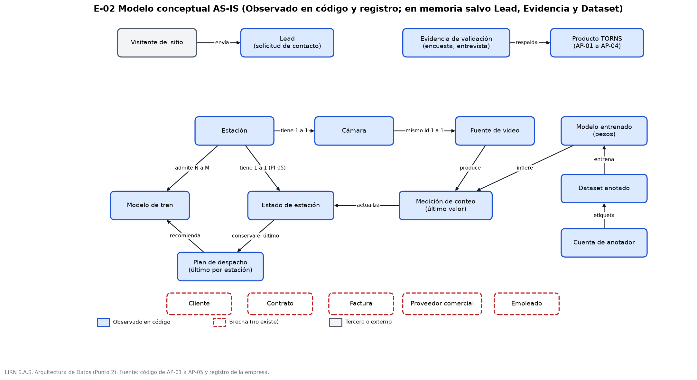

*Nota.* Elaboración propia.

La Ilustración 9 presenta el modelo conceptual objetivo. En la parte superior se agrupan los datos comerciales, desde el contacto y su autorización hasta el contrato, la factura y el acta del piloto; en la inferior, los datos operativos, en los cuales la fuente de video y la versión del modelo generan observaciones de conteo que originan la recomendación de despacho. Las líneas punteadas señalan las entidades condicionales.

**Ilustración 9**  
*Modelo conceptual de datos TO-BE*

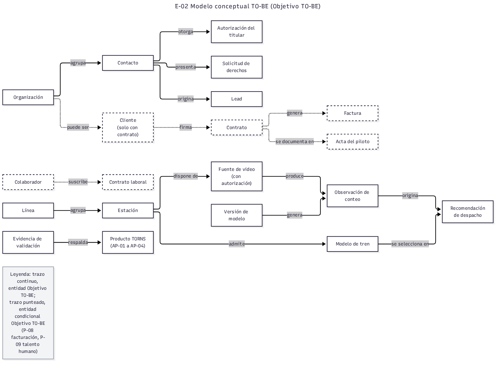

*Nota.* Elaboración propia.

Por su parte, en la Ilustración 10 se observa el modelo lógico objetivo. Destacan la tabla de observación de conteo, que conecta la fuente de video con la versión del modelo, y la de recomendación de despacho, que conserva el historial que hoy se pierde.

**Ilustración 10**  
*Modelo lógico de datos TO-BE*

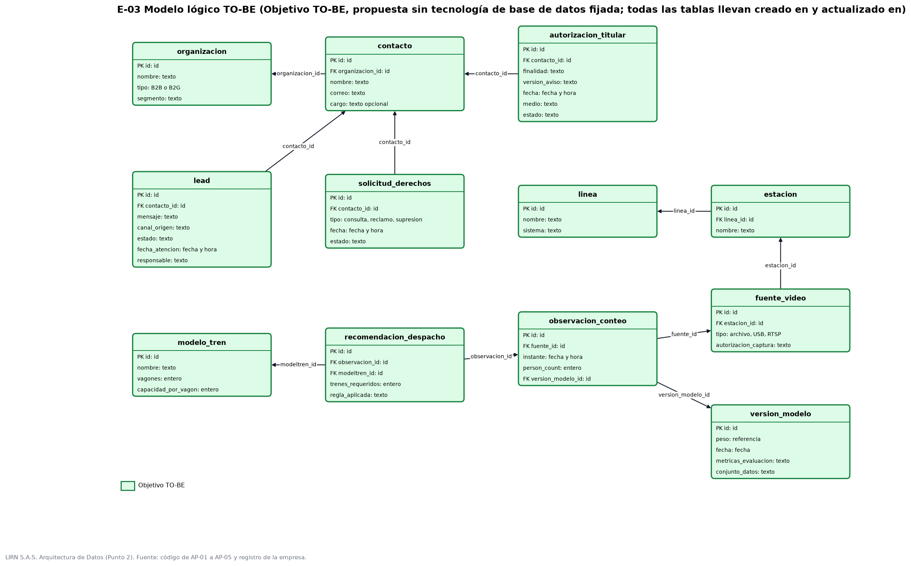

*Nota.* Elaboración propia.

## 4.3 Flujos de información

La información circula por tres flujos. El flujo técnico (FL-T) lleva el video hasta la inferencia, el conteo y el plan de despacho; el flujo comercial (FL-C) traslada los datos del formulario de contacto hasta la hoja de cálculo; y, por último, el flujo de evidencia (FL-E) recoge la encuesta y la entrevista que sustentan el problema de negocio.

La Ilustración 11 muestra el flujo técnico. El video entra al servicio de detección (AP-03), el modelo identifica personas y el conteo resultante actualiza el estado de la estación y el plan de despacho, que se consultan desde la consola (AP-02). Los elementos en morado indican datos volátiles, es decir, datos que se pierden al reiniciar el servicio.

**Ilustración 11**  
*Flujo técnico de información (FL-T)*

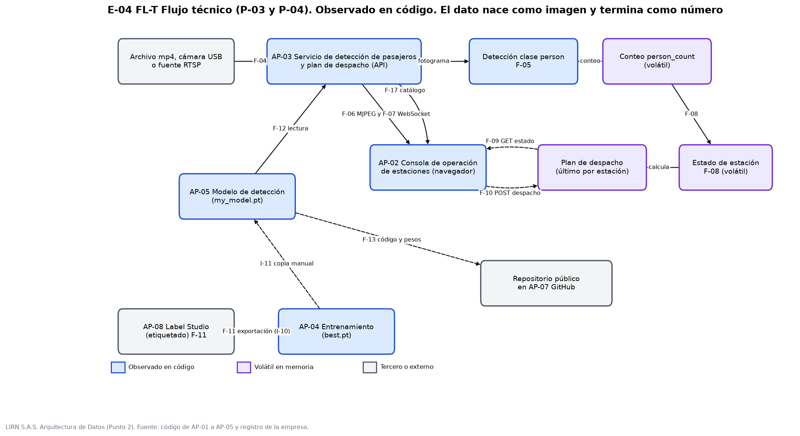

*Nota.* Elaboración propia.

En la Ilustración 12 se observa el flujo comercial, que es el único que lleva datos personales de terceros hacia un servicio externo. El visitante completa un formulario sin aviso ni autorización, los datos viajan a Apps Script y quedan en una hoja de Google de la cuenta personal del fundador; la respuesta al prospecto, marcada en verde, todavía no existe.

**Ilustración 12**  
*Flujo comercial de información (FL-C)*

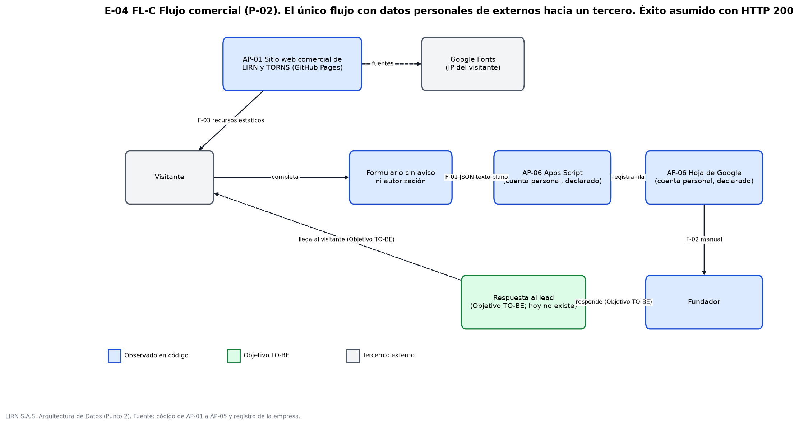

*Nota.* Elaboración propia.

Finalmente, la Ilustración 13 presenta el flujo de evidencia. Las respuestas de los veinte encuestados se agregan en un resumen y las notas de la entrevista al controlador del SITP se conservan en el documento de evidencia; solo los resultados agregados se publican en el sitio para visitantes y evaluadores.

**Ilustración 13**  
*Flujo de evidencia (FL-E)*

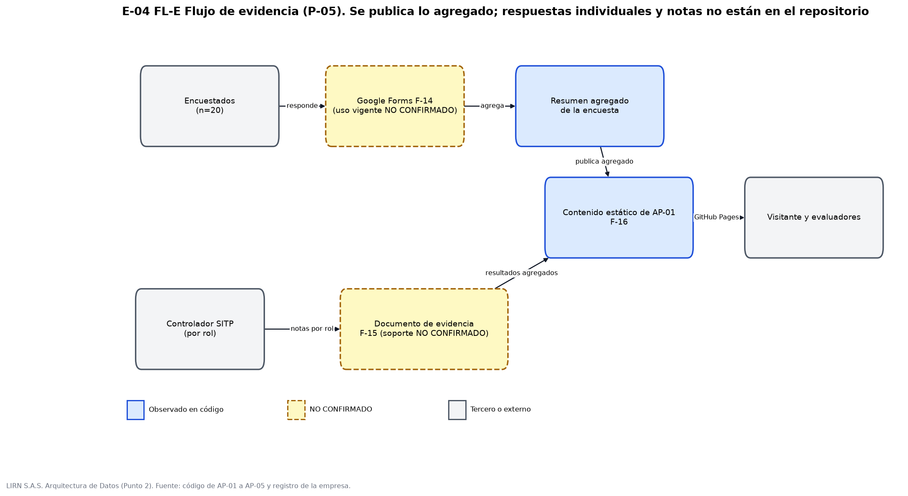

*Nota.* Elaboración propia.

Para complementar los diagramas, la Tabla 7 detalla de dónde parte y a dónde llega cada uno de los diecisiete flujos.

**Tabla 7**  
*Origen y destino de los flujos de información*


| Id   | Flujo                        | Tipo | Origen                                       | Dato                                          | Destino                                                   | Dato personal                    |
| ---- | ---------------------------- | ---- | -------------------------------------------- | --------------------------------------------- | --------------------------------------------------------- | -------------------------------- |
| F-01 | Interés comercial | FL-C | Visitante en AP-01 (Sitio web comercial) | Nombre, correo, organización, mensaje, origen | AP-06 Hoja de cálculo con Apps Script | Sí |
| F-02 | Atención al lead | FL-C | AP-06 Hoja de cálculo de leads | Lead | Sin respuesta al lead | Sí |
| F-03 | Carga del sitio | FL-C | GitHub Pages | Recursos estáticos | Navegador del visitante; la IP llega a AP-12 Google Fonts | IP del visitante |
| F-04 | Captura de video | FL-T | Archivo mp4, cámara USB o fuente RTSP | Fotogramas | Memoria de AP-03 (Servicio de detección y despacho) | Posible (imagen de personas) |
| F-05 | Detección | FL-T | Memoria de AP-03 (Servicio de detección y despacho) | Fotograma y cajas de la clase person | Resumen de conteo | No se almacena |
| F-06 | Flujo MJPEG | FL-T | AP-03 Servicio de detección y despacho | Fotograma anotado | AP-02 (Consola de operación) en el navegador del operador | Posible (imagen) |
| F-07 | Métricas | FL-T | AP-03 Servicio de detección y despacho | Métrica de detección | AP-02 (Consola de operación) en el navegador del operador | No |
| F-08 | Actualización de estación | FL-T | Proceso de streaming de AP-03 (Servicio de detección y despacho) | Conteo por cámara | Estado de estación en memoria | No |
| F-09 | Consulta de estado | FL-T | AP-02 Consola de operación | Solicitud | Estado y último plan | No |
| F-10 | Despacho manual | FL-T | AP-02 Consola de operación | Conteo y estación o cámara | Plan de despacho | No |
| F-11 | Entrenamiento | FL-T | Imágenes anotadas en AP-08 Label Studio | Dataset | Pesos entrenados en AP-04 (Entrenamiento del modelo) | Posible (imágenes) |
| F-12 | Inferencia con pesos | FL-T | AP-05 Modelo de detección | Archivo de pesos | AP-03 Servicio de detección y despacho | No |
| F-13 | Publicación de código | FL-T | Estación de trabajo del fundador | Código y artefactos | Repositorio público en AP-07 GitHub | Sí (cuenta de anotador expuesta) |
| F-14 | Encuesta de validación | FL-E | Encuestados (n=20) | Respuestas | Resumen agregado de la encuesta | Sin identificación |
| F-15 | Entrevista de validación | FL-E | Controlador SITP, por rol | Notas de la entrevista | Documento de evidencia (P-05) | Sin datos identificables |
| F-16 | Publicación de evidencia | FL-E | Documento de evidencia y resumen de encuesta | Resultados agregados | Visitantes del sitio y evaluadores | No |
| F-17 | Catálogo de fuentes de video | FL-T | AP-03 Servicio de detección y despacho | Identificador y nombre de cada video o cámara | AP-02 Consola de operación | No |


*Nota.* Elaboración propia. El detalle completo se presenta en el Anexo B.

## 4.4 Problemas de información

El problema más serio del dominio de datos es que TORNS no conserva memoria de lo que ocurre. Los conteos y los planes de despacho permanecen en la memoria del servicio y, por lo tanto, se pierden cada vez que este se reinicia; sin ese historial no es posible calcular indicadores ni revisar después por qué se recomendó un despacho. A esto se suma que los pesos del modelo, el dataset y los videos no tienen copia fuera de la estación de trabajo. Dicho de otro modo, hoy los datos operativos se comportan como lo escrito en un tablero que se borra cada noche.

El canal de contacto, por su parte, tampoco se ajusta a la norma, ya que recibe datos de posibles clientes sin política de tratamiento ni autorización previa, pese a que los artículos 5 a 7 del Decreto 1377 de 2013 lo exigen (Presidencia de la República de Colombia, 2013). Finalmente, conviene recordar que las imágenes de personas captadas en estación también son datos personales (Congreso de la República de Colombia, 2012, art. 3). En consecuencia, si en el futuro se procesan en la nube, primero deberá firmarse un contrato con el proveedor en calidad de Encargado, es decir, de tercero que trata los datos por cuenta del Responsable.

La Tabla 8 clasifica los dieciocho problemas de información según las categorías que propone el taller (información incompleta, inconsistente, duplicada o aislada), además de una categoría de integridad y seguridad.

**Tabla 8**  
*Problemas de información por categoría*


| Código | Categoría | Problema |
|---|---|---|
| PI-01 | Información incompleta | Sin historial de conteos ni de planes |
| PI-02 | Información incompleta | Lead sin estado, responsable ni autorización |
| PI-03 | Información incompleta | Sin diccionario de datos, propietario ni retención |
| PI-04 | Información incompleta | Dataset fuera del repositorio |
| PI-05 | Información inconsistente | Clave de estación distinta entre catálogo y estado |
| PI-06 | Información inconsistente | Estación con cámara usb1 sin fuente publicada |
| PI-07 | Información inconsistente | Nombres heredados de un proyecto anterior en repositorios y contenedores |
| PI-08 y PI-09 | Información inconsistente | Comentarios del código que hablan de densidad, aunque el sistema solo cuenta personas, y datos de demostración sin rótulo |
| PI-10 | Duplicidad de datos | Videos duplicados entre AP-03 (Servicio de detección y despacho) y AP-04 (Entrenamiento del modelo), dos estados por estación y leads sin control de duplicados |
| PI-11 y PI-12 | Archivos aislados | Hoja de leads, encuesta, diagramas y documentos en servicios separados sin catálogo |
| PI-13 | Archivos aislados | Datos personales de AP-08 (Label Studio) en repositorio público |
| PI-14 | Integridad y seguridad | Despacho sin autenticación ni límite superior, CORS abierto |
| PI-15 | Información incompleta | Encuesta sin soporte individual ni autorización visible |
| PI-16 | Información incompleta | El formulario promete respuesta, pero no se responde a los leads |
| PI-17 | Información incompleta | Sin NIT ni matrícula ante Cámara de Comercio. Mientras tanto, el fundador decide sobre los leads y las imágenes, por lo que es el Responsable del tratamiento como persona natural (Congreso de la República de Colombia, 2012, art. 3, lit. e) y el aviso de privacidad debe identificarlo así |
| PI-18 | Integridad y seguridad | Sin despliegue fuera del equipo del fundador ni respaldos |


*Nota.* Elaboración propia.

## 4.5 Propuesta de datos

Para resolver estos problemas, el modelo objetivo incorpora la persistencia de conteos y planes por estación y fecha, junto con un registro versionado del modelo de detección. Del mismo modo, introduce un gestor de solicitudes de contacto con autorización de tratamiento y agrega las entidades que hoy faltan para operar comercialmente: piloto, factura y contrato.

```{=openxml}
<w:p><w:r><w:br w:type="page"/></w:r></w:p>
```


# Capítulo 5. Arquitectura de Aplicaciones

Este capítulo corresponde a la fase C del ADM en su componente de aplicaciones. En él se inventarían las aplicaciones AP-01 a AP-13, se mapean sus integraciones y se registran los problemas PR-01 a PR-17, así como los elementos a retirar o corregir RA-01 a RA-07. Con esa base, se propone un esquema de interoperabilidad con las aplicaciones nuevas N-01 a N-07 y las interfaces recomendadas (IT-01, IT-02 e IT-04 a IT-07). En este capítulo aparece con frecuencia el término API, que puede entenderse como una ventanilla de atención: recibe solicitudes con un formato acordado y entrega respuestas, sin que quien pregunta necesite conocer el funcionamiento interno.

## 5.1 Inventario de aplicaciones

A continuación, la Tabla 9 presenta una versión resumida del inventario, con la función, el área usuaria y el estado de cada aplicación; el detalle completo se presenta en el Anexo C.

**Tabla 9**  
*Inventario de aplicaciones de LIRN*


| Código | Nombre | Función | Área usuaria | Estado |
|---|---|---|---|---|
| AP-01 | Sitio web comercial de LIRN y TORNS (lirn-web-main) | Presenta la firma y el producto TORNS y recibe mensajes de interés mediante un formulario de contacto | Visitantes externos; rol Comercial (fundador) | En uso (GitHub Pages) |
| AP-02 | Consola de operación de estaciones (tro-frontend) | Muestra video con detecciones, métricas por cámara, estado de estaciones y plan de despacho | Rol de Operación y de Producto (fundador) en demostración; sin usuarios de operador | Prototipo local |
| AP-03 | Servicio de detección de pasajeros y plan de despacho, API (tro-backend) | Ejecuta la detección sobre video, publica métricas por WebSocket y aplica la regla determinista de despacho. | Consumido por AP-02 (Consola de operación); rol de Producto | Prototipo local |
| AP-04 | Entrenamiento del modelo de detección (yolo-train-routes-optimization) | Prepara el conjunto de datos, entrena y exporta el modelo de detección de personas. | Rol de Producto y de Calidad (fundador) | En uso, ejecución local |
| AP-05 | Modelo de detección (my_model/my_model.pt, en yolo-train-routes-optimization) | Artefacto de IA de una clase (person) consumido por AP-03 (Servicio de detección y despacho) como archivo local | Consumido por AP-03 (Servicio de detección y despacho) | Versionado |
| AP-06 | Hoja de cálculo con Apps Script (hoja de Google; receptor: Apps Script configurado en VITE_CONTACT_ENDPOINT) | Recibe y guarda los mensajes del formulario con las columnas timestamp, nombre, email, organizacion, mensaje y origen; solo la consulta el fundador. | Rol Comercial (fundador, único consultor) | En uso como sustituto de CRM, se retira con N-01 (Gestor de leads) |
| AP-07 | GitHub: repositorios, Pages y Actions (github.com/5arSanti) | Control de versiones, pruebas y publicación del sitio | Rol de Producto (fundador) | En uso |
| AP-08 | Label Studio (en Docker; exportaciones en mydata/) | Etiquetado de imágenes del conjunto de datos del modelo de visión. | Rol de Producto (fundador) | En uso |
| AP-09 | Lucidchart (SaaS) | Diagramación de arquitectura y procesos | Rol de Dirección (fundador) | En uso según el registro |
| AP-10 | SharePoint (Microsoft 365) | Almacenamiento de documentos de apoyo; no compromete la operación del producto | Rol de Dirección y Calidad (fundador) | Apoyo documental |
| AP-11 | Correo electrónico | Comunicación y resguardo de algunos documentos; no compromete la operación del producto. | Todos los roles (fundador) | Apoyo documental |
| AP-12 | Google Fonts (fonts.googleapis.com y fonts.gstatic.com, enlazados en AP-01) | Entrega la tipografía Manrope al navegador del visitante; al cargar el sitio, el navegador envía la IP del visitante a Google (flujo F-03, carga del sitio) | Visitantes externos (consumo indirecto) | En uso |
| AP-13 | Google Forms (formulario de la encuesta de validación) | Recoge las respuestas de la encuesta de validación (flujo F-14, encuesta de validación); formulario «Tu experiencia diaria en el transporte masivo de Bogotá», [https://forms.gle/uEEiodW6xn7VL5K69](https://forms.gle/uEEiodW6xn7VL5K69). | Rol de Dirección y Producto (fundador) | En uso |


*Nota.* Elaboración propia. El detalle completo se presenta en el Anexo C.

## 5.2 Situación actual

En la actualidad, el sitio comercial (AP-01), la consola de operación (AP-02) y el servicio de detección y despacho (AP-03) funcionan como prototipo. Ni la consola ni el servicio tienen autenticación y, además, la inferencia solo se ejecuta cuando alguien abre el flujo de video. En el frente comercial, una hoja de cálculo con Apps Script (AP-06) hace las veces de CRM. Por otra parte, no existe integración con ningún centro de control ni aplicación de facturación.

En la Ilustración 14 se observa el contexto de aplicaciones actual, organizado en tres grupos: apoyo, producto TORNS y comercial. Fuera de ese contexto, en rojo, aparece el centro de control del operador, con el cual no existe integración.

**Ilustración 14**  
*Contexto de aplicaciones AS-IS*

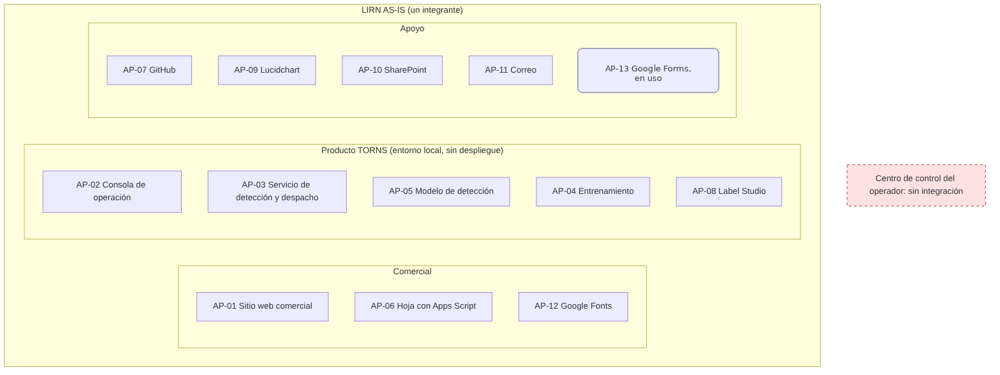

*Nota.* Elaboración propia.

El formulario del sitio envía los mensajes a un receptor en Apps Script, cuya dirección no se reproduce en este informe. Al revisar el código del script se encuentra que la restricción de origen que define no se aplica y que el sitio da por exitoso el envío con cualquier respuesta HTTP 200, sin leer su contenido. En la práctica, el visitante puede ver un mensaje de éxito aunque su solicitud no haya llegado.

## 5.3 Mapa de integraciones

La Ilustración 15 detalla cómo se comunican hoy las aplicaciones. En la parte superior se ve la cadena del producto, desde el etiquetado y el entrenamiento hasta el servicio de detección y la consola; en la inferior, la cadena comercial, en la cual el sitio envía los mensajes a la hoja con Apps Script y estos no reciben respuesta.

**Ilustración 15**  
*Mapa de integraciones AS-IS*

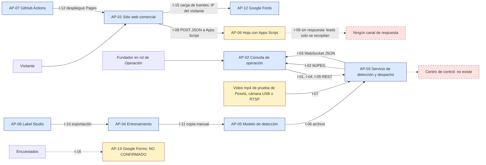

*Nota.* Elaboración propia.

Como complemento, la Tabla 10 precisa el origen, el destino y el tipo de intercambio de cada integración.

**Tabla 10**  
*Integraciones entre aplicaciones*


| ID   | Origen                                       | Destino                        | Tipo de intercambio                                         | Datos intercambiados                                         | Autenticación              |
| ---- | -------------------------------------------- | ------------------------------ | ----------------------------------------------------------- | ------------------------------------------------------------ | -------------------------- |
| I-01 | AP-02 Consola de operación | AP-03 Servicio de detección y despacho | REST, JSON | Lista de videos y cámaras | Ausente |
| I-02 | AP-03 Servicio de detección y despacho | AP-02 Consola de operación | Flujo de video MJPEG | Fotograma anotado | Ausente |
| I-03 | AP-03 Servicio de detección y despacho | AP-02 Consola de operación | WebSocket, JSON | Conteo de personas y métricas de detección | Ausente |
| I-04 | AP-02 Consola de operación | AP-03 Servicio de detección y despacho | REST, JSON | Trenes, estaciones, estado y plan de despacho | Ausente |
| I-05 | AP-02 Consola de operación | AP-03 Servicio de detección y despacho | REST (sondeo) | Estado de salud | Ausente |
| I-06 | AP-05 Modelo de detección | AP-03 Servicio de detección y despacho | Archivo | Pesos del modelo | No aplica |
| I-07 | Fuente de video (archivo, cámara USB o RTSP) | AP-03 Servicio de detección y despacho | Captura con OpenCV | Fotogramas | No aplica |
| I-08 | AP-01 Sitio web comercial | AP-06 Hoja de cálculo de leads | HTTP hacia Apps Script; éxito por HTTP 200 sin confirmación | Datos del formulario de contacto | Ausente |
| I-09 | AP-06 Hoja de cálculo de leads | Ninguno | Sin integración; los leads no se responden | Lead | No aplica |
| I-10 | AP-08 Label Studio | AP-04 Entrenamiento del modelo | Archivo | Anotaciones e imágenes | No aplica |
| I-11 | AP-04 Entrenamiento del modelo | AP-05 Modelo de detección | Archivo, copia manual | Pesos del modelo | No aplica |
| I-12 | AP-07 GitHub | AP-01 Sitio web comercial | CI/CD con GitHub Actions | Sitio compilado | Token de la plataforma |
| I-13 | AP-01 a AP-05 | AP-07 GitHub | Control de versiones, Git sobre HTTPS | Código y artefactos | Cuenta de GitHub |
| I-14 | AP-03 Servicio de detección y despacho | Centro de control del operador | No existe | No aplica | No aplica |
| I-15 | AP-01 (navegador del visitante) | AP-12 Google Fonts | Recurso externo HTTPS | IP del visitante hacia Google; tipografía hacia el navegador | No aplica |
| I-16 | Encuestados | AP-13 Google Forms | Formulario SaaS | Respuestas de la encuesta | Cuenta de Google del fundador |


*Nota.* Elaboración propia. El detalle completo se presenta en el Anexo D.

## 5.4 Problemas identificados

El análisis no encontró aplicaciones duplicadas; lo que sí se duplica es el texto que describe el producto, pues el sitio y la consola lo presentan con mensajes distintos (PR-10). Para clasificar los hallazgos se empleó una escala de severidad: es Alta cuando el problema afecta el cumplimiento legal, la seguridad o la capacidad central de conteo y despacho; Media cuando limita la continuidad, el piloto o la integración; y Baja cuando se trata de consistencia o deuda técnica.

La Tabla 11 relaciona los diecisiete problemas con su categoría y su severidad.

**Tabla 11**  
*Problemas de aplicaciones por categoría y severidad*


| ID    | Problema                                                                                               | Categoría                                            | Severidad                          |
| ----- | ------------------------------------------------------------------------------------------------------ | ---------------------------------------------------- | ---------------------------------- |
| PR-01 | La hoja de cálculo actúa como sustituto de CRM, sin acuse, reintento ni cola | Dependencia de hoja de cálculo; falta de integración | Media |
| PR-02 | El formulario recopila datos personales sin política de tratamiento ni autorización | Seguridad y cumplimiento | Alta |
| PR-03 | API y consola sin autenticación; CORS abierto con credenciales | Seguridad | Alta |
| PR-04 | Inferencia ligada al flujo de video: sin cliente no hay conteo | Falta de integración (acoplamiento) | Alta |
| PR-05 | Conteos, estado y planes solo en memoria | Falta de persistencia | Alta |
| PR-06 | Sin integración con el centro de control del operador | Falta de integración | Media |
| PR-07 | Modelo copiado a mano; deriva de versiones entre entrenamiento y API | Falta de integración (empaquetado); proceso manual | Media |
| PR-08 | Identificadores de estación inconsistentes | Defecto de aplicación | Alta |
| PR-09 | Nombres heredados de un proyecto anterior en código y contenedores | Consistencia de identidad | Baja |
| PR-10 | Textos sin respaldo en sitio y consola | Consistencia de identidad | Baja |
| PR-11 | Middleware no activado y detecciones simuladas | Deuda técnica | Baja |
| PR-12 | Backend sin pruebas; imagen con configuración de desarrollo | Calidad y seguridad | Alta |
| PR-13 | Sin despliegue fuera del equipo local ni entorno de piloto | Falta de plataforma | Media |
| PR-14 | Herramientas personales sin gobierno; base de Label Studio con datos personales en repositorio público | Dependencia de herramientas externas | Alta |
| PR-15 | Sin aplicación de facturación y contabilidad | Capacidad ausente | Baja (Media con piloto contratado) |
| PR-16 | Cámaras físicas sin resultados de prueba documentados | Evidencia | Media |
| PR-17 | Leads recopilados sin respuesta ni seguimiento | Proceso manual inexistente | Media |


*Nota.* Elaboración propia.

## 5.5 Propuesta de interoperabilidad

La propuesta parte de retirar la hoja de cálculo que hoy funciona como CRM (AP-06) para reemplazarla por un gestor de solicitudes con autorización de tratamiento (N-01). Asimismo, el servicio de detección se divide en dos: una API de despacho (AP-03a) y un servicio de inferencia independiente (AP-03b). A ello se suman la identidad y los roles de usuario (N-02), la persistencia de conteos y planes (N-04), el registro versionado del modelo (N-05) y la facturación (N-06), que dan un lugar estable a los datos que el capítulo 4 identificó como volátiles o inexistentes. Por último, la interfaz con el centro de control (IT-06) entrega una recomendación, pero la decisión de despacho sigue en manos del operador, conforme al principio de que esa decisión es humana (PN-04).

En la Ilustración 16 se presenta el contexto de aplicaciones objetivo. Las cajas en verde corresponden a las aplicaciones nuevas o transformadas, como el gestor de solicitudes, la identidad de usuarios, la API de despacho, el servicio de inferencia, la persistencia y el registro de modelos, mientras que la facturación y la nómina se agrupan en el bloque administrativo.

**Ilustración 16**  
*Contexto de aplicaciones TO-BE*

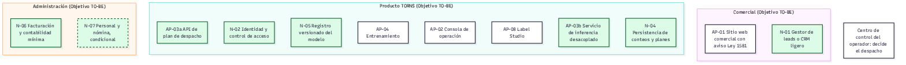

*Nota.* Elaboración propia.

La Ilustración 17, a su vez, muestra las integraciones objetivo. El servicio de inferencia recibe el video de cada estación y publica eventos de conteo que consumen la API de despacho y la persistencia; finalmente, la API entrega una recomendación autenticada al centro de control, que conserva la decisión.

**Ilustración 17**  
*Mapa de integraciones TO-BE*

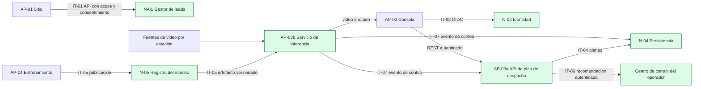

*Nota.* Elaboración propia.

### 5.5.1 Nuevas aplicaciones

La Tabla 12 presenta las siete aplicaciones nuevas que propone el estado objetivo, junto con el problema que atiende cada una y su dependencia principal. Ninguna de ellas existe hoy.

**Tabla 12**  
*Aplicaciones nuevas propuestas*


| ID            | Aplicación propuesta                                      | Problema que atiende                 | Dependencia                                               |
| ------------- | --------------------------------------------------------- | ------------------------------------ | --------------------------------------------------------- |
| N-01 | Gestor de leads o CRM ligero con base de datos integrada | PR-01 Hoja de cálculo como CRM; PR-02 Formulario sin autorización; PR-17 Leads sin seguimiento | Modelo de lead y autorización (capítulo 4) |
| N-02 | Identidad y control de acceso de usuarios (consola y API) | PR-03 API y consola sin autenticación | Proveedor de identidad (capítulo 6) |
| N-03 (AP-03b) | Servicio de inferencia desacoplado de la entrega de video | PR-04 Inferencia ligada al video | Cómputo con GPU (capítulo 6) |
| N-04 | Persistencia de conteos, estado y planes de despacho | PR-05 Datos solo en memoria | Modelo lógico de datos y base de datos |
| N-05 | Registro versionado del modelo | PR-07 Modelo copiado a mano | Almacén de objetos (capítulo 6) |
| N-06 | Facturación electrónica y contabilidad mínima (SaaS) | PR-15 Sin facturación | Formalización ante Cámara de Comercio y DIAN |
| N-07 | Gestión de personal y nómina (SaaS) | Necesidad TO-BE; hoy no hay personal | Formalización y personal que vincular |


*Nota.* Elaboración propia.

### 5.5.2 Integraciones recomendadas

En la Tabla 13 se describen las integraciones que conectarían esas aplicaciones, con su origen, su destino y el problema que resuelven. Tampoco existen hoy.

**Tabla 13**  
*Integraciones recomendadas*


| ID    | Origen        | Destino                        | Tipo                                                             | Problema     |
| ----- | ------------- | ------------------------------ | ---------------------------------------------------------------- | ------------ |
| IT-01 | AP-01 Sitio web comercial | N-01 Gestor de leads | API REST con acuse de recibo y registro de consentimiento | PR-01 Hoja de cálculo como CRM; PR-02 Formulario sin autorización |
| IT-02 | AP-02 Consola de operación; AP-03a API de despacho | N-02 Identidad y acceso | Autenticación con roles; CORS restringido | PR-03 API y consola sin autenticación |
| IT-04 | AP-03a API de despacho | N-04 Persistencia de conteos | Persistencia de planes y estados | PR-05 Datos solo en memoria |
| IT-05 | AP-04 Entrenamiento del modelo | N-05 Registro del modelo; AP-03b Servicio de inferencia | Publicación de modelo versionado con metadatos | PR-07 Modelo copiado a mano |
| IT-06 | AP-03a API de despacho | Centro de control del operador | Recomendación autenticada; el operador decide | PR-06 Sin integración con el centro de control |
| IT-07 | AP-03b Servicio de inferencia | AP-03a API de despacho; N-04 Persistencia de conteos | Asíncrona por evento de conteo, mediante una cola de mensajes por seleccionar | PR-04 Inferencia ligada al video |


*Nota.* Elaboración propia.

### 5.5.3 Aplicaciones y elementos a retirar o corregir

Por último, la Tabla 14 señala lo que debe retirarse o corregirse y con qué se reemplaza.

**Tabla 14**  
*Aplicaciones y elementos a retirar o corregir*


| ID    | Elemento                                         | Motivo                                   | Reemplazo                                            |
| ----- | ------------------------------------------------ | ---------------------------------------- | ---------------------------------------------------- |
| RA-01 | Rol de la hoja de cálculo como CRM (AP-06) | Dependencia de hoja, sin control | N-01 Gestor de leads |
| RA-02 | Nombres heredados de un proyecto anterior | Confunden la identidad del producto | Nombres LIRN y TORNS |
| RA-03 | Textos sin respaldo en consola y sitio | Afirmaciones no evidenciadas | Textos alineados con lo observado |
| RA-04 | Identificadores de estación inconsistentes | Defecto | Identificador único por estación |
| RA-05 | Middleware no activado y detecciones simuladas | Código sin uso | Activar o eliminar |
| RA-06 | Base de Label Studio en repositorio público | Exposición de datos personales | Almacenamiento privado |
| RA-07 | Carga de Google Fonts desde servidores de Google | Transfiere la IP del visitante sin aviso | Tipografía alojada en el sitio o mención en el aviso |


*Nota.* Elaboración propia.

```{=openxml}
<w:p><w:r><w:br w:type="page"/></w:r></w:p>
```


# Capítulo 6. Arquitectura Tecnológica

Este capítulo corresponde a la fase D del ADM y presenta el inventario tecnológico, los diagramas del estado actual y del objetivo, los riesgos RT-01 a RT-13 y la propuesta de entornos.

## 6.1 Inventario tecnológico

La Tabla 15 presenta el inventario tecnológico, agrupado en servidores y equipos, redes, plataformas y software base, bases de datos y servicios en la nube.

**Tabla 15**  
*Inventario tecnológico de LIRN*


| Código | Tipo | Descripción |
|---|---|---|
| IT-EQ-01 | Servidores y equipos | Estación del fundador: Intel Core i5-10400 a 2,90 GHz, 48 GB de RAM, NVIDIA GeForce GTX 1050 Ti de 4 GB, 1,14 TB de almacenamiento con 975 GB usados (cerca del 85 %), Windows de 64 bits |
| IT-EQ-02 | Servidores y equipos | GPU de entrenamiento: La misma GTX 1050 Ti; la salida del cuaderno registra PyTorch 2.7.1 con CUDA 11.8 y Ultralytics 8.3.228 |
| IT-EQ-03 | Servidores y equipos | Cámaras: Cámara integrada usb0 y cámara USB externa usb1 |
| IT-EQ-04 | Servidores y equipos | Pruebas con cámaras: pruebas con cámaras USB integradas en portátiles (usb0) y externas (usb1) entre el 16 y el 20 de noviembre de 2025, sin resultados documentados |
| IT-EQ-05 | Servidores y equipos | Servidores de producción: No existen |
| IT-EQ-06 | Servidores y equipos | GPU de producción: No existe |
| IT-RD-01 | Redes | Red local de la estación: La consola llama a la API en localhost por defecto ([http://localhost:8000/api/v1](http://localhost:8000/api/v1)) |
| IT-RD-02 | Redes | Puertos del contenedor: Puerto de la API por variable PORT y puerto de depuración 5678 publicado |
| IT-RD-03 | Redes | Puerto de etiquetado: 8080 para Label Studio |
| IT-RD-04 | Redes | Transporte de video y métricas: MJPEG sobre HTTP y métricas por WebSocket, sin cifrado propio |
| IT-RD-05 | Redes | Fuente RTSP: Soportada por el backend; no hay cámara de campo instalada |
| IT-RD-06 | Redes | Segmentación, firewall o VPN: No existen actualmente segmentación de red, firewall ni VPN |
| IT-SW-01 | Plataformas y software base | Contenedor del backend: Python 3.11 slim, FastAPI, Uvicorn con recarga automática, Ultralytics y OpenCV; paquetes de desarrollo incluidos |
| IT-SW-02 | Plataformas y software base | Docker Compose: Un servicio, verificación de salud cada 30 segundos, depuración activa por defecto; nombre de contenedor y red residual de otro proyecto |
| IT-SW-03 | Plataformas y software base | Consola de operación: React 19 con Vite, ejecución local |
| IT-SW-04 | Plataformas y software base | Sitio comercial: React con Vite; pruebas y publicación con GitHub Actions en GitHub Pages |
| IT-SW-05 | Plataformas y software base | Entrenamiento: Anaconda, Python 3.13, Ultralytics YOLO11, cuaderno |
| IT-SW-06 | Plataformas y software base | Etiquetado: Label Studio en Docker con volumen local |
| IT-BD-01 | Bases de datos y almacenamiento | Base de datos de producción: No existe |
| IT-BD-02 | Bases de datos y almacenamiento | Estado del backend: Conteos y plan de despacho solo en memoria; se pierden al reiniciar |
| IT-BD-03 | Bases de datos y almacenamiento | Base SQLite de Label Studio: Dentro del repositorio de entrenamiento, con cuenta de anotador |
| IT-BD-04 | Bases de datos y almacenamiento | Pesos, imágenes, exportes y videos: Versionados en repositorios; videos duplicados entre backend y entrenamiento |
| IT-BD-05 | Bases de datos y almacenamiento | Dataset preprocesado: Vive en la estación, fuera del repositorio, sin respaldo |
| IT-BD-06 | Bases de datos y almacenamiento | Leads: Hoja de Google alimentada por Apps Script en la cuenta personal del fundador |
| IT-NB-01 | Nube y servicios de terceros | GitHub, Pages y Actions: Repositorios y publicación del sitio comercial |
| IT-NB-02 | Nube y servicios de terceros | Google Apps Script y Sheets: Recepción de leads por POST desde el formulario |
| IT-NB-03 | Nube y servicios de terceros | Google Fonts: Tipografía del sitio comercial |
| IT-NB-04 | Nube y servicios de terceros | Lucidchart, SharePoint y correo: Apoyo documental |
| IT-NB-05 | Nube y servicios de terceros | Nube de cómputo: Solo como idea, sin despliegue |


*Nota.* Elaboración propia.

## 6.2 Diagrama tecnológico y situación actual

En la Ilustración 18 se observa la infraestructura actual. Casi todo el sistema se ejecuta en la estación de trabajo del fundador, dentro de un contenedor de desarrollo, y solo el sitio comercial, el formulario y los repositorios dependen de servicios de terceros como GitHub y Google.

**Ilustración 18**  
*Diagrama tecnológico AS-IS*

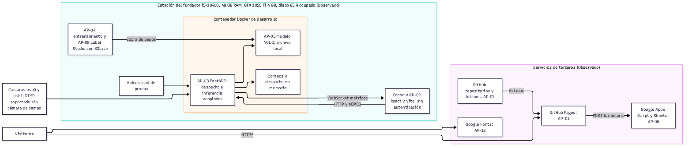

*Nota.* Elaboración propia.

Hoy toda la operación se ejecuta en una sola estación de trabajo, cuyo disco está cerca de su capacidad, sin copias de respaldo ni separación de entornos. Tampoco existen segmentación de red, firewall ni VPN. En cuanto a las cámaras, entre el 16 y el 20 de noviembre de 2025 se hicieron pruebas con cámaras integradas (usb0) y externas (usb1) en varios portátiles y computadores de escritorio; sin embargo, esas pruebas no dejaron resultados documentados, por lo que todavía no sirven como evidencia del desempeño.

## 6.3 Riesgos tecnológicos

Entre las arquitecturas de aplicaciones y de tecnología se registran 20 riesgos: los siete elementos a retirar o corregir de Aplicaciones (RA) y los trece riesgos tecnológicos (RT). Los cuatro tipos que menciona el enunciado quedan cubiertos así: los equipos obsoletos, en RT-13; la falta de respaldo, en RT-02 (Sin respaldos); los problemas de seguridad, en RT-05 (Consola y API sin autenticación), RT-06 (Configuración de desarrollo expuesta) y RT-12 (Contraseñas sin gestor); y la dependencia de un proveedor, en RT-10 (Dependencia de GitHub y Google).

La Tabla 16 resume esos veinte riesgos.

**Tabla 16**  
*Riesgos de aplicaciones y tecnología*


| Riesgo | Descripción breve                                                |
| ------ | ---------------------------------------------------------------- |
| RA-01 | Hoja de cálculo usada como CRM, sin control |
| RA-02 | Nombres heredados de un proyecto anterior |
| RA-03 | Textos sin respaldo en consola y sitio |
| RA-04 | Identificadores de estación inconsistentes |
| RA-05 | Middleware no activado y detecciones simuladas |
| RA-06 | Base de Label Studio con datos personales en repositorio público |
| RA-07 | Google Fonts transfiere la IP del visitante sin aviso |
| RT-01 | Dependencia de una sola persona |
| RT-02 | Sin respaldos de pesos, dataset ni videos |
| RT-03 | Disco cerca de su capacidad |
| RT-04 | Modelo sin evaluación en estación |
| RT-05 | Consola y API sin autenticación |
| RT-06 | Configuración de desarrollo expuesta |
| RT-07 | Backend sin pruebas ni integración continua |
| RT-08 | Conteos solo en memoria |
| RT-09 | Datos personales en el laboratorio |
| RT-10 | Dependencia de cuentas de GitHub y Google |
| RT-11 | Cámara USB distinta de una cámara de campo |
| RT-12 | Contraseñas y llaves de acceso sin un gestor dedicado |
| RT-13 | Equipos obsoletos en la única estación |


*Nota.* Elaboración propia.

## 6.4 Propuesta tecnológica


### 6.4.1 Mejoras por eje

La propuesta tecnológica se organiza en los cuatro ejes que plantea el taller. Uno de ellos es la virtualización mediante contenedores, que pueden imaginarse como cajas de mudanza: cada aplicación viaja con todo lo que necesita para funcionar, de modo que se comporta igual en cualquier equipo. La Tabla 17 resume las mejoras de cada eje, todas ellas propuestas para el estado objetivo.

**Tabla 17**  
*Propuesta tecnológica por eje del enunciado*


| Eje             | Mejoras                                                                                                                                                                                                       |
| --------------- | ------------------------------------------------------------------------------------------------------------------------------------------------------------------------------------------------------------- |
| Modernización | Partición de AP-03 (Servicio de detección y despacho) en AP-03a (API de despacho) y AP-03b (inferencia continua); imagen de ejecución mínima sin depurador; pruebas e integración continua para backend y consola; N-04 (Persistencia de conteos) |
| Virtualización | Contenedores separados para AP-03a (API de despacho), AP-03b (Servicio de inferencia), laboratorio y demostración; entorno de entrenamiento y etiquetado reproducible |
| Servicios cloud | Nodos de aplicación, datos e identidad alojables en nube; GPU bajo demanda; almacén de objetos versionado para pesos, videos y exportes |
| Seguridad | Autenticación con roles (N-02); orígenes permitidos explícitos y cifrado de video, métricas y eventos; autenticación entre servicios; gestor de secretos; retiro de datos personales de repositorios públicos |


*Nota.* Elaboración propia.

### 6.4.2 Entornos y alternativas de nube

En el estado objetivo, la operación se distribuye en cinco entornos separados: Desarrollo, Laboratorio, Demostración, Piloto y Público. A ellos se agregan un almacén de objetos para modelos y videos, un gestor de secretos, respaldos verificados y GPU bajo demanda para la inferencia, un esquema comparable a alquilar un vehículo solo los días en que se necesita en lugar de comprarlo. En cuanto al proveedor de nube, el estado objetivo contempla dos alternativas de despliegue, Azure y GCP, que se comparan más adelante. La selección final se hará al contratar el primer piloto, de modo que la preferencia por GCP que se desprende del análisis es una recomendación técnica.

La Ilustración 19 presenta la infraestructura objetivo, distribuida en nodos separados: público, laboratorio, datos, inferencia con GPU, aplicación, identidad y un nodo administrativo condicional. Una cola de eventos conecta el servicio de inferencia con la API de despacho, y las líneas punteadas señalan los componentes que dependen de la formalización de la empresa.

**Ilustración 19**  
*Diagrama tecnológico TO-BE*

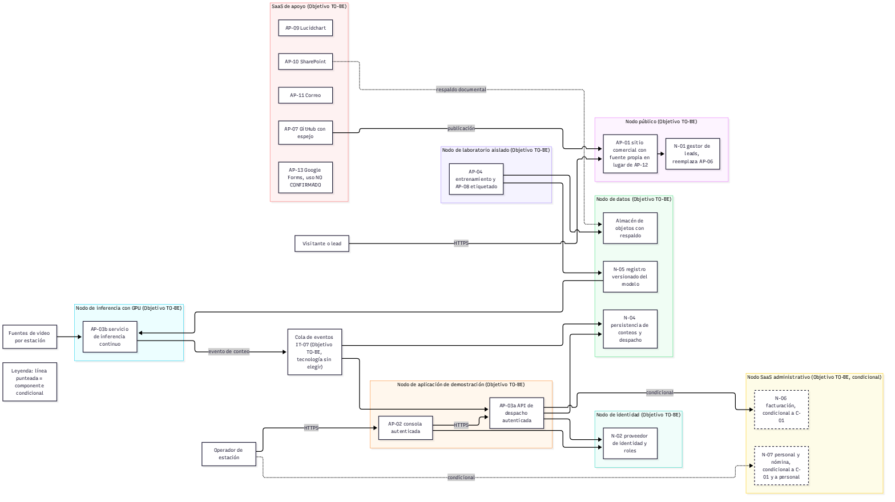

*Nota.* Elaboración propia.

Para orientar esa decisión futura, el Anexo E estima el costo de operar en São Paulo (Azure Brazil South y GCP southamerica-east1), que es la única ubicación donde ambos proveedores ofrecen la GPU T4. Los valores corresponden a precios de lista de pago por uso, tomados de la Azure Retail Prices API (Microsoft, 2026) y de las páginas de precios de Google Cloud (Google, 2026) y consultados el 2 de noviembre de 2026. Se trata, en consecuencia, de una estimación y no de una cotización.

La Tabla 18 compara el costo mensual estimado de ambos proveedores en dos escenarios.

**Tabla 18**  
*Costo mensual estimado de operación en Azure y GCP*


| Escenario              | Azure (USD/mes) | GCP (USD/mes) | Diferencia              |
| ---------------------- | --------------- | ------------- | ----------------------- |
| Piloto (1 a 3 cámaras) | 755,45 | 650,11 | GCP 105,34 menos (14 %) |
| Escala (15 cámaras) | 3.096,77 | 2.864,32 | GCP 232,45 menos (8 %) |


*Nota.* Elaboración propia a partir de precios de lista de Microsoft (2026) y Google (2026). Los totales excluyen los rubros sin precio de lista publicado y no aplican descuentos; el desglose por rubro se presenta en el Anexo E.

Con esa salvedad, la estimación favorece a GCP southamerica-east1, tanto por costo como por disponibilidad de la T4 en tres zonas; no obstante, Azure publica niveles de servicio (SLA) iguales o superiores en VPN, gestión de secretos y base de datos sin alta disponibilidad. Por lo tanto, ambas alternativas son viables y la elección dependerá de las condiciones del piloto.

### 6.4.3 Consideraciones legales

Desde el punto de vista legal, en ambas nubes los datos personales saldrían hacia Brasil, país que no figura en la lista de destinos con nivel adecuado de protección fijada por la Circular Externa 005 de 2017, modificada por la Circular Externa 002 de 2018 (Superintendencia de Industria y Comercio [SIC], 2017, 2018). Por consiguiente, antes de cargar cualquier dato personal deberá firmarse el contrato de transmisión con el proveedor en calidad de Encargado, figura comparable a la de un servicio de mensajería que transporta un paquete ajeno sin poder decidir sobre su contenido (Presidencia de la República de Colombia, 2013). De igual manera, los nodos administrativos de facturación y nómina, que dependen de la formalización de la empresa, se rigen por la Resolución 000165 de 2023 (Dirección de Impuestos y Aduanas Nacionales [DIAN], 2023), la Resolución 000013 de 2021 (DIAN, 2021), la Ley 100 de 1993 (Congreso de la República de Colombia, 1993) y el Decreto 1072 de 2015 (Presidencia de la República de Colombia, 2015).

```{=openxml}
<w:p><w:r><w:br w:type="page"/></w:r></w:p>
```


# Capítulo 7. Roadmap de Transformación

Este capítulo corresponde a las fases E y F del ADM y, de manera complementaria, a las fases G y H. En él se presentan la Arquitectura de Negocio objetivo, el análisis de brechas, el portafolio de proyectos, la matriz de priorización, la hoja de ruta y los indicadores de éxito, así como el registro de requisitos, el gobierno de la implementación y la gestión del cambio.

## 7.1 Arquitectura de Negocio (TO-BE)

El estado que se busca para LIRN puede resumirse de la siguiente manera. La firma queda constituida como S.A.S. y ofrece TORNS a un operador privado o a una entidad pública mediante un primer piloto pagado. En ese escenario, la demanda se mide en la estación y el centro de control recibe una recomendación, aunque la decisión sigue siendo suya. Al mismo tiempo, los datos personales se tratan conforme a la Ley 1581 de 2012 y la operación deja de depender de un solo equipo y de una sola persona. Nada de esto existe hoy; el apartado describe el estado al que se quiere llegar.

### 7.1.1 Capacidades

En el estado objetivo, las diez capacidades cuentan con un proceso y un responsable. Las que hoy son básicas se formalizan: el control de lo que se afirma públicamente (CAP-01) se aplica a cada pieza y propuesta comercial, y la gestión de la evidencia (CAP-02) incorpora una política de tratamiento publicada y la autorización registrada de los titulares. Las capacidades del núcleo técnico, por su parte, dejan de ser solo demostrativas, ya que el conteo (CAP-04) se evalúa en condiciones reales de estación y la recomendación de despacho (CAP-05) se conserva en un historial comparable con la decisión real del centro de control. Por último, las tres capacidades ausentes se crean únicamente cuando el negocio las necesita: la integración con el centro de control (CAP-07) llega con el operador, la facturación (CAP-09) con el primer cobro y la gestión del talento humano (CAP-10) con la primera vinculación.

### 7.1.2 Procesos

Los cinco procesos actuales se conservan, aunque cada uno amplía su alcance. Así, la dirección estratégica (P-01) añade la revisión del portafolio y la aprobación de propuestas; la relación comercial (P-02) deja de limitarse a recibir interés y pasa a gestionar el embudo completo hasta la propuesta; la realización del producto (P-03) incluye la evaluación en estación y el versionado del modelo antes de cada entrega; el acompañamiento (P-04) se extiende de la demostración al piloto; y el proceso de evidencia (P-05) verifica que todo indicador publicado tenga fuente. A estos se suman cuatro procesos nuevos, propuestos solo donde una capacidad ausente lo exige: P-06 Contratación y piloto, que va desde la propuesta aprobada hasta el acta de cierre; P-07 Integración con el centro de control, que mantiene al operador humano en el circuito; P-08 Gestión financiera y facturación; y P-09 Gestión del talento humano, condicionado a que exista personal que vincular.

### 7.1.3 Servicios

Los tres servicios actuales, SN-01 Información y recepción de interés, SN-02 Demostración guiada y SN-03 Verificación de evidencia, se mantienen, con un ajuste importante en el primero: la recepción de interés incorpora aviso de privacidad, autorización y una respuesta trazable. Además, se crean dos servicios nuevos. El primero es el piloto de medición de demanda en estación (SN-04), un servicio pagado y acotado en tiempo y número de estaciones que exige, como condición previa, evaluar el modelo con video de estación y acordar con el operador la fuente de video y la red. El segundo es el soporte y mejora del servicio (SN-05), que atiende incidencias y ajustes acordados con el operador. El precio, la duración y el alcance del piloto se definirán con el primer operador interesado.

### 7.1.4 Información y recursos tecnológicos

Para sostener lo anterior, el negocio requiere un historial de conteos y recomendaciones por estación y fecha, un registro de solicitudes con autorización de tratamiento, los contratos y facturas del piloto y, más adelante, los registros laborales de los empleados como datos personales protegidos. En términos tecnológicos, esto se traduce en un servicio de inferencia continua que no dependa de que alguien abra el video, en autenticación con roles para la consola y la API, en un entorno de piloto separado del laboratorio y en las aplicaciones de gestión de solicitudes, registro de modelos, facturación y nómina descritas en el capítulo 5.

### 7.1.5 Organización

Finalmente, las cinco áreas funcionales siguen existiendo como roles. La diferencia es que un cargo nuevo solo se justifica cuando una capacidad ausente lo exige, de modo que el número de personas y la fecha de cada vinculación se definirán según lo exija el crecimiento del negocio.

### 7.1.6 Síntesis y principios rectores

La Tabla 19 resume el contraste entre el punto de partida y el estado objetivo en cada elemento de la arquitectura.

**Tabla 19**  
*Contraste entre el estado actual y el estado objetivo*


| Elemento     | Punto de partida                                                                                                           | Estado objetivo                                                                                                                                                                              |
| ------------ | -------------------------------------------------------------------------------------------------------------------------- | ------------------------------------------------------------------------------------------------------------------------------------------------------------------------------------------------------------- |
| Visión | Cero clientes, sin piloto, una persona | LIRN formalizada como S.A.S. ofrece TORNS bajo un primer piloto pagado con un operador B2B o una entidad B2G; el centro de control decide el despacho |
| Capacidades | CAP-07 (Integración con el centro de control), CAP-09 (Gestión financiera) y CAP-10 (Talento humano) ausentes | CAP-01 a CAP-10 con proceso y responsable |
| Procesos | P-01 a P-05 | Se conservan P-01 a P-05 y se agregan P-06 Contratación y piloto, P-07 Integración con el centro de control, P-08 Gestión financiera y facturación y P-09 Gestión del talento humano, este último condicional |
| Servicios | SN-01 a SN-03 | Se agregan SN-04 Piloto de medición de demanda en estación y SN-05 Soporte y mejora del servicio. El precio, la duración y el número de estaciones de SN-04 (Piloto de medición en estación) se acuerdan con el operador |
| Información | Conteos en memoria; leads en hoja personal | Historial de conteos y recomendaciones; leads con autorización Ley 1581; contratos, facturas y nómina como activos gobernados |
| Aplicaciones | Prototipo local sin autenticación; hoja de cálculo como CRM | N-01 a N-07 e interfaces IT-01 a IT-07, según el capítulo 5 |
| Tecnología | Una estación de trabajo, sin respaldos ni entornos separados | Cinco entornos, almacén de objetos, gestor de secretos, respaldo verificado y GPU bajo demanda, según el capítulo 6 |
| Organización | Un autor único cubre las cinco áreas | Las áreas existen como roles; un cargo nuevo solo se justifica por una capacidad ausente. El número de personas y la fecha dependen del crecimiento |


*Nota.* Elaboración propia.

Tres principios orientan este estado objetivo: afirmar solo lo que está evidenciado (PN-02), reconocer que la decisión de despacho pertenece al operador (PN-04) y crecer únicamente cuando una capacidad lo justifique (PN-08).

## 7.2 Análisis de brechas

Al comparar el estado actual con el objetivo se identifican 26 brechas, agrupadas en cuatro series: negocio (B-N), datos (B-D), aplicaciones (B-A) y tecnología (B-T). Entre ellas, las más críticas son la falta de formalización legal (B-N01), el formulario sin autorización de tratamiento (B-D02), la ausencia de respaldos (B-D06) y el disco casi lleno, con equipos obsoletos, de la única estación de trabajo (B-T06). Además, la columna de trazas indica los problemas (PI y PR) y riesgos (RA y RT) de los capítulos 4 a 6 que originan cada brecha. Una brecha puede entenderse como la distancia entre el punto de partida y el destino de un recorrido: identificarla permite decidir qué tramo recorrer primero.

La Tabla 20 presenta cada brecha con lo que existe hoy, lo que hace falta y lo que debe cambiar.

**Tabla 20**  
*Análisis de brechas entre el estado actual y el objetivo*


| ID | Qué existe hoy | Qué hace falta | Qué debe cambiar | Trazas |
|---|---|---|---|---|
| B-N01 | No hay registro ante Cámara de Comercio; sin NIT ni matrícula mercantil | S.A.S. formalizada | Registro ante Cámara de Comercio y DIAN | PI-17 Empresa sin registro legal |
| B-N02 | Nombres heredados de un proyecto anterior en repositorios, contenedores y textos | Identidad única LIRN y TORNS en todas las superficies | Retirar los nombres heredados | PI-07 Nombres heredados; PR-09 Nombres heredados; PR-10 Textos sin respaldo |
| B-N03 | Leads recopilados en hoja sin respuesta ni seguimiento | Embudo con atención y seguimiento (CAP-03) | Incorporar paso de atención al proceso comercial | PI-02 Lead sin estado ni autorización; PI-16 Leads sin respuesta; PR-17 Leads sin seguimiento |
| B-N04 | Sin evaluación del modelo en estación; recall 0,55 es métrica de entrenamiento de la última época sobre 1.000 imágenes del COCO Person Dataset de Roboflow, no de estación | Evaluación con video de estación acordado con operador | Definir protocolo de evaluación en campo | RA-03 Textos sin respaldo; RA-05 Código sin uso; RT-04 Modelo sin evaluación en estación; PR-16 Cámaras sin pruebas documentadas |
| B-N05 | CAP-07 (Integración con el centro de control), CAP-09 (Gestión financiera) y CAP-10 (Talento humano) ausentes | Capacidades con proceso: P-07 (Integración con el centro de control), P-08 (Gestión financiera y facturación) y P-09 (Gestión del talento humano) | Diseñar interoperabilidad, facturación y talento | PR-06 Sin integración con el centro de control; PR-15 Sin facturación |
| B-N06 | Sin proceso de contratación ni piloto | P-06 Contratación y piloto; SN-04 Piloto de medición en estación | Diseñar proceso de piloto pagado | Sección 7.1 |
| B-N07 | Dependencia de una sola persona para las cinco áreas | Roles futuros (Comercial, Ingeniería, Operación, Calidad) | Plan de talento ligado a CAP-10 (Talento humano); documento de recuperación y segundo custodio | PR-15 Sin facturación; RT-01 Dependencia de una persona |
| B-D01 | Conteos y planes solo en memoria | Historial comparable por estación | Persistencia gestionada | PI-01 Sin historial de conteos; PR-05 Datos solo en memoria; RT-08 Conteos solo en memoria |
| B-D02 | Formulario sin política Ley 1581 ni casilla de autorización; datos en cuenta personal de Google | Política, aviso y autorización publicados | Formalizar tratamiento de datos personales | PI-02 Lead sin estado ni autorización; PI-17 Empresa sin registro legal; PR-02 Formulario sin autorización |
| B-D03 | Sin diccionario, propietario de dato ni retención | Gobierno de datos mínimo | Catálogo y política de retención | PI-03 Sin diccionario de datos; PI-11 Hoja y encuesta aisladas; PI-12 Documentos aislados |
| B-D04 | Cuenta de anotador con datos personales en repositorio público | Datos personales fuera del repositorio | Retirar y controlar base de Label Studio (AP-08) | PI-13 Datos personales en repositorio público; PR-14 Herramientas sin gobierno; RA-06 Base de etiquetado pública; RT-09 Datos personales en el laboratorio |
| B-D05 | Inconsistencias de identificadores y datos de demostración legibles como reales | Catálogo de estaciones único y datos de demo rotulados | Corregir y rotular | PI-05 Clave de estación inconsistente; PI-06 Cámara sin fuente publicada; PI-09 Datos de demostración sin rótulo; PR-08 Identificadores inconsistentes |
| B-D06 | Sin respaldos de pesos, dataset, base de etiquetado ni videos | Respaldo fuera de la estación con prueba de restauración | Política de respaldo y almacén de objetos versionado | PI-18 Sin respaldos; RT-02 Sin respaldos |
| B-A01 | AP-06 (hoja con Apps Script) como sustituto de CRM, sin acuse ni reintento | Gestor estructurado de leads (N-01) | Reemplazar AP-06 (Hoja de cálculo de leads) con integración IT-01 (Formulario hacia el gestor de leads) | PR-01 Hoja de cálculo como CRM; PI-02 Lead sin estado ni autorización |
| B-A02 | AP-02 (Consola de operación) y AP-03 (Servicio de detección y despacho) sin autenticación; CORS abierto | Identidad y roles (N-02) | Autenticación y CORS restringido | PR-03 API y consola sin autenticación; PI-14 Despacho sin autenticación; RT-05 Consola y API sin autenticación; RT-06 Configuración de desarrollo expuesta |
| B-A03 | Inferencia ligada a la apertura del stream en AP-03 (Servicio de detección y despacho) | AP-03a API de despacho y AP-03b (Servicio de inferencia) inferencia desacoplada (N-03) | Partición lógica y cola de conteos | PR-04 Inferencia ligada al video |
| B-A04 | AP-05 (Modelo de detección) copiado a mano, deriva de versiones entre AP-04 (Entrenamiento del modelo) y AP-03 (Servicio de detección y despacho) | Registro versionado del modelo (N-05) | Publicación de artefacto con metadatos | PR-07 Modelo copiado a mano |
| B-A05 | Sin integración con centro de control | Interfaz autenticada IT-06 (Interfaz con el centro de control) | Acordar contrato de interfaz con operador | PR-06 Sin integración con el centro de control |
| B-A06 | Sin aplicación de facturación y contabilidad | Facturación electrónica SaaS (N-06) | Adoptar servicio | PR-15 Sin facturación |
| B-A07 | Código sin uso, textos sin respaldo, sin pruebas | Código limpio, textos alineados, pruebas | Saneamiento | PR-10 Textos sin respaldo; PR-11 Código sin uso; PR-12 Backend sin pruebas; RA-03 Textos sin respaldo; RT-07 Backend sin pruebas |
| B-T01 | Un solo entorno (desarrollo en la estación del fundador) | Entornos de laboratorio, demostración y piloto separados según la sección 6.4.2 | Contenedores separados para AP-03a (API de despacho), AP-03b (Servicio de inferencia), laboratorio y demostración | PR-13 Sin entorno de piloto; PI-18 Sin respaldos |
| B-T02 | Configuración de desarrollo expuesta: CORS abierto, depuración y recarga activas, puerto publicado | Imagen de ejecución mínima y perfiles de entorno | Endurecer imágenes; pruebas e integración continua del backend | PR-12 Backend sin pruebas; RT-06 Configuración de desarrollo expuesta; RT-07 Backend sin pruebas |
| B-T03 | Existe una plantilla de secretos, pero no un gestor dedicado | Gestor de secretos por entorno y registro de accesos | Adoptar gestor de secretos | RT-12 Contraseñas sin gestor |
| B-T04 | Solo cámaras USB usb0 y usb1; GPU de la estación obsoleta; inferencia acoplada al video | Fuente de campo definida con un operador; AP-03b (Servicio de inferencia) continuo con cola IT-07 (Cola de eventos de conteo); GPU bajo demanda | Evaluación de infraestructura de campo y cola de eventos | RT-04 Modelo sin evaluación en estación; RT-11 Cámara USB en lugar de cámara de campo; RT-13 Equipos obsoletos |
| B-T05 | Publicación y leads en cuentas de GitHub y Google | Espejo de repositorios y N-01 (Gestor de leads) | Plan de continuidad | RT-10 Dependencia de GitHub y Google |
| B-T06 | Disco de la única estación cerca de su capacidad y equipos obsoletos | Almacén de objetos fuera de la estación y GPU bajo demanda | Retiro de duplicados y migración de artefactos | RT-03 Disco casi lleno; RT-13 Equipos obsoletos |


*Nota.* Elaboración propia.

## 7.3 Portafolio de proyectos

Para cerrar las brechas se propone un portafolio de diez proyectos. La Tabla 21 presenta cada uno con su objetivo, el beneficio esperado y su prioridad.

**Tabla 21**  
*Portafolio de proyectos de transformación*


| Proyecto | Nombre                                          | Objetivo                                                                                                                                                                                | Beneficio esperado                                                                                                                                  | Prioridad   |
| -------- | ----------------------------------------------- | --------------------------------------------------------------------------------------------------------------------------------------------------------------------------------------- | --------------------------------------------------------------------------------------------------------------------------------------------------- | ----------- |
| PY-01 | Formalización legal de LIRN S.A.S. | Obtener matrícula mercantil y NIT ante la Cámara de Comercio de Bogotá y la DIAN | Habilita contratar y facturar, y permite definir si la sociedad asume en adelante el rol de Responsable del tratamiento, informando a los titulares | 1 |
| PY-02 | Alineación de la identidad de TORNS | Retirar los nombres heredados de un proyecto anterior en repositorios, contenedores y textos | Identidad coherente en todas las superficies | 2 |
| PY-03 | Canal comercial conforme a la Ley 1581 | Publicar política y aviso, capturar autorización y reemplazar la hoja por un gestor de leads con respuesta | Cumplimiento legal y leads atendidos | 1 |
| PY-04 | Historial de conteos y despacho | Persistir conteos, estado y planes por estación y fecha | Comparabilidad y auditoría de recomendaciones; base de indicadores | 2 |
| PY-05 | Inferencia desacoplada y evaluación en estación | Separar AP-03a (API de despacho) y AP-03b (Servicio de inferencia), versionar el modelo y evaluarlo con video de estación | Evidencia de desempeño en plataforma, hoy inexistente | 2 |
| PY-06 | Interoperabilidad con el centro de control | Implantar P-07 (Integración con el centro de control) e IT-06 (Interfaz con el centro de control) con interfaz autenticada; el operador decide | Recomendación usable por el operador sin perder la decisión humana | 3 |
| PY-07 | Seguridad, respaldo y separación de entornos | Respaldo verificado, gestión de secretos, autenticación con roles (N-02), retiro de datos personales del repositorio público y entornos de demostración, laboratorio y piloto separados | Continuidad y menor exposición | 1 |
| PY-08 | Primer piloto pagado B2B o B2G | Ejecutar P-06 (Contratación y piloto) y prestar SN-04 (Piloto de medición en estación) con un operador | Primera validación comercial y técnica en campo | 3 |
| PY-09 | Gestión financiera y facturación | Implantar P-08 (Gestión financiera y facturación) con facturación electrónica y contabilidad mínima (N-06) | Poder cobrar y registrar el piloto | 1 |
| PY-10 | Gestión del talento humano | Implantar P-09 (vinculación, nómina, seguridad social, desvinculación) con N-07 (Gestión de nómina) y tratamiento Ley 1581 de datos de empleados | Vinculación conforme cuando la capacidad lo exija | Condicional |


*Nota.* Elaboración propia.

## 7.4 Matriz de priorización

Cada proyecto se valoró según su impacto, su complejidad y su costo relativo, así como por las dependencias que habilita. Así, la formalización legal (PY-01) ocupa el primer lugar, ya que combina impacto alto con complejidad baja y, además, es requisito del piloto (PY-08), de la facturación (PY-09) y del talento humano (PY-10). En el extremo opuesto, la interoperabilidad con el centro de control (PY-06) queda en prioridad 3, porque requiere un operador real.

La Tabla 22 resume esa valoración junto con la justificación de cada caso.

**Tabla 22**  
*Matriz de priorización de proyectos*


| Proyecto | Impacto | Complejidad | Costo relativo | Justificación                                                                                                                                                                                              | Prioridad   |
| -------- | ------- | ----------- | -------------- | ---------------------------------------------------------------------------------------------------------------------------------------------------------------------------------------------------------- | ----------- |
| PY-01 Formalización legal | Alto | Baja | Bajo | Es requisito de PY-08 (Primer piloto pagado), PY-09 (Gestión financiera y facturación) y PY-10 (Talento humano) | 1 |
| PY-03 Canal comercial conforme | Alto | Media | Bajo | El formulario actual no cumple la Ley 1581 de 2012 | 1 |
| PY-07 Seguridad y respaldo | Alto | Media | Medio | No hay respaldos ni entornos separados; requiere almacén de objetos, gestor de secretos y entornos según la sección 6.4; atiende RT-02 (Sin respaldos) y RT-12 (Contraseñas sin gestor) | 1 |
| PY-09 Gestión financiera y facturación | Alto | Media | Medio | Es condición previa del piloto; requiere PY-01 (Formalización legal) y un servicio de facturación | 1 |
| PY-02 | Alineación de la identidad de TORNS | Retirar los nombres heredados de un proyecto anterior en repositorios, contenedores y textos | Identidad coherente en todas las superficies | 2 |
| PY-04 Historial de conteos | Alto | Media | Medio | Es la base de los indicadores; requiere N-04 (Persistencia de conteos) en un nodo de datos en la nube, Azure o GCP según la sección 6.4.2 | 2 |
| PY-05 Inferencia y evaluación en estación | Alto | Alta | Alto | Requiere video de estación, acuerdo con un operador, GPU bajo demanda y la cola IT-07 (Cola de eventos de conteo); atiende RT-04 (Modelo sin evaluación en estación), RT-11 (Cámara USB en lugar de cámara de campo) y RT-13 (Equipos obsoletos) | 2 |
| PY-08 Primer piloto pagado | Alto | Alta | Alto | Es la meta de la visión; depende de PY-01 (Formalización legal), PY-03 (Canal comercial conforme), PY-05 (Inferencia y evaluación en estación), PY-07 (Seguridad y respaldo) y PY-09 (Gestión financiera y facturación) | 3 |
| PY-06 Interoperabilidad con el centro de control | Medio | Alta | Medio | Requiere un operador real y un acuerdo de interfaz | 3 |
| PY-10 Talento humano | Medio | Media | Alto | Solo aplica cuando haya personal que vincular | Condicional |


*Nota.* Elaboración propia.

## 7.5 Hoja de ruta

La Tabla 23 distribuye los proyectos en los tres horizontes que plantea el taller.

**Tabla 23**  
*Hoja de ruta por horizonte de tiempo*


| Horizonte  | Proyectos                                           |
| ---------- | --------------------------------------------------- |
| 0 a 1 año | PY-01 Formalización legal; PY-03 Canal comercial conforme; PY-07 Seguridad y respaldo; PY-09 Gestión financiera y facturación; PY-02 Identidad de TORNS; PY-04 Historial de conteos |
| 1 a 3 años | PY-05 Inferencia y evaluación en estación; PY-08 Primer piloto pagado |
| 3 a 5 años | PY-06 Interoperabilidad con el centro de control |
| Sin fecha | PY-10 (Talento humano), condicional a que haya personal que vincular |


*Nota.* Elaboración propia.

En la Ilustración 20 se observa la misma hoja de ruta como un diagrama de dependencias. Los proyectos del corto plazo alimentan la inferencia desacoplada y el primer piloto del mediano plazo, que a su vez habilitan la interoperabilidad con el centro de control en el largo plazo; el talento humano aparece aparte y sin fecha, porque es condicional.

**Ilustración 20**  
*Hoja de ruta de transformación y dependencias entre proyectos*

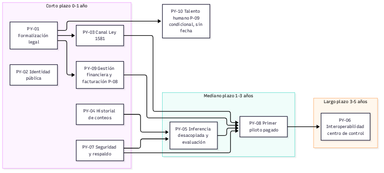

*Nota.* Elaboración propia.

## 7.6 Indicadores de éxito

Cuando un indicador todavía no tiene medición, su línea base se tomará en el primer periodo de uso del proyecto que lo habilita. Las metas son cualitativas, porque un valor numérico solo puede fijarse con datos reales. La Tabla 24 presenta los trece indicadores con su fórmula, su línea base y su meta.

**Tabla 24**  
*Indicadores de éxito*


| ID    | Tipo                     | Indicador                                   | Fórmula                                                               | Línea base                                                                              | Meta                            | Proyecto     |
| ----- | ------------------------ | ------------------------------------------- | --------------------------------------------------------------------- | --------------------------------------------------------------------------------------- | ------------------------------------------------ | ------------ |
| IN-01 | Reducción de tiempos | Primera respuesta a un lead | Promedio de (fecha de respuesta menos fecha de recepción) por periodo | Los leads no se responden | Todo lead con respuesta registrada | PY-03 Canal comercial conforme |
| IN-02 | Reducción de tiempos | Restauración tras pérdida del equipo | Tiempo entre la falla simulada y el servicio restaurado | No hay respaldo | Restauración documentada y probada | PY-07 Seguridad y respaldo |
| IN-03 | Reducción de tiempos | Espera en andén durante el piloto | Promedio de espera medida con el operador, antes y después | Sin medición; se toma al iniciar el piloto | Reducción acordada con el operador | PY-08 Primer piloto pagado |
| IN-04 | Disminución de costos | Pasos manuales para publicar el modelo | Número de pasos manuales por publicación | El modelo se copia a mano | Publicación sin pasos manuales | PY-05 Inferencia y evaluación en estación |
| IN-05 | Disminución de costos | Despachos sin respaldo de demanda observada | Despachos sin recomendación asociada / despachos totales | Sin medición; se toma al iniciar el piloto | Reducción acordada con el operador | PY-08 Primer piloto pagado; PY-04 Historial de conteos |
| IN-06 | Incremento de ventas | Conversión de leads | Leads con propuesta / leads con autorización | Cero propuestas | Conversión registrada y creciente | PY-03 Canal comercial conforme |
| IN-07 | Incremento de ventas | Piloto pagado firmado | Sí o no (acta de inicio con contrato) | No existe | Al menos un piloto en el horizonte de 1 a 3 años | PY-08 Primer piloto pagado |
| IN-08 | Incremento de ventas | Pilotos facturados | Facturas electrónicas emitidas / pilotos ejecutados | No hay facturación | Todo piloto facturado | PY-09 Gestión financiera y facturación |
| IN-09 | Satisfacción de usuarios | Satisfacción del controlador | Valoración en encuesta de cierre del piloto | Sin medición; se toma al cierre del piloto | Valoración favorable registrada en acta | PY-08 Primer piloto pagado |
| IN-10 | Satisfacción de usuarios | Solicitudes de titulares atendidas en plazo | Solicitudes atendidas en plazo / solicitudes recibidas | Sin medición; hoy no hay canal para los titulares | Totalidad dentro del plazo legal | PY-03 Canal comercial conforme |
| IN-11 | Calidad técnica | Recall en video de estación | Verdaderos positivos / (verdaderos positivos + falsos negativos) | Sin medición en estación; 0,55 en entrenamiento | Medido y reportado con fuente y alcance | PY-05 Inferencia y evaluación en estación |
| IN-12 | Calidad técnica | Coincidencia con la decisión del operador | Recomendaciones coincidentes / recomendaciones emitidas | Sin medición; se toma durante el piloto | Medida y revisada con el operador | PY-06 Interoperabilidad con el centro de control; PY-04 Historial de conteos |
| IN-13 | Calidad técnica | Activos críticos con respaldo verificado | Activos con restauración probada / activos críticos | Sin respaldos | Totalidad de activos críticos | PY-07 Seguridad y respaldo |


*Nota.* Elaboración propia.

Como se observa, las metas no fijan cifras que carezcan de sustento. Por ejemplo, el recall de 0,55 (la proporción de personas que el modelo logra detectar) corresponde a la última época del entrenamiento del 15 de noviembre de 2025, con precisión de 0,73 y mAP50 de 0,64, y no a la operación real. Por esa razón, IN-11 (Recall en video de estación) medirá el recall sobre video real de estación, un insumo que todavía no existe. Así, si en un andén hay cien personas y el modelo detecta cincuenta y cinco, su recall es de 0,55.

## 7.7 Registro de requisitos

Para que cada proyecto pueda darse por cumplido sin ambigüedad, las brechas se traducen en veinte requisitos de arquitectura. Cada requisito indica su origen, el proyecto que lo atiende y un criterio de verificación concreto, de manera similar a la lista de chequeo con la que se recibe una obra terminada. La Tabla 25 los presenta; ninguno se cumple todavía.

**Tabla 25**  
*Registro de requisitos de arquitectura*


| ID    | Dominio      | Enunciado                                                                                                                                                                                                       | Origen              | Proyecto | Criterio de verificación                                                                           |
| ----- | ------------ | --------------------------------------------------------------------------------------------------------------------------------------------------------------------------------------------------------------- | ------------------- | -------- | -------------------------------------------------------------------------------------------------- |
| RQ-01 | Negocio | La organización debe contar con matrícula mercantil y NIT | B-N01 Sin formalización legal | PY-01 Formalización legal | Certificado de existencia vigente |
| RQ-02 | Negocio | El código, los contenedores y los textos públicos deben usar solo la identidad LIRN y TORNS | B-N02 Nombres heredados; PI-07 Nombres heredados | PY-02 Identidad de TORNS | Revisión sin nombres heredados |
| RQ-03 | Datos | Todo formulario debe publicar política y capturar autorización Ley 1581 | PI-02 Lead sin estado ni autorización; PR-02 Formulario sin autorización | PY-03 Canal comercial conforme | Formulario con casilla y enlace a política |
| RQ-04 | Negocio | Todo lead debe tener estado, responsable y respuesta registrada | PI-16 Leads sin respuesta; PR-17 Leads sin seguimiento | PY-03 Canal comercial conforme | Registro en gestor con campos completos |
| RQ-05 | Aplicaciones | El canal de contacto debe confirmar recepción y reintentar | PR-01 Hoja de cálculo como CRM | PY-03 Canal comercial conforme | Prueba de acuse |
| RQ-06 | Datos | Conteos y planes deben persistir por estación y fecha | PI-01 Sin historial de conteos; PR-05 Datos solo en memoria | PY-04 Historial de conteos | Consulta histórica tras reinicio |
| RQ-07 | Datos | Cada estación debe tener un identificador único | PI-05 Clave de estación inconsistente; PR-08 Identificadores inconsistentes | PY-04 Historial de conteos | Catálogo sin duplicados |
| RQ-08 | Aplicaciones | La inferencia debe ejecutarse sin depender de clientes de video | PR-04 Inferencia ligada al video | PY-05 Inferencia y evaluación en estación | Conteo activo sin stream abierto |
| RQ-09 | Aplicaciones | AP-05 (Modelo de detección) debe publicarse versionado con metadatos y entorno fijado | PR-07 Modelo copiado a mano | PY-05 Inferencia y evaluación en estación | Versión trazable desde el entrenamiento hasta el servicio de detección |
| RQ-10 | Negocio | Toda métrica del modelo debe citar fuente y alcance; la de entrenamiento no se presenta como de estación | B-N04 Modelo sin evaluación en estación; RA-03 Textos sin respaldo | PY-05 Inferencia y evaluación en estación | Revisión de afirmaciones públicas en P-05 (Evidencia, calidad y mejora) |
| RQ-11 | Tecnología | Debe existir respaldo verificado de pesos, dataset, leads y configuración | PI-18 Sin respaldos; RT-02 Sin respaldos | PY-07 Seguridad y respaldo | Restauración de prueba desde el almacén de objetos fuera de la estación |
| RQ-12 | Tecnología | Secretos fuera del código en gestor dedicado | B-T03 Sin gestor de secretos; RT-12 Contraseñas sin gestor | PY-07 Seguridad y respaldo | Escaneo del repositorio sin secretos y secretos cargados desde el gestor por entorno |
| RQ-13 | Aplicaciones | AP-02 (Consola de operación) y AP-03 (Servicio de detección y despacho) deben autenticar con roles y CORS restringido | PR-03 API y consola sin autenticación; RT-05 Consola y API sin autenticación; RT-06 Configuración de desarrollo expuesta | PY-07 Seguridad y respaldo | Acceso anónimo rechazado |
| RQ-14 | Tecnología | Entornos de demostración, laboratorio y piloto separados | PR-13 Sin entorno de piloto; B-T01 Un solo entorno | PY-07 Seguridad y respaldo | Laboratorio, demostración y piloto operan separados con accesos separados |
| RQ-15 | Datos | Ningún dato personal en repositorios públicos | PI-13 Datos personales en repositorio público; PR-14 Herramientas sin gobierno | PY-07 Seguridad y respaldo | Revisión de AP-07 (GitHub) sin base de AP-08 (Label Studio) |
| RQ-16 | Aplicaciones | Facturación electrónica conforme a la DIAN (DIAN, 2023) | PR-15 Sin facturación; N-06 Facturación electrónica | PY-09 Gestión financiera y facturación | Factura de prueba (requiere RQ-01) |
| RQ-17 | Aplicaciones | Interfaz autenticada con centro de control del operador | PR-06 Sin integración con el centro de control | PY-06 Interoperabilidad con el centro de control | Contrato de interfaz acordado con el operador |
| RQ-18 | Negocio | El piloto requiere fuente de video y red acordadas, actas y evidencia de resultados | B-N06 Sin proceso de piloto; SN-04 Piloto de medición en estación | PY-08 Primer piloto pagado | Actas firmadas con resultados y alcance |
| RQ-19 | Negocio | La vinculación de personal debe hacerse con contrato, afiliaciones y tratamiento Ley 1581 de datos de empleados (DIAN, 2021; Congreso de la República de Colombia, 1993; Presidencia de la República de Colombia, 2015) (condicional) | B-N07 Dependencia de una persona; N-07 Gestión de nómina | PY-10 Talento humano | Expediente por colaborador |
| RQ-20 | Negocio | Ninguna pieza pública afirma cliente, contrato, piloto firmado ni impacto no medido | PN-02 Afirmar solo lo evidenciado; P-05 Evidencia, calidad y mejora | Todos | Revisión de afirmaciones públicas en P-05 (Evidencia, calidad y mejora) |


*Nota.* Elaboración propia.

## 7.8 Gobierno de la implementación

La fase G del ADM se ocupa de vigilar que la implementación respete la arquitectura definida. En el caso de LIRN, el punto de partida es sencillo: una sola persona decide y ejecuta, y no existe un comité. Por esa razón, el gobierno propuesto no crea una estructura nueva, sino que separa los roles que esa persona debe ejercer conscientemente en cada momento. La Tabla 26 presenta esos roles.

**Tabla 26**  
*Roles de gobierno de la implementación*


| Rol                                      | Responsabilidad                                                       | Quién lo ejerce hoy                                                                                                                                                                                                        |
| ---------------------------------------- | --------------------------------------------------------------------- | -------------------------------------------------------------------------------------------------------------------------------------------------------------------------------------------------------------------------- |
| Patrocinador y autoridad de arquitectura | Aprueba proyectos, cambios a los requisitos y excepciones | El fundador |
| Revisión de calidad | Verifica la conformidad de cada resultado antes de cerrar un proyecto | Rol de Calidad, mediante el proceso P-05 (Evidencia, calidad y mejora) |
| Responsable del tratamiento de datos | Responde por el cumplimiento de la Ley 1581 de 2012 | El fundador como persona natural, por decidir sobre los datos (Congreso de la República de Colombia, 2012, art. 3, lit. e); la formalización (PY-01) no le transfiere por sí sola esa responsabilidad a la futura sociedad |


*Nota.* Elaboración propia.

Cada proyecto se cierra solo si cumple los requisitos de la Tabla 25 y su criterio de verificación; el resultado puede ser conforme, conforme con observaciones o no conforme, y toda no conformidad se trata en el proceso P-05 (Evidencia, calidad y mejora). Además, la implementación se rige por cuatro reglas. En primer lugar, ninguna pieza pública afirma clientes, contratos, pilotos firmados ni impacto no medido (RQ-20 y principio PN-02). En segundo lugar, toda recolección de datos personales requiere autorización previa e informada del titular. En tercer lugar, la recomendación de despacho no sustituye la decisión del centro de control (PN-04). Por último, toda métrica del modelo debe citar su fuente y su alcance (RQ-10).

Para verificar el avance, se definen tres puntos de control, que funcionan como las paradas de revisión de un viaje largo. La Tabla 27 los resume.

**Tabla 27**  
*Puntos de control de la implementación*


| Punto | Momento                   | Evidencia requerida                                                         |
| ----- | ------------------------- | --------------------------------------------------------------------------- |
| PC-1 | Cierre del corto plazo | PY-01 (Formalización legal), PY-03 (Canal comercial conforme), PY-07 (Seguridad y respaldo) y PY-09 (Gestión financiera y facturación) conformes |
| PC-2 | Antes de firmar el piloto | Evaluación en estación de PY-05 (Inferencia y evaluación en estación) y acuerdo sobre la fuente de video y la red |
| PC-3 | Cierre del piloto | Informe de resultados del piloto e indicadores IN-03 (Espera en andén), IN-05 (Despachos sin respaldo de demanda) e IN-09 (Satisfacción del controlador) medidos |


*Nota.* Elaboración propia.

## 7.9 Gestión del cambio de la arquitectura

La fase H del ADM reconoce que ninguna arquitectura es definitiva: cuando cambian las condiciones, el plan debe revisarse. En consecuencia, se identifican los eventos que obligan a revisar este plan, llamados disparadores, y el efecto que produce cada uno, como se observa en la Tabla 28.

**Tabla 28**  
*Disparadores de revisión de la arquitectura*


| Disparador                                                                          | Efecto                                                                                                                                            |
| ----------------------------------------------------------------------------------- | ------------------------------------------------------------------------------------------------------------------------------------------------- |
| Elección entre Azure y GCP, de la tecnología de cola IT-07 o del gestor de secretos | Se revisan las brechas B-T01 a B-T06, los costos de PY-04 (Historial de conteos), PY-05 (Inferencia y evaluación en estación) y PY-07 (Seguridad y respaldo) frente a la estimación del Anexo E y los requisitos RQ-11 (Respaldo verificado), RQ-12 (Gestor de secretos) y RQ-14 (Entornos separados) |
| Formalización legal (PY-01) | Se actualiza este plan y se habilitan PY-09 (Gestión financiera y facturación) y PY-10 (Talento humano) |
| Firma de un piloto | Se activan el proceso P-06 (Contratación y piloto), el servicio SN-04 (Piloto de medición en estación) y los indicadores de campo |
| Necesidad de vincular personal | Se activa PY-10 (Talento humano) |
| Resultado de la evaluación en estación | Se revisan la promesa de valor de CAP-04 (Detección y conteo de demanda) y lo que se afirma públicamente |
| Cambio normativo en protección de datos, facturación o nómina | Se revisan RQ-03 (Autorización en formularios), RQ-16 (Facturación electrónica) y RQ-19 (Vinculación conforme) |


*Nota.* Elaboración propia.

Cuando ocurre un disparador, el cambio sigue cuatro pasos: primero, se registra la solicitud con su origen, su dominio y los elementos afectados; segundo, se clasifica como simplificación, cambio incremental o reformulación de la arquitectura; tercero, el fundador la aprueba o la rechaza; y, por último, si se aprueba, se actualizan todas las secciones de este plan que usan los elementos afectados.

En cuanto al cambio organizacional, hoy se limita a hábitos de trabajo de una sola persona: responder a los prospectos (PY-03), respaldar la información (PY-07) y revisar lo que se afirma en público (P-05). La adopción de roles nuevos llegará con PY-10 (Talento humano). Finalmente, los indicadores IN-01 a IN-13 se revisan en cada punto de control, con una regla sencilla: un indicador sin línea base no se reporta como mejora.

```{=openxml}
<w:p><w:r><w:br w:type="page"/></w:r></w:p>
```


# Capítulo 8. Conclusiones


## 8.1 Respuesta a la pregunta del taller

Considero que la arquitectura propuesta sí ayuda a LIRN a cumplir sus objetivos estratégicos en los próximos cinco años, y la razón principal es que ordena el cambio según lo que cada paso necesita del anterior. Primero la empresa tiene que existir legalmente y tratar bien los datos de las personas; después puede medir con rigor; luego puede cobrar por lo que mide, y solo al final tiene sentido conectarse con la operación de un tercero.

En el primer año el trabajo se concentra en lo básico. La formalización legal (PY-01), el canal comercial conforme a la Ley 1581 (PY-03) y la seguridad y el respaldo (PY-07) le dan a LIRN existencia legal, una forma correcta de recibir solicitudes y la tranquilidad de no perderlo todo si falla el único equipo. Con eso se atienden el canal comercial honesto (OE-02), la protección de datos (OE-03) y la preparación para el piloto (OE-05). Al mismo tiempo, el historial de conteos (PY-04) y la facturación (PY-09) hacen que TORNS deje de ser una demostración que se borra al reiniciar, lo que apoya el producto demostrable (OE-01) y el ajuste entre demanda y oferta (OE-04).

Entre el primer y el tercer año llega lo que hoy más falta: probar el modelo con video real de estación (PY-05). Esa prueba es la puerta de entrada al primer piloto pagado (PY-08). Ya entre el tercer y el quinto año, la integración con el centro de control (PY-06) lleva la recomendación al operador, pero la decisión de despacho sigue siendo suya.

## 8.2 Reflexión final

Para saber si el plan funciona propongo trece indicadores, de IN-01 a IN-13. Ninguno trae una meta inventada: donde todavía no hay datos, la cifra se fijará con la primera medición real. Al final, LIRN seguirá siendo una empresa pequeña, pero ya no dependerá de un solo computador ni de una sola persona, y cada cambio podrá seguirse desde el objetivo que lo motiva hasta el proyecto y el indicador que lo miden.

```{=openxml}
<w:p><w:r><w:br w:type="page"/></w:r></w:p>
```

# Capítulo 9. Recomendaciones

Con base en lo anterior, estas son las recomendaciones que propongo, en orden de urgencia:

1. **Formalizar la empresa primero (PY-01).** Sin matrícula mercantil ni NIT, LIRN no puede firmar contratos ni facturar a su nombre; hoy eso solo lo puede hacer el fundador como persona natural. Mientras tanto, el Responsable de los datos personales es él mismo, porque es quien decide sobre ellos (Congreso de la República de Colombia, 2012, art. 3, lit. e). Hay que tener en cuenta que crear la sociedad no le traspasa automáticamente los datos ya recogidos, así que ese cambio debe informarse a los titulares.
2. **Corregir el formulario de contacto cuanto antes.** Antes de seguir recibiendo solicitudes hay que publicar la política y el aviso de tratamiento y pedir la autorización del titular, porque hoy el formulario no cumple los artículos 5 a 7 del Decreto 1377 de 2013 (Presidencia de la República de Colombia, 2013).
3. **Respaldar los activos críticos fuera del equipo.** Los pesos del modelo, el dataset y los videos deben copiarse en otro medio y la restauración debe probarse, ya que el disco está cerca de su capacidad y no hay ninguna copia verificada.
4. **Conseguir video de estación antes de publicar métricas de campo.** Ese video debe acordarse con un operador y tratarse según la Ley 1581 de 2012. El recall de 0,55 viene del entrenamiento y no de una estación real, así que no debe presentarse como un resultado operativo.
5. **Comunicar solo lo que se puede demostrar.** En cualquier material público conviene dejar claro que TransMilenio es un caso de estudio, que quien deja sus datos es un prospecto y no un cliente, y que TORNS es un prototipo y no un piloto firmado.
6. **Elegir la nube al momento de contratar el piloto.** Azure y GCP son alternativas válidas para el estado objetivo. Con los precios de la sección 6.4.2 y el Anexo E, GCP en São Paulo resulta más económico, pero la elección final debe hacerse con las condiciones reales del piloto. En cualquier caso, antes de subir datos personales a la nube debe firmarse el contrato de transmisión con el proveedor como Encargado.
7. **Revisar la hoja de ruta cada año.** Siguiendo la fase H del ADM, la hoja de ruta se revisa una vez al año. Además, la integración con el centro de control (PY-06) y el piloto (PY-08) no deberían adelantarse mientras no estén listos la formalización (PY-01), el canal comercial (PY-03) y la seguridad y el respaldo (PY-07).

```{=openxml}
<w:p><w:r><w:br w:type="page"/></w:r></w:p>
```


# Glosario

Los términos se presentan en orden alfabético, con una explicación breve y sencilla.

**ADM (Método de Desarrollo de Arquitectura).** Secuencia de fases que propone TOGAF para pasar de la situación actual a la deseada, como los planos de una obra hechos por etapas.

**API.** Punto de contacto entre programas que recibe solicitudes y entrega respuestas, como una ventanilla de atención.

**Apps Script.** Herramienta de Google para escribir pequeños programas que trabajan con hojas de cálculo y formularios.

**Arquitectura Empresarial.** Descripción ordenada de cómo una organización combina negocio, datos, aplicaciones y tecnología para cumplir su misión.

**AS-IS.** Estado actual de la organización, tal como funciona hoy.

**B2B y B2G.** Venta a otras empresas (B2B) o a entidades públicas (B2G).

**BPMN.** Notación gráfica estándar para dibujar procesos, similar a un diagrama de flujo con reglas comunes.

**Brecha.** Diferencia entre lo que existe hoy y lo que se necesita en el estado objetivo.

**Capacidad de negocio.** Algo que la organización sabe hacer, independientemente de cómo lo haga; por ejemplo, vender o facturar.

**Contenedor.** Paquete que lleva una aplicación con todo lo que necesita para funcionar igual en cualquier equipo, como una caja de mudanza.

**CORS.** Regla del navegador que define qué sitios web pueden comunicarse con un servicio; si queda abierta, cualquiera puede hacerlo.

**CRM.** Sistema para registrar y dar seguimiento a los clientes y prospectos de una empresa.

**Dataset.** Conjunto de imágenes o datos que se usa para entrenar un modelo de inteligencia artificial.

**Encargado del tratamiento.** Tercero que trata datos personales por cuenta de otro, sin decidir sobre ellos, como un mensajero que transporta un paquete ajeno.

**Firewall.** Barrera que filtra las conexiones que entran y salen de una red, como un portero que revisa quién pasa.

**GPU.** Procesador especializado en cálculos en paralelo, muy útil para analizar imágenes con inteligencia artificial.

**Indicador.** Medida que permite saber si un objetivo se está cumpliendo, como el velocímetro de un vehículo.

**Inferencia.** Momento en que un modelo ya entrenado analiza una imagen nueva y decide qué contiene.

**Lead o prospecto.** Persona u organización que mostró interés en el producto, pero que todavía no es cliente.

**MJPEG.** Forma de transmitir video enviando una imagen tras otra, como un libro de dibujos animados que se hojea rápido.

**Modelo de detección.** Programa entrenado para reconocer objetos en imágenes; en TORNS reconoce personas.

**Nube.** Servicios de cómputo y almacenamiento que se alquilan por internet en lugar de comprar equipos propios.

**Persistencia.** Capacidad de guardar datos de forma permanente para que no se pierdan al apagar o reiniciar el sistema.

**Piloto.** Prueba real y acotada del producto con un cliente, normalmente pagada y con fecha de inicio y cierre.

**Recall.** Proporción de personas presentes que el modelo logra detectar; un recall de 0,55 significa que detecta 55 de cada 100.

**Respaldo.** Copia de seguridad de la información guardada en otro lugar para recuperarla si se pierde la original.

**Responsable del tratamiento.** Persona u organización que decide para qué y cómo se usan unos datos personales.

**Roadmap u hoja de ruta.** Plan que ordena en el tiempo los proyectos necesarios para llegar al estado objetivo.

**SaaS.** Software que se usa por internet mediante suscripción, sin instalarlo en equipos propios.

**SLA.** Compromiso de nivel de servicio que un proveedor asume, por ejemplo, el porcentaje de tiempo en que su servicio estará disponible.

**TO-BE.** Estado objetivo o futuro al que la organización quiere llegar.

**TOGAF.** Marco de referencia de The Open Group para diseñar y gobernar la arquitectura empresarial.

**Visión por computador.** Rama de la inteligencia artificial que permite a un programa interpretar imágenes y video.

**VPN.** Conexión cifrada que crea un túnel privado sobre internet entre dos redes o equipos.

**WebSocket.** Canal de comunicación que permanece abierto para enviar datos en tiempo real, como una llamada telefónica que no se cuelga.

```{=openxml}
<w:p><w:r><w:br w:type="page"/></w:r></w:p>
```


# Bibliografía

Congreso de la República de Colombia. (1993, 23 de diciembre). *Ley 100 de 1993, por la cual se crea el sistema de seguridad social integral y se dictan otras disposiciones*. Función Pública, Gestor Normativo. [https://www.funcionpublica.gov.co/eva/gestornormativo/norma.php?i=5248](https://www.funcionpublica.gov.co/eva/gestornormativo/norma.php?i=5248)

Congreso de la República de Colombia. (2008, 5 de diciembre). *Ley 1258 de 2008, por medio de la cual se crea la sociedad por acciones simplificada*. Función Pública, Gestor Normativo. [https://www.funcionpublica.gov.co/eva/gestornormativo/norma.php?i=34130](https://www.funcionpublica.gov.co/eva/gestornormativo/norma.php?i=34130)

Congreso de la República de Colombia. (2012, 17 de octubre). *Ley Estatutaria 1581 de 2012, por la cual se dictan disposiciones generales para la protección de datos personales*. Función Pública, Gestor Normativo. [https://www.funcionpublica.gov.co/eva/gestornormativo/norma.php?i=49981](https://www.funcionpublica.gov.co/eva/gestornormativo/norma.php?i=49981)

Dirección de Impuestos y Aduanas Nacionales. (2021, 11 de febrero). *Resolución 000013 de 2021, por la cual se implementa y desarrolla en el sistema de facturación electrónica la funcionalidad del documento soporte de pago de nómina electrónica y se adopta el anexo técnico*. [https://www.dian.gov.co/normatividad/Normatividad/Resoluci%C3%B3n%20000013%20de%2011-02-2021.pdf](https://www.dian.gov.co/normatividad/Normatividad/Resoluci%C3%B3n%20000013%20de%2011-02-2021.pdf)

Dirección de Impuestos y Aduanas Nacionales. (2023, 1 de noviembre). *Resolución 000165 de 2023, por la cual se desarrolla el sistema de facturación, los proveedores tecnológicos, se adopta la versión 1.9 del anexo técnico de factura electrónica de venta, se expide el anexo técnico 1.0 del documento equivalente electrónico, y se dictan otras disposiciones en materia del sistema de facturación*. [https://www.dian.gov.co/normatividad/Normatividad/Resoluci%C3%B3n%20000165%20de%2001-11-2023.pdf](https://www.dian.gov.co/normatividad/Normatividad/Resoluci%C3%B3n%20000165%20de%2001-11-2023.pdf)

Equipo TORNS. (2026a). *Guía Actividad 2, Ingeniería Aplicada* [Documento interno no publicado].

Equipo TORNS. (2026b). *Tu experiencia diaria en el transporte masivo de Bogotá* [Formulario de encuesta]. Google Forms. [https://forms.gle/uEEiodW6xn7VL5K69](https://forms.gle/uEEiodW6xn7VL5K69)

Google. (2026). *Accelerator-optimized VM pricing* [Página de precios de Google Cloud]. Recuperado el 2 de noviembre de 2026, de [https://cloud.google.com/products/compute/pricing/accelerator-optimized](https://cloud.google.com/products/compute/pricing/accelerator-optimized)

Microsoft. (2026). *Azure Retail Prices API* [Interfaz de precios de lista]. Recuperado el 2 de noviembre de 2026, de [https://prices.azure.com/api/retail/prices](https://prices.azure.com/api/retail/prices)

Object Management Group. (2014). *Business Process Model and Notation (BPMN), Version 2.0.2*. [https://www.omg.org/spec/BPMN/2.0.2/](https://www.omg.org/spec/BPMN/2.0.2/)

Presidencia de la República de Colombia. (2013, 27 de junio). *Decreto 1377 de 2013, por el cual se reglamenta parcialmente la Ley 1581 de 2012*. Función Pública, Gestor Normativo. [https://www.funcionpublica.gov.co/eva/gestornormativo/norma.php?i=53646](https://www.funcionpublica.gov.co/eva/gestornormativo/norma.php?i=53646)

Presidencia de la República de Colombia. (2015, 26 de mayo). *Decreto 1072 de 2015, Decreto Único Reglamentario del Sector Trabajo*. Función Pública, Gestor Normativo. [https://www.funcionpublica.gov.co/eva/gestornormativo/norma.php?i=72173](https://www.funcionpublica.gov.co/eva/gestornormativo/norma.php?i=72173)

Presidencia de la República de Colombia. (2019, 5 de junio). *Decreto 957 de 2019, por el cual se adiciona el capítulo 13 al Título 1 de la Parte 2 del Libro 2 del Decreto 1074 de 2015*. Función Pública, Gestor Normativo. [https://www.funcionpublica.gov.co/eva/gestornormativo/norma.php?i=94550](https://www.funcionpublica.gov.co/eva/gestornormativo/norma.php?i=94550)

Superintendencia de Industria y Comercio. (2017, 10 de agosto). *Circular Externa 005 de 2017, adicionar un Capítulo Tercero al Título V de la Circular Única*. Diario Oficial 50.321. [https://sedeelectronica.sic.gov.co/transparencia/normativa/circular-05-12](https://sedeelectronica.sic.gov.co/transparencia/normativa/circular-05-12)

Superintendencia de Industria y Comercio. (2018, 23 de marzo). *Circular Externa 002 de 2018, por medio de la cual se modifica el numeral 3.2 del Capítulo Tercero del Título V de la Circular Única*. Diario Oficial 50.544. [https://sedeelectronica.sic.gov.co/transparencia/normativa/circular-02-14](https://sedeelectronica.sic.gov.co/transparencia/normativa/circular-02-14)

The Open Group. (2022). *The TOGAF Standard, 10th Edition*. [https://www.opengroup.org/togaf](https://www.opengroup.org/togaf)

Ultralytics. (s. f.). *Ultralytics YOLO11* [Documentación]. Recuperado el 1 de noviembre de 2026, de [https://docs.ultralytics.com/models/yolo11/](https://docs.ultralytics.com/models/yolo11/)

```{=openxml}
<w:p><w:r><w:br w:type="page"/></w:r></w:p>
```


# Anexos

Los anexos se entregan como hojas de cálculo junto con este documento. No sustituyen ninguna sección del plan: amplían el detalle de tablas que ya se presentan de forma completa o resumida en los capítulos.

**Anexo A. Inventario de datos** (archivo «Anexo A - Inventario de datos.xlsx»). Detalla los 23 conjuntos de datos de la Tabla 6, con su tipo, el activo de información asociado, los atributos observados, el soporte, la persistencia, el responsable funcional, la clasificación de seguridad y la presencia de datos personales.

**Anexo B. Matriz de flujos de información** (archivo «Anexo B - Matriz de flujos.xlsx»). Amplía la Tabla 7 con el canal de cada flujo, la persistencia en el destino, el proceso de negocio y la integración asociada.

**Anexo C. Inventario de aplicaciones** (archivo «Anexo C - Inventario de aplicaciones.xlsx»). Amplía la Tabla 9 con el identificador técnico, el tipo, el estado y los procesos y capacidades que soporta cada aplicación.

**Anexo D. Mapa de integraciones** (archivo «Anexo D - Mapa de integraciones.xlsx»). Amplía la Tabla 10 con el protocolo, el disparador, la autenticación y el flujo de datos de cada integración.

**Anexo E. Comparativo de costos de nube Azure y GCP** (archivo «Anexo E - Comparativo de nube Azure y GCP.xlsx»). Desglosa por rubro la estimación resumida en la Tabla 18: servicio, referencia, región, precio unitario, cantidad, subtotal mensual, fuente, fecha de consulta y nivel de servicio publicado.