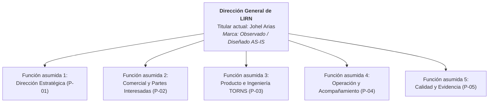
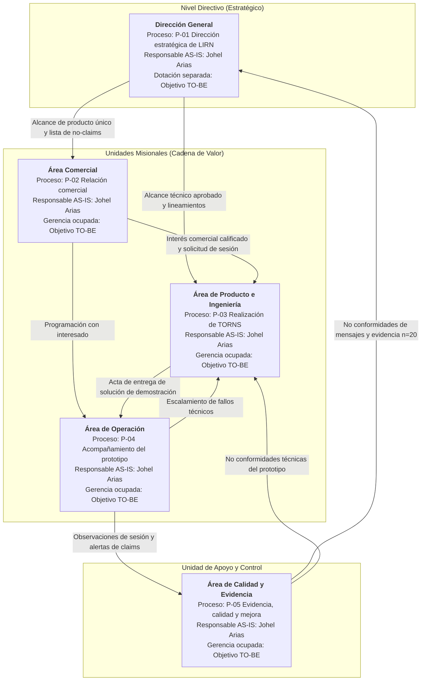

# 3. Organigrama y 7. Partes Interesadas (Stakeholders)

**Onda:** M1. Arquitectura de Negocio (Fase B de TOGAF ADM)  
**Organización:** LIRN  
**Producto único:** TORNS  
**Política de hechos:** `Observado` | `Diseñado AS-IS` | `Objetivo TO-BE` | `NO CONFIRMADO`

---

## 3. Organigrama de la Organización

Siguiendo la separación metodológica de TOGAF entre la dotación real de personal (*headcount*) y las unidades funcionales que ejecutan los procesos de negocio, la estructura organizacional de LIRN se documenta mediante dos vistas complementarias.

**Nota sobre la copia pública histórica (`Observado`):** La página pública `/torns` conserva en su banda informativa tres nombres propios correspondientes a la etapa académica inicial del proyecto. Para efectos del gobierno actual de la firma y de esta Arquitectura Empresarial, el equipo vigente de LIRN es exclusivamente **Johel Arias** (una persona). La actualización de esa banda pública se registra como brecha de alineación documental para el horizonte `Objetivo TO-BE`.

### 3.1 Vista jerárquica AS-IS (Dotación actual real)

En su estado actual (`Observado` en equipo / `Diseñado AS-IS` en estructura societaria), LIRN opera como una microempresa unipersonal encabezada por una única posición directiva ocupada. No existen gerencias intermedias con personal contratado hoy.

### 3.2 Vista funcional de Arquitectura de Negocio (Áreas, departamentos y evolución TO-BE)

Para garantizar la ejecución ordenada del mapa de procesos ISO (`P-01` a `P-05`), LIRN estructura su operación en una Dirección General y cuatro áreas funcionales subordinadas, apoyadas transversalmente por un área de Calidad. En el estado `Diseñado AS-IS`, el fundador es el responsable directo de las cinco unidades. La ocupación de estas áreas por gerencias o especialistas distintos constituye un `Objetivo TO-BE`.

### 3.3 Descripción de áreas, cargos funcionales y relaciones entre áreas

| Área / Departamento funcional | Nivel organizacional | Proceso dueño | Responsable AS-IS (`Observado`) | Rol proyectado (`Objetivo TO-BE`) | Relaciones e intercambios con otras áreas |
|---|---|---|---|---|---|
| **Dirección General** | Dirección estratégica | `P-01` | Johel Arias | Director General (CEO) | Emite hacia **Comercial** y **Producto** el acta de producto único (TORNS) y la lista de claims prohibidos. Recibe de **Calidad** las no conformidades sobre mensajes públicos y la evidencia autorizada (`n=20`). |
| **Área Comercial** | Gerencia / Departamento misional | `P-02` | Johel Arias | Líder Comercial B2B / B2G (suplente previsto en ficha: Dirección) | Recibe de **Dirección** las reglas de comunicación honesta. Captura solicitudes desde el canal público y transfiere a **Producto** y **Operación** las notas de interés calificado cuando un prospecto solicita ver el prototipo. |
| **Área de Producto e Ingeniería** | Gerencia / Departamento misional | `P-03` | Johel Arias | Líder de Producto e Ingeniería IA/Backend (suplente previsto: Operación) | Recibe de **Dirección** el alcance aprobado y de **Comercial** el interés calificado. Prepara el modelo YOLO11s (`my_model.pt`), la API FastAPI y la interfaz de despacho, y los entrega mediante acta interna a **Operación**. Recibe de **Calidad** y **Operación** reportes de fallos técnicos. |
| **Área de Operación** | Gerencia / Departamento misional | `P-04` | Johel Arias | Coordinador de Operaciones y Demostración (suplente previsto: Producto) | Recibe de **Producto** la solución de demostración verificada y de **Comercial** las solicitudes de acompañamiento. Ejecuta sesiones guiadas mostrando conteo y recomendación sin operar la red real. Escala fallos a **Producto** o desviaciones de alcance a **Calidad**. |
| **Área de Calidad y Evidencia** | Departamento de apoyo | `P-05` | Johel Arias | Analista de Calidad y Cumplimiento (suplente previsto: Dirección) | Custodia la encuesta del 17 de agosto de 2026 (`n=20`) y las notas de la entrevista al controlador SITP. Audita los mensajes públicos y las sesiones de **Operación**; abre y cierra no conformidades que obligan a acciones correctivas en **Dirección** y **Producto**. |

---

## 7. Partes Interesadas (Stakeholders)

De acuerdo con TOGAF, las partes interesadas (*stakeholders*) comprenden a toda persona, unidad interna u organización externa que afecta, es afectada o posee un interés legítimo sobre las decisiones y resultados de la arquitectura empresarial de LIRN.

### 7.1 Matriz de identificación y clasificación de partes interesadas

| ID | Parte interesada (Stakeholder) | Categoría | Relación con LIRN y TORNS | Interés principal en la arquitectura | Nivel de influencia | Marca de hecho |
|---|---|---|---|---|---|---|
| **SH-01** | **Johel Arias (Fundador y Director General)** | Interna (Dirección, Comercial, Producto, Operación y Calidad) | Único integrante actual de la firma y autor técnico del prototipo y de los procesos. | Garantizar la viabilidad técnica de TORNS, el rigor de los no-claims y la preparación hacia un primer piloto pagado. | **Alta** | `Observado` / `Diseñado AS-IS` |
| **SH-02** | **Universidad Libre y docente evaluadora del taller AE** | Externa (Academia y gobierno metodológico) | Entorno académico que evalúa el Plan de Transformación Empresarial bajo TOGAF. | Coherencia metodológica entre las arquitecturas de Negocio, Datos, Aplicaciones, Tecnología y el Roadmap, con originalidad y trazabilidad verificable. | **Alta** | `Observado` |
| **SH-03** | **Operadores concesionarios de transporte masivo (incluye rol de controlador operativo como el entrevistado del SITP)** | Externa (Segmento objetivo B2B, no clientes actuales) | Empresas que ejecutan rutas troncales o ferroviarias y sufren desajustes de frecuencia y multas operativas. | Disponer de conteo oportuno de demanda en estación y recomendaciones de despacho que reduzcan la coordinación reactiva por radio. | **Alta** (sobre requisitos de producto) / **Media** (en operación AS-IS sin contrato) | `Observado` (entrevista SITP) / `Diseñado AS-IS` (segmento) |
| **SH-04** | **Administradores y supervisores de estaciones** | Externa (Segmento objetivo B2B secundario) | Personal encargado de vigilar la saturación de plataformas (código `TP 19`). | Alertas tempranas de acumulación de pasajeros en andenes y soporte visual mediante flujo de cámaras. | **Media** | `Diseñado AS-IS` |
| **SH-05** | **Entes gestores de movilidad y sistemas ferroviarios (TransMilenio S.A. como referente público; Sistema Metro de Bogotá como segmento B2G)** | Externa (Contexto regulatorio y segmento objetivo B2G, no clientes actuales) | Entidades públicas que planifican el sistema, supervisan niveles de servicio y aplican multas operativas a concesionarios. | Cumplimiento de estándares de servicio, seguridad vial, protección de datos (Ley 1581) e interoperabilidad futura. | **Media** (en AS-IS como marco de referencia) / **Alta** (en TO-BE para pilotos B2G) | `Observado` (caso de estudio) / `Diseñado AS-IS` |
| **SH-06** | **Visitantes del sitio comercial y prospectos (leads) del formulario de contacto** | Externa (Canal comercial en `/torns#contacto`) | Decisores, operadores o evaluadores que consultan la propuesta de LIRN y dejan sus datos de contacto. | Recibir información veraz sobre el estado del prototipo, respuesta oportuna a su solicitud y protección de sus datos personales. | **Media** | `Observado` |
| **SH-07** | **Pasajeros y usuarios del transporte público masivo (incluye muestra `n=20` del 17 de agosto de 2026)** | Externa (Comunidad y beneficiarios finales indirectos) | Ciudadanos que padecen esperas prolongadas y sobrecostos cuando los vehículos pasan llenos. | Reducción de tiempos de espera en estación y mejor ajuste de frecuencias en hora pico, sin ser compradores directos del software. | **Baja** (en decisión comercial directa) / **Media** (como fuente de validación del problema) | `Observado` |
| **SH-08** | **Proveedores de plataformas e insumos técnicos (GitHub, Google, Roboflow, Ultralytics)** | Externa (Proveedores tecnológicos de base) | Plataformas que alojan el sitio público (GitHub Pages), reciben el formulario (Google Apps Script / Sheets) y proveen la base de visión (`coco-person` y YOLO11s). | Continuidad de términos de servicio, disponibilidad de APIs y cumplimiento de licencias de software y datasets. | **Media** | `Observado` |

### 7.2 Mapa de poder e interés de las partes interesadas

- **Gestionar de cerca (Influencia Alta, Interés Alto):** **SH-01 (Fundador)** y **SH-02 (Universidad Libre / Evaluación AE)** determinan las decisiones inmediatas de diseño arquitectónico y control de calidad en las ondas M1 a M5. **SH-03 (Operadores de transporte / controladores)** aporta los requerimientos funcionales críticos del dominio operativo.
- **Mantener satisfechos y alineados (Influencia Media, Interés Alto/Medio):** **SH-05 (Entes gestores y sistemas metro)**, **SH-06 (Leads del canal comercial)** y **SH-08 (Proveedores técnicos)** condicionan las restricciones legales (Ley 1581 de 2012), la disponibilidad del canal de contacto y la estabilidad tecnológica del prototipo.
- **Monitorear y conservar como evidencia (Influencia Baja/Media comercial, Interés en el problema):** **SH-04 (Administradores de estación)** y **SH-07 (Pasajeros del sistema masivo)** sustentan la justificación social y cuantitativa del problema de negocio custodiada en el proceso `P-05`.
