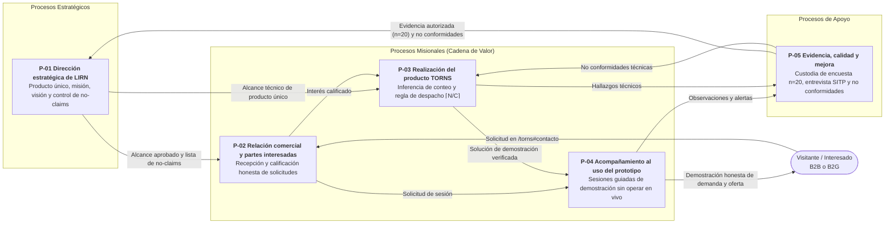
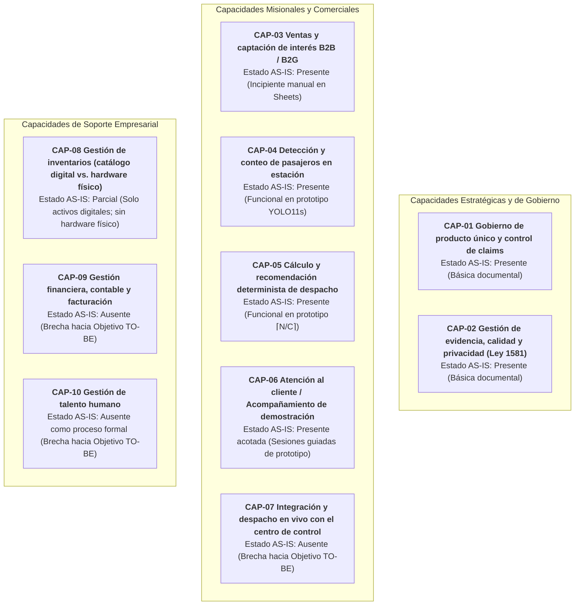

# 4. Activos de Información, 5. Mapa de Procesos (BPM) y 6. Mapa de Capacidades

**Onda:** M1. Arquitectura de Negocio (Fase B de TOGAF ADM)  
**Organización:** LIRN  
**Producto único:** TORNS  
**Política de hechos:** `Observado` | `Diseñado AS-IS` | `Objetivo TO-BE` | `NO CONFIRMADO`

---

## 4. Activos de Información

LIRN identifica y clasifica siete activos de información dentro de su arquitectura de negocio (superando el mínimo de cinco requeridos). En cumplimiento de la **Ley Estatutaria 1581 de 2012** y el Decreto 1377 de 2013 de la República de Colombia, cada activo que involucra o puede involucrar datos personales recibe una clasificación específica de privacidad y nivel de sensibilidad.

### 4.1 Criterios de clasificación aplicados

1. **Seguridad y acceso corporativo:**
   - **Público:** Información aprobada por Dirección (`P-01`) para divulgación abierta en el sitio comercial de LIRN y TORNS.
   - **Interno:** Información operativa, técnica o metodológica de uso exclusivo de la firma.
   - **Confidencial:** Información que contiene datos de terceros o prospectos comerciales y cuyo acceso requiere control estricto.
   - **Reservado:** Propiedad intelectual crítica y activos algorítmicos núcleo del producto TORNS.
2. **Clasificación de datos personales (Ley 1581 de 2012):**
   - **Dato público:** Calificado así por la ley o la Constitución (ej. nombre y rol empresarial público del representante).
   - **Dato semiprivado:** Dato que no tiene naturaleza íntima ni pública y cuyo conocimiento interesa al titular y a un sector determinado (ej. correo corporativo y organización de un prospecto B2B).
   - **Dato privado:** Dato que por su naturaleza íntima o reservada solo es relevante para el titular (ej. correo personal o mensaje individual remitido en el formulario).
   - **Dato sensible:** Aquel que afecta la intimidad del titular o incluye datos biométricos e imágenes de personas físicas captadas en video.

### 4.2 Inventario clasificado de activos de información

| ID | Activo de información | Descripción y soporte actual | Proceso custodio | Clasificación de seguridad | ¿Incluye datos personales? | Clasificación bajo Ley 1581 de 2012 y medidas de tratamiento | Marca de hecho |
|---|---|---|---|---|---|---|---|
| **AI-01** | **Registro de solicitudes y prospectos comerciales (Leads)** | Registros enviados desde el formulario en `/torns#contacto` (campos: nombre, correo electrónico, organización opcional y mensaje), recibidos vía Google Apps Script en Google Sheets cuando `VITE_CONTACT_ENDPOINT` está configurado. | `P-02 Relación comercial y partes interesadas` | **Confidencial** | **Sí** | **Datos personales privados y semiprivados.** LIRN actúa como Responsable del Tratamiento. Se utilizan exclusivamente para responder al interés comercial solicitado en `P-02`, sin cesión a terceros ni perfilamiento automatizado. | `Observado` / `Diseñado AS-IS` |
| **AI-02** | **Repositorio de evidencia de validación del problema (`n=20` y entrevista SITP)** | Resultados de la encuesta aplicada el **17 de agosto de 2026** (`n=20` respuestas válidas en Google Forms) y notas técnicas de la entrevista al controlador de SITP (documentado únicamente por su rol operativo, sin nombre personal). | `P-05 Evidencia, calidad y mejora` | **Interno** (síntesis estadística autorizada como **Público** en `/torns`) | **No** (en el activo consolidado) | **Datos estadísticos anonimizados y registro de rol.** No se conserva ni publica identificación personal de los encuestados ni el nombre del controlador entrevistado. | `Observado` |
| **AI-03** | **Fuentes de video de estaciones y métricas de conteo (`person_count`)** | Archivos de video de demostración en `tro-backend/src/app/assets/`, capturas por cámara USB o RTSP, stream MJPEG anotado y mensajes JSON por WebSocket (`video_id`, `timestamp`, `total_objects`, `person_count`, `label_counts`). | `P-03 Realización del producto TORNS` y `P-04 Acompañamiento` | **Interno / Confidencial** | **Potencialmente sí (imagen de personas)** | **Dato potencialmente sensible (imagen en video).** El prototipo aplica minimización de datos: el modelo detecta únicamente la caja de la clase `"person"` para obtener `person_count`, sin realizar reconocimiento facial, biometría identificativa ni seguimiento individual persistente. | `Observado` |
| **AI-04** | **Pesos entrenados del modelo de visión (`my_model.pt`) y dataset curado** | Archivo binario de pesos `my_model/my_model.pt` (arquitectura YOLO11s entrenada a 512px por 60 épocas; precisión 0,73, recall 0,55, mAP50 0,64) y partición de entrenamiento/validación (3.694 / 1.000 imágenes procedentes de Roboflow `coco-person` y etiquetado propio en Label Studio). | `P-03 Realización del producto TORNS` | **Reservado** | **No** (en los pesos `.pt`); **Imagen pública/curada** (en el dataset de entrenamiento) | **Sin datos personales identificables en el modelo matemático.** Los pesos contienen únicamente tensores numéricos; las imágenes de entrenamiento provienen de conjuntos públicos de detección de peatones sin vinculación a titulares identificados. | `Observado` |
| **AI-05** | **Código fuente de las cuatro superficies de software** | Repositorios y módulos de `lirn-web-main` (sitio comercial), `tro-frontend` (aplicación operativa), `tro-backend` (API FastAPI y calculadora determinista de despacho con regla `⌈N/C⌉`) y `yolo-train-routes-optimization`. | `P-03 Realización del producto TORNS` | **Interno / Reservado** | **No** | **No aplica Ley 1581 de 2012** (activo de propiedad intelectual y lógica algorítmica). | `Observado` |
| **AI-06** | **Documentación de gobierno, fichas ISO, guías BPMN y Registro de Empresa** | Actas de alcance de producto único, lista de claims prohibidos, fichas y guías `P-01` a `P-05`, diagramas BPMN publicados y `registro-empresa.md`. | `P-01 Dirección estratégica` y `P-05 Evidencia, calidad y mejora` | **Interno** (diagrama BPMN en Lucidchart publicado para evaluación) | **Sí (mínimos)** | **Dato público empresarial.** Incluye únicamente el nombre del fundador (**Johel Arias**) en su calidad de responsable organizacional y autor del proyecto. | `Observado` |
| **AI-07** | **Registros de facturación, contabilidad y contratos comerciales** | Libros contables, facturación electrónica DIAN, contratos B2B/B2G con operadores y acuerdos de nivel de servicio (SLA). | Dirección / Gestión Financiera futura | **No existe hoy (Brecha AS-IS)** | **No existe hoy** | **Brecha declarada.** Al no existir clientes ni pilotos firmados hoy, LIRN no genera facturación ni contratos. Se proyecta como activo **Confidencial** con datos semiprivados de representantes legales en el `Objetivo TO-BE`. | `Observado` (ausencia) / `Brecha` |

---

## 5. Mapa de Procesos (Modelados en BPM)

El mapa de procesos de LIRN fue aprobado el 13 de septiembre de 2026 (`Observado`) bajo estructura ISO y notación BPMN 2.0. Articula un proceso estratégico, tres procesos misionales que recorren la cadena de valor desde el interés comercial hasta el acompañamiento del prototipo, y un proceso de apoyo dedicado a la custodia de evidencia y control de calidad.

**Entregable publicado de referencia:** El modelado completo en la nube se encuentra disponible en el tablero de [procesos de empresa LIRN en Lucidchart](https://lucid.app/lucidchart/4bc5f4f1-c350-40a4-b752-63eb17d2cb77/edit).

### 5.1 Vista general de interacción de procesos

### 5.2 Catálogo detallado de procesos modelados en BPM

| Código | Nombre del proceso | Tipo de proceso | Dueño funcional (AS-IS: Johel Arias) | Objetivo del proceso | Entradas clave | Salidas clave | Indicadores definidos en ficha | Documentación y modelo BPM |
|---|---|---|---|---|---|---|---|---|
| **P-01** | **Dirección estratégica de LIRN** | **Estratégico** | Dirección | Mantener un solo producto (TORNS), custodiar la misión y la visión aprobadas y controlar que la comunicación pública no incurra en claims prohibidos. | Misión y visión aprobadas; mensajes públicos vigentes; evidencia `n=20`; no conformidades de `P-05`. | Alcance de producto aprobado (`P-02`, `P-03`); lista de claims prohibidos; decisión de un solo producto. | 1) Un solo producto ofertado (meta: Sí). 2) Claims prohibidos detectados (meta: 0 abiertos). 3) Revisiones de dirección (`NO CONFIRMADO` calendario fijo). | [Ficha P-01](../../procesos/P-01-ficha.md) · [Guía BPMN P-01](../../procesos/P-01-guia-bpmn.md) |
| **P-02** | **Relación comercial y partes interesadas** | **Misional** | Comercial | Recibir y calificar interés comercial por TORNS a través del canal público de contacto de LIRN, sin fingir cliente ni piloto firmado. | Solicitud de contacto (nombre, correo, organización opcional, mensaje); alcance y no-claims de `P-01`; estado del canal. | Solicitud registrada; comunicación de fallo honesto si el canal no está disponible; respuesta alineada al alcance; interés calificado hacia `P-03`. | 1) Solicitudes recibidas (`NO CONFIRMADO` meta). 2) Solicitudes rechazadas por canal no disponible. 3) Respuestas emitidas. | [Ficha P-02](../../procesos/P-02-ficha.md) · [Guía BPMN P-02](../../procesos/P-02-guia-bpmn.md) |
| **P-03** | **Realización del producto TORNS** | **Misional** | Producto | Entregar la solución de producto TORNS que mide demanda en estación y propone oferta al centro de control como prototipo aplicado. | Alcance de `P-01`; interés calificado de `P-02`; fuente de video de estación; no conformidades técnicas de `P-05`. | Solución de demostración lista para `P-04`; métricas de demanda en estación; oferta propuesta al centro de control; no conformidad abierta si falla. | 1) Solución de demostración verificada (meta: Sí antes de entrega). 2) Fuentes de medición disponibles. 3) Oferta propuesta disponible (meta: Sí). | [Ficha P-03](../../procesos/P-03-ficha.md) · [Guía BPMN P-03](../../procesos/P-03-guia-bpmn.md) |
| **P-04** | **Acompañamiento al uso del prototipo** | **Misional** | Operación | Acompañar el uso del prototipo TORNS mostrando demanda medida y oferta propuesta, sin afirmar operación en vivo del operador. | Solución de demostración entregada por `P-03`; solicitud de sesión (`P-02` o interna); métricas y oferta del prototipo. | Informe de acompañamiento con observaciones; escalamiento a `P-03` (fallo técnico) o a `P-05` (claim indebido). | 1) Sesiones realizadas (`NO CONFIRMADO` meta). 2) Solución disponible al inicio de sesión (meta: Sí). 3) Escalamientos por claim indebido (meta: 0). | [Ficha P-04](../../procesos/P-04-ficha.md) · [Guía BPMN P-04](../../procesos/P-04-guia-bpmn.md) |
| **P-05** | **Evidencia, calidad y mejora** | **Apoyo** | Calidad | Conservar la evidencia autorizada (`n=20` y entrevista SITP) y gestionar no conformidades para alimentar el ciclo PHVA de `P-01` y `P-03`. | Encuesta 17 de agosto de 2026 (`n=20`); entrevista a controlador SITP; hallazgos y observaciones de `P-01`, `P-03` y `P-04`. | Evidencia vigente publicada bajo leyenda de investigación; no conformidades abiertas o cerradas; lecciones de mejora hacia `P-01` y `P-03`. | 1) Evidencia `n=20` presente con fecha 17 de agosto de 2026 (meta: Sí). 2) No conformidades abiertas. 3) Claims de impacto inventados (meta: 0). | [Ficha P-05](../../procesos/P-05-ficha.md) · [Guía BPMN P-05](../../procesos/P-05-guia-bpmn.md) |

### 5.3 Diagramas BPMN publicados de los procesos (`Observado`)

#### Proceso Estratégico: `P-01 Dirección estratégica de LIRN`

#### Proceso Misional: `P-02 Relación comercial y partes interesadas`

#### Proceso Misional: `P-03 Realización del producto TORNS`

#### Proceso Misional: `P-04 Acompañamiento al uso del prototipo`

#### Proceso de Apoyo: `P-05 Evidencia, calidad y mejora`

---

## 6. Mapa de Capacidades de Negocio (Business Capabilities)

En TOGAF, una capacidad de negocio (*Business Capability*) define **qué** sabe hacer la organización para ejecutar su estrategia, con independencia de quién lo haga o con qué herramienta se implemente. El mapa de capacidades de LIRN integra las cinco capacidades empresariales estándar exigidas en la guía del taller (Ventas, Atención al cliente, Gestión financiera, Gestión de inventarios y Gestión de talento humano) junto con las capacidades nucleares de ingeniería de TORNS, distinguiendo con rigor qué está presente hoy (`Observado` / `Diseñado AS-IS`) y qué constituye una **Brecha** hacia el `Objetivo TO-BE`.

### 6.1 Diagrama del mapa de capacidades por nivel y estado de madurez

### 6.2 Catálogo y evaluación de capacidades de negocio

| Código | Capacidad de negocio (incluye las requeridas por el taller) | Nivel / Categoría | Estado en el AS-IS | Proceso asociado | Cómo opera hoy o por qué es una brecha | Evolución requerida en `Objetivo TO-BE` | Marca de hecho |
|---|---|---|---|---|---|---|---|
| **CAP-01** | **Dirección de producto único y gobierno de marca** | Estratégica | **Presente (Básica)** | `P-01` | Mantiene la separación LIRN (firma) / TORNS (producto), custodia misión y visión y aplica la lista de claims prohibidos. | Formalizar gobierno societario S.A.S. y alinear la copia pública heredada de tres nombres con el equipo real. | `Observado` |
| **CAP-02** | **Gestión de evidencia, calidad y cumplimiento normativo** | Apoyo | **Presente (Básica)** | `P-05` | Custodia la encuesta `n=20` del 17 de agosto de 2026 y la entrevista SITP; gestiona no conformidades de forma documental. | Implementar política registrada de tratamiento de datos (Ley 1581) y trazabilidad sistematizada de no conformidades. | `Observado` |
| **CAP-03** | **Ventas (Captación y calificación de interés comercial B2B/B2G)** | Misional | **Presente (Incipiente)** | `P-02` | Recibe prospectos mediante el formulario público de `/torns#contacto` conectado por Apps Script a Google Sheets y realiza calificación manual. No hay cierre de contratos hoy. | Incorporar un CRM ligero, embudo de seguimiento de propuestas B2B/B2G y gestión contractual para el primer piloto pagado. | `Observado` / `Diseñado AS-IS` |
| **CAP-04** | **Detección y conteo de demanda en estación por visión artificial** | Misional (Núcleo técnico) | **Presente (Funcional en prototipo)** | `P-03` | Ejecuta inferencia con `my_model.pt` (YOLO11s, umbral 0,5) sobre flujos OpenCV y entrega `person_count` por WebSocket y video MJPEG. | Evaluar el modelo en condiciones reales de estación, mejorar el recall (`0,55` actual) y desacoplar la inferencia de la apertura manual del stream. | `Observado` |
| **CAP-05** | **Recomendación de oferta y cálculo de despacho** | Misional (Núcleo técnico) | **Presente (Funcional en prototipo)** | `P-03` | Aplica la regla determinista `⌈N/C⌉` sobre capacidades configuradas de 5, 10 y 15 pasajeros, seleccionando el vehículo más pequeño suficiente. | Parametrizar capacidades reales de flotas troncales o ferroviarias del operador y persistir el historial de recomendaciones. | `Observado` |
| **CAP-06** | **Atención al cliente (Acompañamiento al interesado en el prototipo)** | Misional | **Presente (Acotada a precomercial)** | `P-04` | Al no existir clientes firmados, la capacidad de atención al cliente se ejerce como acompañamiento guiado a prospectos y evaluadores durante sesiones de demostración del prototipo. | Establecer soporte técnico B2B, acuerdos de nivel de servicio (SLA) y capacitación a operadores de centro de control durante el piloto. | `Observado` / `Diseñado AS-IS` |
| **CAP-07** | **Integración y despacho en vivo sobre la red del operador** | Misional (Futura) | **Ausente (Brecha AS-IS)** | Fuera de `P-03` / `P-04` hoy | El prototipo no se conecta al sistema SCADA, SAE ni a las consolas de radio de ningún operador de transporte. | Desarrollar adaptadores de interoperabilidad (API segura con autenticación de operador) para alimentar tableros de control en un piloto real. | `Observado` (ausencia) / `Objetivo TO-BE` |
| **CAP-08** | **Gestión de inventarios (Catálogo de fuentes digitales y modelos)** | Apoyo / Operativa | **Parcial (Digital presente; físico ausente)** | `P-03` | LIRN es una firma de software puro: no fabrica, compra ni almacena inventario físico de cámaras en campo. Solo administra el catálogo digital de videos de estación (`/api/v1/videos`), la flota lógica (capacidades 5, 10 y 15) y el versionado de pesos `.pt`. | Mantener un registro formal de activos de software, versiones de modelos entrenados y fuentes RTSP autorizadas por estación en piloto. | `Observado` / `Brecha` (en inventario físico) |
| **CAP-09** | **Gestión financiera, contable y facturación** | Apoyo empresarial | **Ausente (Brecha AS-IS)** | Brecha organizacional | La firma no emite facturas, no registra ingresos operativos ni dispone de software contable o ERP porque no tiene contratos vigentes. | Formalizar NIT y matrícula mercantil S.A.S., habilitar facturación electrónica DIAN y control presupuestal de costos cloud y licenciamiento. | `Observado` (ausencia) / `Brecha` |
| **CAP-10** | **Gestión de talento humano** | Apoyo empresarial | **Ausente como proceso formal (Brecha AS-IS)** | Brecha organizacional | El equipo actual es una sola persona (**Johel Arias**), quien concentra las cinco áreas funcionales sin nómina ni procesos de selección activos. | Definir perfiles de contratación o vinculación por servicios para cubrir las áreas de Comercial, Ingeniería, Operación y Calidad cuando inicie el escalamiento TO-BE. | `Observado` (ausencia) / `Brecha` |
