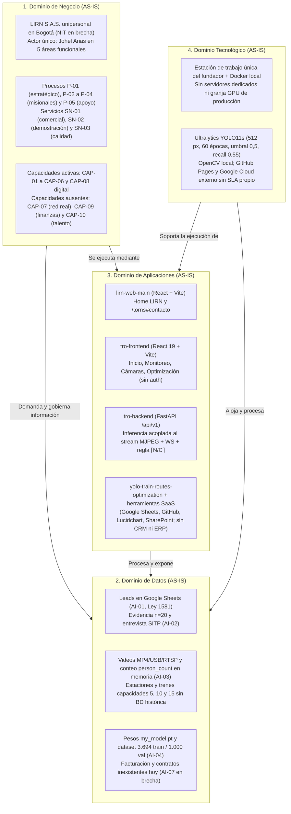

# 8. Documento: Arquitectura de Negocio (AS-IS)

**Onda:** M1. Arquitectura de Negocio (Fase B de TOGAF ADM)  
**Organización:** LIRN  
**Producto único:** TORNS  
**Política de hechos:** `Observado` | `Diseñado AS-IS` | `Objetivo TO-BE` | `NO CONFIRMADO`

---

## 1. Propósito del documento AS-IS

El documento de **Arquitectura de Negocio (AS-IS)** representa el estado actual e integral de **LIRN** desde las cuatro perspectivas o dominios de la Arquitectura Empresarial bajo TOGAF: **Negocio, Datos, Aplicaciones y Tecnología**. Su propósito no es presentar un escenario idealizado ni relegar las restricciones operativas a una nota marginal, sino describir con exactitud cómo opera hoy la firma en la realidad: qué estructura y procesos ejecuta, qué capacidades existen o faltan, qué información utiliza y cómo se almacena, qué sistemas soportan la operación diaria, sobre qué infraestructura tecnológica descansan y cómo la articulación de estos cuatro dominios habilita el cumplimiento de la misión institucional y genera valor para las partes interesadas.

---

## 2. Dominio de Arquitectura de Negocio (Estado actual AS-IS)

El dominio de negocio define cómo se organiza LIRN hoy, qué procesos ejecuta, qué servicios entrega, qué capacidades tiene operativas y dónde se sitúan sus fronteras reales:

- **Estructura organizacional y gobierno real (`Observado` / `Diseñado AS-IS`):** LIRN opera en Bogotá D.C. bajo el marco de una Sociedad por Acciones Simplificada (S.A.S.) unipersonal cuya formalización registral (NIT y matrícula mercantil ante la Cámara de Comercio de Bogotá y la DIAN) aún no se ha ejecutado y constituye una condición real del presente. La planta física está conformada por una única persona (**Johel Arias**), quien asume la Dirección General y ejecuta directamente las cinco áreas funcionales de la firma: Dirección (`P-01`), Comercial (`P-02`), Producto e Ingeniería (`P-03`), Operación (`P-04`) y Calidad (`P-05`). No existen gerencias intermedias ocupadas ni nómina administrativa (`Objetivo TO-BE`). En la página pública `/torns` subsiste una banda informativa con tres nombres heredados de la fase académica inicial, lo cual representa una desalineación documental del AS-IS frente al equipo real de una sola persona.
- **Ejecución actual de los procesos de negocio (`Observado`):**
  - *Gobierno estratégico (`P-01`):* Mantiene a TORNS como único producto, custodia la misión y la visión aprobadas y aplica la regla de control de claims (prohibición de afirmar clientes, contratos, pilotos firmados, alianzas o métricas de ahorro comercial no probadas).
  - *Ciclo comercial (`P-02`):* Recibe solicitudes de contacto originadas en `/torns#contacto`, verifica manualmente que los datos estén completos y responde al interesado dentro del alcance del prototipo. **Lead no es cliente:** hoy la firma registra cero clientes firmados y cero ingresos por ventas. Transmilenio opera exclusivamente como caso de estudio y referente del problema público.
  - *Realización y acompañamiento del producto (`P-03` y `P-04`):* Prepara el entorno del prototipo TORNS y conduce sesiones guiadas de demostración donde un usuario con rol de centro de control observa el conteo de pasajeros en estación y la recomendación de despacho, sin intervenir la operación en vivo ni la flota real de ningún concesionario.
  - *Aseguramiento de evidencia y calidad (`P-05`):* Custodia los dos respaldos empíricos de la firma (la encuesta del 17 de agosto de 2026 con `n=20` y la entrevista al controlador de SITP documentada por rol) y gestiona de forma documental las no conformidades técnicas o de mensaje público.
- **Servicios de negocio que entrega hoy la organización (`Observado` / `Diseñado AS-IS`):**
  1. **`SN-01` Información institucional y recepción de interés comercial (`P-02`):** Exposición pública de la propuesta de valor de LIRN y TORNS y captura honesta de prospectos B2B y B2G, sin pasarela de pagos ni demostración simulada.
  2. **`SN-02` Demostración guiada de medición de demanda y recomendación de oferta (`P-03` y `P-04`):** Ejecución en tiempo real del ciclo estación hacia cámara, conteo `person_count` y cálculo determinista de unidades \(\lceil N / C \rceil\) sobre capacidades de referencia (5, 10 y 15 pasajeros).
  3. **`SN-03` Verificación de evidencia y control de no-claims (`P-01` y `P-05`):** Control interno que asegura que toda cifra publicada provenga de la encuesta `n=20`, de la entrevista SITP o de las métricas reales del modelo entrenado.
- **Estado real de las capacidades de negocio (`Observado`):** La operación actual sostiene capacidades funcionales de gobierno de marca (`CAP-01`), custodia documental de evidencia y privacidad (`CAP-02`), captación manual de interés comercial (`CAP-03`), detección de personas en video (`CAP-04`), cálculo determinista de despacho (`CAP-05`), acompañamiento en sesiones de demostración (`CAP-06`) y gestión de catálogo digital de fuentes y modelos (`CAP-08` digital). Al mismo tiempo, el AS-IS de negocio carece hoy de cuatro capacidades empresariales: no existe integración ni despacho en vivo sobre la red de un operador (`CAP-07`), no hay inventario físico de cámaras ni hardware en estaciones (`CAP-08` físico), no opera un proceso de gestión financiera, contabilidad ni facturación electrónica (`CAP-09`), y no existe gestión formal de talento humano ni nómina (`CAP-10`).

---

## 3. Dominio de Arquitectura de Datos (Estado actual AS-IS)

El dominio de datos describe qué información existe hoy en LIRN, cómo se estructura, cómo circula entre los procesos y bajo qué condiciones reales de persistencia y privacidad opera:

- **Datos comerciales y de partes interesadas (`AI-01` y `AI-02`, `Observado`):**
  - *Prospectos comerciales (`AI-01`):* Cada solicitud enviada en `/torns#contacto` contiene nombre, correo electrónico, organización opcional y mensaje. Son datos personales privados y semiprivados regulados por la Ley Estatutaria 1581 de 2012. En el AS-IS se almacenan como filas en una hoja de cálculo de Google Sheets sin modelo relacional de seguimiento comercial, sin historial automatizado de interacciones y sin un aviso de privacidad formalizado aún como registro auditable dentro del flujo web.
  - *Evidencia de validación (`AI-02`):* Comprende las 20 respuestas válidas de la encuesta del 17 de agosto de 2026 en Google Forms y las notas de la entrevista al controlador operativo del SITP (donde se documentan los códigos radiales `TP 19`, `TQ 04`, `TP 69`, `TP 70`, `TP 59`, `TP 56` y `TP 29` sin registrar el nombre propio del entrevistado). Se conservan como archivos documentales estáticos custodiados por `P-05`.
- **Datos operativos de estación, conteo y despacho (`AI-03`, `Observado`):**
  - *Fuentes de video y fotogramas:* El sistema consume archivos de video pregrabados alojados localmente en el backend o flujos de cámara USB/RTSP. Aunque la imagen de personas en video es un dato potencialmente sensible bajo la Ley 1581 de 2012, el AS-IS aplica minimización técnica: procesa los fotogramas en memoria para detectar la clase `person` y no almacena rostros ni identificadores biométricos.
  - *Métricas de detección en tiempo real:* Por cada fotograma procesado, el backend construye un objeto JSON con cinco atributos: `video_id`, `timestamp`, `total_objects`, `person_count` y `label_counts`.
  - *Datos de estaciones, flota y despacho:* El backend mantiene el catálogo de estaciones, su carga puntual de pasajeros \(N\) alimentada por `person_count` y el catálogo de modelos de tren con capacidades fijas de 5, 10 y 15 pasajeros, sobre los cuales genera la recomendación de despacho.
  - *Condición real de persistencia en el AS-IS:* **No existe base de datos transaccional ni histórica en operación.** Los conteos `person_count`, el estado de ocupación de las estaciones y los planes de despacho recomendados viven únicamente en la memoria volátil del proceso de ejecución del backend mientras dura la sesión. Al reiniciar el servicio o cerrar el flujo de video, el historial operativo se pierde, por lo que hoy no es posible consultar series de tiempo históricas por estación ni auditar despachos pasados.
- **Activos algorítmicos, código y datos empresariales ausentes (`AI-04` a `AI-07`, `Observado`):**
  - Los pesos entrenados `my_model.pt` y el conjunto de datos curado (3.694 imágenes de entrenamiento y 1.000 de validación procedentes de Roboflow `coco-person` y etiquetado propio en Label Studio) se almacenan como archivos en el sistema de ficheros y repositorio del proyecto (`AI-04`).
  - El código fuente de las cuatro superficies (`AI-05`) y las fichas, guías e imágenes BPMN de los procesos `P-01` a `P-05` (`AI-06`) residen en archivos de repositorio y documentos en la nube.
  - **Ausencia de datos financieros y contractuales (`AI-07`):** En coherencia con la ausencia de clientes firmados y de NIT activo, en el AS-IS de datos no existen tablas ni registros de facturación, cuentas por cobrar, contratos comerciales ni acuerdos de nivel de servicio (SLA).

---

## 4. Dominio de Arquitectura de Aplicaciones (Estado actual AS-IS)

El dominio de aplicaciones representa el comportamiento y las interacciones reales de los sistemas de software propios y de terceros que hoy soportan a LIRN y TORNS. La plataforma actual no es una malla de microservicios distribuidos, sino cuatro superficies de software en el repositorio apoyadas por servicios SaaS puntuales:

- **Superficie 1. Sitio comercial institucional (`lirn-web-main`, `Observado`):** Aplicación web estática construida en React y Vite. Publica la portada corporativa de LIRN y la página de producto `/torns` con la narrativa del problema, la evidencia autorizada y el formulario de contacto. No ejecuta lógica operativa del sistema de transporte. Cuando la variable `VITE_CONTACT_ENDPOINT` está definida, envía los datos del formulario mediante una petición HTTP hacia un script de Google Apps Script que inserta el registro en Google Sheets; cuando el endpoint no está disponible, muestra un aviso honesto de fallo sin fingir recepción.
- **Superficie 2. Aplicación operativa de centro de control (`tro-frontend`, `Observado`):** Aplicación de página única (SPA) desarrollada en React 19 y Vite, estructurada en cuatro vistas operativas: Inicio, Monitoreo, Cámaras y Optimización. Consume el video anotado renderizándolo directamente como etiqueta `` conectada al endpoint MJPEG del backend, recibe métricas en vivo por WebSocket y consulta o solicita recomendaciones de despacho por REST. En su estado AS-IS real, **carece de módulo de autenticación, control de sesiones y perfiles de usuario (RBAC)**, por lo que cualquier operador con acceso a la red local de demostración accede a todas las vistas sin credenciales.
- **Superficie 3. API de backend, visión y despacho (`tro-backend`, `Observado`):** Servicio monolítico modular construido en Python (versión 3.11 o superior) sobre FastAPI, bajo el prefijo `/api/v1` con tres enrutadores (`/health`, `/videos` y `/routing`). Concentra tres responsabilidades técnicas:
  1. Lee la fuente de video con OpenCV y ejecuta inferencia con Ultralytics sobre `my_model.pt` en `GET /api/v1/videos/{video_id}/stream`, devolviendo un stream HTTP `multipart/x-mixed-replace` (MJPEG) con las cajas dibujadas.
  2. Publica en `WS /api/v1/videos/ws/{video_id}/detections` el conteo `person_count` y las métricas por fotograma.
  3. Actualiza la demanda de la estación a partir del conteo del stream y ejecuta en `GET /api/v1/routing/stations/status` y `POST /api/v1/routing/dispatch` la regla determinista que elige el vehículo más pequeño suficiente (capacidades 5, 10 y 15) y calcula \(\lceil N / C \rceil\).
  - *Acoplamiento arquitectónico real del AS-IS:* **La inferencia y la actualización de demanda están acopladas al consumo visual del stream MJPEG.** Si ningún navegador mantiene abierta la ruta `GET /api/v1/videos/{video_id}/stream`, el backend no ejecuta inferencia en segundo plano ni actualiza automáticamente la carga de las estaciones. Además, el servicio no cuenta hoy con una suite de pruebas automatizadas de backend ni con conectores hacia sistemas externos de despacho (SAE o SCADA) de un operador real.
- **Superficie 4. Entorno de entrenamiento de visión (`yolo-train-routes-optimization`, `Observado`):** Conjunto de notebooks, configuración de dataset y scripts de entrenamiento sobre Ultralytics YOLO11s que produce el archivo de pesos `my_model/my_model.pt`. Opera como un componente fuera de línea (*offline*): el modelo entrenado se copia manualmente como artefacto estático hacia el backend, sin un pipeline automatizado de reentrenamiento o despliegue continuo de modelos (MLOps).
- **Aplicaciones de soporte y vacíos aplicativos en el AS-IS (`Observado`):** La operación se apoya en Google Sheets y Google Apps Script (como receptor elemental de prospectos), GitHub (control de versiones), Lucidchart (modelado BPMN de `P-01` a `P-05`), SharePoint y correo electrónico. En el estado actual **no existen sistemas CRM, ERP, software de facturación electrónica ni herramientas ITSM de mesa de ayuda**, por lo que Google Sheets asume de forma manual e improvisada el rol de registro comercial. Asimismo, en el código fuente subsisten nombres técnicos de carpetas e identificadores heredados (`tro-frontend`, `tro-backend`) que difieren de la identidad vigente LIRN y TORNS.

---

## 5. Dominio de Arquitectura Tecnológica (Estado actual AS-IS)

El dominio tecnológico describe la infraestructura física, de virtualización, de red, de almacenamiento y de cómputo sobre la cual corren hoy las aplicaciones y los datos de LIRN:

- **Infraestructura de cómputo y ejecución operativa (`Observado`):** Toda la ejecución activa del producto TORNS (`tro-frontend`, `tro-backend` e inferencia del modelo `my_model.pt`) reside en **una única estación de trabajo local perteneciente al fundador (Johel Arias)**, orquestada mediante contenedores Docker locales y entorno de desarrollo local. No existen hoy servidores dedicados en centro de datos, clústeres en la nube ni instancias con GPU de producción para el backend.
- **Procesamiento de video e inferencia de inteligencia artificial (`Observado`):** La captura de video se realiza con OpenCV leyendo archivos locales MP4 en `tro-backend/src/app/assets/` o dispositivos locales USB/RTSP conectados al equipo de demostración. No existen cámaras físicas instaladas en estaciones de transporte público ni enlaces de red dedicados hacia patios o troncales. El modelo `my_model.pt` (YOLO11s entrenado a 512 píxeles por 60 épocas con umbral de confianza de 0,5) alcanza en validación una precisión de `0,73`, un `mAP50` de `0,64` y un **recall de `0,55`**. En la operación tecnológica real del AS-IS, ese recall implica que el sistema tiende a subcontar pasajeros cuando existen oclusiones o alta densidad en el encuadre, y no ha sido sometido aún a evaluación de estrés en condiciones de iluminación y ángulo de una estación real.
- **Servicios en nube, red y dependencias externas (`Observado`):** El único componente desplegado en nube pública es el sitio comercial estático (`lirn-web-main`), alojado en **GitHub Pages**, junto con el webhook de **Google Apps Script y Google Sheets** que recibe el formulario de contacto y los tableros documentales en **Lucidchart** y **SharePoint**. La comunicación entre `tro-frontend` y `tro-backend` ocurre por HTTP (REST y stream MJPEG) y WebSocket sobre red local, sin terminación TLS/HTTPS dedicada para entornos productivos de misión crítica ni cortafuegos de aplicación (WAF).
- **Resiliencia, respaldo y continuidad tecnológica en el AS-IS (`Observado`):** La infraestructura actual presenta una concentración total de riesgo operativo (*single point of failure*) en la estación de trabajo y en la disponibilidad de una sola persona. Aunque el código fuente está versionado en Git, **no existe una política formal ni automatizada de copias de seguridad (backups)** para los datos de contacto en Google Sheets, los videos de prueba o los pesos entrenados, ni existe separación física de entornos entre laboratorio de desarrollo y consola de demostración comercial.

---

## 6. Síntesis integrada de los cuatro dominios en la Línea Base (AS-IS)

| Dominio TOGAF | Estado operativo real hoy (Línea base AS-IS) | Procesos y capacidades que soporta | Cómo habilita hoy la misión, la visión y los objetivos estratégicos |
|---|---|---|---|
| **1. Negocio** | S.A.S. unipersonal en Bogotá con NIT y matrícula en brecha. Un único actor (**Johel Arias**) ejecuta las 5 áreas funcionales y los procesos `P-01` a `P-05`. Cero clientes y cero contratos firmados; Transmilenio como caso de estudio. Tres servicios activos (`SN-01`, `SN-02`, `SN-03`). Capacidades `CAP-01` a `CAP-06` operativas a escala precomercial; `CAP-07`, `CAP-09` y `CAP-10` ausentes. | `P-01` a `P-05` · `CAP-01` a `CAP-06` y `CAP-08` (digital) | Asegura el gobierno de un único producto (TORNS), mantiene un canal comercial honesto sin claims falsos (**OE-02**, **OE-03**) y conduce demostraciones guiadas del ciclo demanda hacia oferta (**OE-01**, **OE-04**), dejando trazada la ruta hacia el primer piloto pagado (**OE-05**). |
| **2. Datos** | Siete activos identificados (`AI-01` a `AI-07`): leads con datos personales (Ley 1581) en Google Sheets; evidencia estática `n=20` (17 de agosto de 2026) y entrevista SITP; conteos `person_count`, carga de estación y despachos **en memoria volátil sin base de datos histórica**; capacidades fijas de tren (5, 10 y 15); pesos `my_model.pt` y dataset (3.694 / 1.000); facturación y contratos inexistentes hoy. | `P-02`, `P-03`, `P-04`, `P-05` · `CAP-02`, `CAP-03`, `CAP-04`, `CAP-05`, `CAP-08` | Permite sustentar con evidencia empírica el problema público en Bogotá, registrar el interés de prospectos B2B/B2G y transformar el número de pasajeros detectados ahora en un cálculo objetivo de unidades \(\lceil N / C \rceil\). |
| **3. Aplicaciones** | Cuatro superficies propias: `lirn-web-main` (sitio comercial React + Vite), `tro-frontend` (consola React 19 con 4 vistas, **sin autenticación de operador**), `tro-backend` (API FastAPI `/api/v1` donde **la inferencia está acoplada a abrir el stream MJPEG**, WebSocket de métricas y regla determinista de despacho) y `yolo-train-routes-optimization` (entrenamiento offline). Apoyadas por Google Sheets (usado como registro comercial por ausencia de CRM y ERP), GitHub, Lucidchart y SharePoint. | `P-01`, `P-02`, `P-03`, `P-04`, `P-05` · `CAP-03`, `CAP-04`, `CAP-05`, `CAP-06` | Materializa la separación entre vitrina institucional (LIRN vende) y producto operativo (TORNS mide y recomienda), entregando al usuario de centro de control un flujo funcional de extremo a extremo en entorno de demostración. |
| **4. Tecnología** | Ejecución concentrada en la **estación de trabajo local del fundador** con contenedores Docker locales, OpenCV sobre videos locales o cámara USB/RTSP y modelo YOLO11s (`my_model.pt`, umbral 0,5, precisión 0,73, **recall 0,55**, mAP50 0,64). Sitio estático en GitHub Pages. Sin servidores ni GPU de producción en nube, sin cámaras instaladas en estaciones reales y sin política automatizada de respaldo. | `P-02`, `P-03`, `P-04` · `CAP-03`, `CAP-04`, `CAP-05` | Viabiliza la operación del prototipo aplicado y la presencia web pública a costo de infraestructura cercano a cero, coherente con una microempresa unipersonal sin facturación activa, y provee la línea base exacta sobre la cual se diseñarán las ondas M2, M3, M4 y M5. |

## 7. Generación de valor para las partes interesadas desde el AS-IS

1. **Para los operadores concesionarios y el rol de controlador operativo (`SH-03`) y administradores de estación (`SH-04`):** El AS-IS demuestra con software funcional cómo pasar de reportes radiales manuales y reactivos (`TP 19`, `TQ 04`, `TP 29`) a una medición visual automatizada (`person_count`) conectada con una regla matemática de asignación (\(\lceil N / C \rceil\)).
2. **Para los entes gestores (`SH-05`), prospectos del canal comercial (`SH-06`) y pasajeros (`SH-07`):** Presenta una propuesta respaldada por evidencia ciudadana real (`n=20`) y acotada por el cumplimiento de la Ley 1581 de 2012 y la minimización de datos en video (conteo de personas sin biometría identificativa).
3. **Para la Dirección de LIRN (`SH-01`) y la evaluación académica de Arquitectura Empresarial (`SH-02`):** Entrega un diagnóstico AS-IS íntegro y verificable en los cuatro dominios TOGAF, donde la realidad técnica y organizacional actual queda descrita sin omisiones y sirve como cimiento directo para la Arquitectura de Datos (Punto 2), Aplicaciones (Punto 3), Tecnología (Punto 4) y el Roadmap de Transformación (Punto 5).
