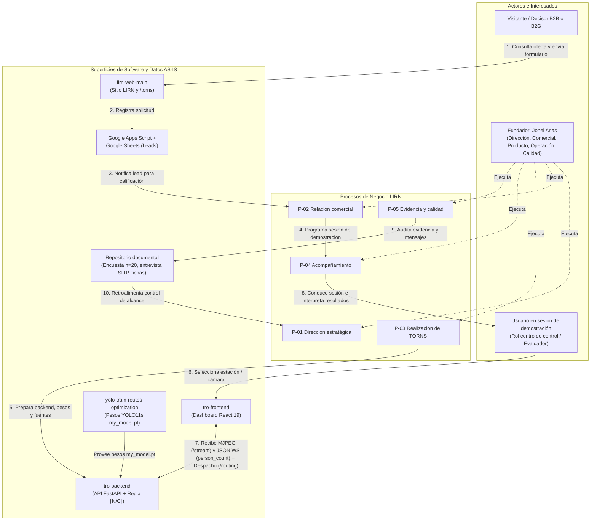

# 8. Documento: Arquitectura de Negocio (AS-IS)

**Onda:** M1. Arquitectura de Negocio (Fase B de TOGAF ADM)  
**Organización:** LIRN  
**Producto único:** TORNS  
**Política de hechos:** `Observado` | `Diseñado AS-IS` | `Objetivo TO-BE` | `NO CONFIRMADO`

---

## 1. Propósito y alcance del documento

El presente documento establece la **Arquitectura de Negocio de Línea Base (AS-IS)** de **LIRN**. Su objetivo es describir de manera integral cómo opera hoy la organización, articulando su estructura societaria y funcional, sus procesos de negocio, los servicios que presta alrededor de su único producto (**TORNS**), las capacidades habilitadas, los actores internos y externos involucrados y los flujos de información que recorren la firma.

Asimismo, identifica las aplicaciones, los activos de datos y la infraestructura tecnológica que soportan la operación diaria actual, explicando cómo estos elementos permiten cumplir la misión, avanzar hacia la visión y sostener los cinco objetivos estratégicos sin incurrir en afirmaciones de operación comercial o pilotos inexistentes.

---

## 2. Operación actual del negocio (Perspectiva de Negocio AS-IS)

### 2.1 Estructura organizacional y modelo de gobierno

LIRN opera bajo el marco de una Sociedad por Acciones Simplificada (S.A.S.) domiciliada en Bogotá D.C., Colombia, configurada como una microempresa unipersonal (`Diseñado AS-IS`, con formalización de NIT y matrícula mercantil identificada como brecha inicial). El equipo actual está integrado por una sola persona: **Johel Arias** (`Observado`).

Para que la operación empresarial sea ordenada y auditable, la Dirección General organiza el trabajo en cinco áreas funcionales que corresponden exactamente a los cinco procesos del sistema de gestión de la firma (`Observado` / `Diseñado AS-IS`):

1. **Dirección (`P-01`):** Fija el rumbo estratégico, preserva la regla de producto único (TORNS) y prohíbe cualquier afirmación pública de clientes, contratos, pilotos firmados o métricas de impacto comercial no verificadas.
2. **Comercial (`P-02`):** Gestiona la relación con partes interesadas que llegan por el canal digital público, calificando su interés de forma manual y transparente.
3. **Producto e Ingeniería (`P-03`):** Construye, entrena, mantiene y verifica el prototipo funcional TORNS (visión por computadora y cálculo determinista de oferta).
4. **Operación (`P-04`):** Conduce las sesiones de acompañamiento y demostración del prototipo ante interesados o evaluadores, asegurando que los resultados se interpreten como medición de demostración y no como despacho en vivo sobre la red de un operador.
5. **Calidad (`P-05`):** Custodia la evidencia empírica del problema de negocio (encuesta del 17 de agosto de 2026 con `n=20` y entrevista al controlador SITP) y administra las no conformidades técnicas o de comunicación.

### 2.2 Servicios de negocio actuales

Dado que LIRN se encuentra en etapa precomercial sin clientes firmados (`Observado`), su catálogo actual de servicios de negocio se compone de dos servicios externos y un servicio interno de aseguramiento:

| Código | Servicio de negocio | Proceso que lo entrega | Consumidor del servicio | Alcance real en el AS-IS (`Observado`) |
|---|---|---|---|---|
| **SN-01** | **Información institucional y recepción de interés comercial** | `P-02 Relación comercial y partes interesadas` | Visitantes del sitio web, operadores B2B, entidades B2G y comunidad académica | Presenta en el sitio público de LIRN y en `/torns` la misión, la visión, el caso de estudio de Transmilenio y el mecanismo de TORNS, y recibe solicitudes de contacto reales sin ofrecer compra en línea ni demos simuladas. |
| **SN-02** | **Demostración guiada de medición de demanda y recomendación de oferta en estación** | `P-03 Realización del producto TORNS` y `P-04 Acompañamiento al uso del prototipo` | Personal de centro de control (como usuario previsto), decisores interesados y evaluadores académicos | Ejecuta en tiempo real el conteo de pasajeros (`person_count`) sobre fuentes de video de estación y calcula la asignación de unidades y frecuencias mediante la regla determinista `⌈N/C⌉` sobre capacidades de referencia (5, 10 y 15). |
| **SN-03** | **Verificación de evidencia y control de no-claims** | `P-01 Dirección estratégica` y `P-05 Evidencia, calidad y mejora` | Áreas internas de LIRN y lectores de la evidencia pública | Garantiza que toda cifra divulgada provenga de la encuesta `n=20` del 17 de agosto de 2026, de la entrevista al controlador SITP o de las métricas reales del modelo, bloqueando promesas comerciales improcedentes. |

---

## 3. Actores y flujos de información en la operación diaria

La operación diaria de LIRN articula tres flujos de información principales que conectan a los actores externos con los procesos internos y las superficies técnicas:

### 3.1 Descripción de los tres flujos operativos AS-IS

1. **Flujo comercial y de captura de interés (`P-01` -> `P-02`):**
   - **Origen:** Un visitante externo (decisor de un operador de transporte, representante de entidad de movilidad o par académico) accede al sitio comercial `lirn-web-main` y consulta la propuesta de producto en `/torns`.
   - **Procesamiento:** Si desea iniciar conversación, completa el formulario en `/torns#contacto` (nombre, correo, organización opcional y mensaje). Cuando el endpoint `VITE_CONTACT_ENDPOINT` está activo, la solicitud viaja hacia un webhook de Google Apps Script y se almacena como fila en una hoja de Google Sheets; si el canal no está configurado o falla, la interfaz informa el estado con honestidad sin simular un envío exitoso (`Observado`).
   - **Destino:** El fundador, actuando en el rol de Comercial (`P-02`), revisa manualmente el registro, verifica su completitud y responde dentro de los límites de alcance fijados por `P-01` (sin prometer integración en vivo ni piloto ya contratado).
2. **Flujo misional de medición de demanda y recomendación de despacho (`P-03` -> `P-04`):**
   - **Origen:** En una sesión de preparación (`P-03`) o de acompañamiento (`P-04`), el operador de la demostración abre la aplicación operativa `tro-frontend` y selecciona una estación o fuente de video disponible en `tro-backend/src/app/assets/` (o una cámara USB/RTSP local).
   - **Procesamiento:** La apertura de la vista invoca el endpoint `GET /api/v1/videos/{video_id}/stream`. El backend en FastAPI lee los fotogramas con OpenCV y ejecuta inferencia frame a frame con el modelo `my_model.pt` (YOLO11s, clase `"person"`, umbral `0,5`). De manera simultánea:
     - Entrega el flujo de video anotado con cajas delimitadoras como stream HTTP `multipart/x-mixed-replace` (MJPEG).
     - Publica por el canal WebSocket `WS /api/v1/videos/ws/{video_id}/detections` un objeto JSON con `video_id`, `timestamp`, `total_objects`, `person_count` y `label_counts`.
     - Actualiza la carga de pasajeros \(N\) de la estación para que los endpoints `GET /api/v1/routing/stations/status` y `POST /api/v1/routing/dispatch` calculen la oferta recomendada eligiendo el modelo de tren de menor capacidad que cubra la demanda (entre las capacidades 5, 10 y 15 del prototipo) y el número de unidades \(\lceil N / C \rceil\).
   - **Destino:** El usuario en `tro-frontend` visualiza en pantalla tanto la evidencia visual del andén como el conteo en vivo y la recomendación de despacho para el centro de control.
3. **Flujo de gobierno, evidencia y mejora continua (`P-05` -> `P-01` y `P-03`):**
   - **Origen:** La evidencia de investigación levantada por la firma (encuesta del 17 de agosto de 2026 con `n=20` y entrevista al controlador de SITP), junto con las observaciones recogidas en sesiones de `P-04` y las revisiones del sitio público.
   - **Procesamiento:** El proceso `P-05` verifica que los textos públicos mantengan a Transmilenio únicamente como caso de estudio y que la encuesta `n=20` se presente bajo la leyenda de investigación del equipo. Si detecta un fallo en el prototipo o un mensaje que sugiera cliente o piloto firmado, abre una no conformidad.
   - **Destino:** Las no conformidades de mensaje se remiten a `P-01` para corrección por Dirección; las no conformidades técnicas se remiten a `P-03` para ajuste en el código o en el entorno de demostración.

---

## 4. Soporte transversal de Datos, Aplicaciones y Tecnología al Negocio (AS-IS)

Aunque el detalle de las arquitecturas de Datos, Aplicaciones y Tecnología se desarrolla en las ondas M2, M3 y M4 respectivamente, la Arquitectura de Negocio AS-IS identifica cómo estas tres capas sostienen hoy la operación diaria y el cumplimiento de la misión:

| Dominio TOGAF | Elementos que operan hoy en LIRN (`Observado`) | Cómo habilitan los procesos de negocio y la misión | Limitaciones en el AS-IS (Brechas que restringen la visión) |
|---|---|---|---|
| **Datos (M2)** | - Leads de contacto en Google Sheets (datos personales bajo Ley 1581 de 2012). - Evidencia de validación (`n=20` del 17 de agosto de 2026 y entrevista SITP). - Streams de video de prueba y métricas volátiles JSON (`person_count`). - Catálogo en memoria de estaciones y modelos de tren (capacidades 5, 10 y 15). - Pesos entrenados `my_model.pt` y dataset (3.694 train / 1.000 val). | Proveen la materia prima para demostrar que el problema existe en Bogotá (`P-05`), recibir prospectos (`P-02`) y calcular la oferta de vehículos en función de los pasajeros medidos ahora (`P-03`, `P-04`). | Los conteos `person_count` y los planes de despacho no se persisten en una base de datos histórica; los prospectos residen en una hoja de cálculo aislada; no existen aún entidades de facturación ni contratos. |
| **Aplicaciones (M3)** | Cuatro superficies propias en el repositorio: 1. `lirn-web-main` (React + Vite): home institucional LIRN y página de producto `/torns`. 2. `tro-frontend` (React 19 + Vite): vistas de Inicio, Monitoreo, Cámaras y Optimización. 3. `tro-backend` (Python >= 3.11, FastAPI): routers `/api/v1/health`, `/api/v1/videos` y `/api/v1/routing`. 4. `yolo-train-routes-optimization`: pipeline de entrenamiento YOLO11s. Apoyadas por Google Sheets, GitHub, Lucidchart y SharePoint. | Separan con claridad la vitrina comercial (`lirn-web-main` para `P-01` y `P-02`) de la consola operativa de demostración (`tro-frontend` y `tro-backend` para `P-03` y `P-04`), materializando el ciclo estación -> cámara -> conteo -> recomendación. | La inferencia está acoplada a que un cliente HTTP mantenga abierto el stream MJPEG; no existe autenticación de operadores en el dashboard; no hay CRM ni ERP; persisten identificadores técnicos internos heredados (`tro-*`) en nombres de carpetas del código. |
| **Tecnología (M4)** | - Estación de trabajo local del fundador. - Contenedores Docker locales para ejecución de backend y frontend. - GitHub Pages para el despliegue público del sitio comercial. - Inferencia local con Ultralytics, PyTorch y OpenCV sobre archivos MP4 o cámara USB/RTSP. - Repositorio Git para control de versiones. | Permite ejecutar demostraciones completas del prototipo y mantener publicado el sitio institucional a costo marginal cercano a cero, acorde con una microempresa unipersonal en fase precomercial. | Dependencia de una única estación de trabajo y de una sola persona; ausencia de infraestructura cloud con GPU dedicada para múltiples estaciones concurrentes; recall del modelo en `0,55` (tendencia a subcontar en escenas densas); sin esquema automatizado de copias de seguridad. |

---

## 5. Contribución de la Arquitectura AS-IS a la Misión, la Visión y el Valor para las Partes Interesadas

1. **Habilitación de la misión hoy:** La misión de LIRN exige medir quién espera ahora en la estación para ajustar la oferta de transporte. La articulación entre `P-03` y las superficies `tro-backend` + `tro-frontend` cumple este propósito a escala de prototipo aplicado: convierte un flujo de video en un conteo objetivo (`person_count`) y transforma ese conteo en una decisión concreta de tipo y cantidad de vehículos (\(\lceil N / C \rceil\)).
2. **Camino hacia la visión y los cinco objetivos estratégicos:**
   - Sostiene **OE-01** y **OE-04** al disponer de un bucle funcional completo (detección visual + regla matemática de despacho) verificable en sesiones de acompañamiento (`P-04`).
   - Sostiene **OE-02** y **OE-03** al operar un canal de contacto real en `/torns#contacto` gobernado por las reglas de no-claims de `P-01` y encuadrado en la Ley 1581 de 2012.
   - Prepara **OE-05** al dejar explícitas las brechas organizacionales, de datos, de aplicaciones y de infraestructura que separan hoy al prototipo aplicado de un primer piloto pagado en el horizonte `Objetivo TO-BE`.
3. **Generación de valor para las partes interesadas:**
   - Para los **operadores de transporte y controladores (SH-03)**, demuestra con un artefacto funcional cómo sustituir reportes radiales reactivos (`TP 19`, `TP 29`) por mediciones automatizadas en plataforma.
   - Para los **visitantes y prospectos (SH-06)** y la **academia evaluadora (SH-02)**, ofrece una organización transparente donde cada capacidad declarada está respaldada por código ejecutable, procesos modelados en BPMN y evidencia empírica verificable (`n=20`), sin distorsionar el diagnóstico arquitectónico con clientes o contratos ficticios.
