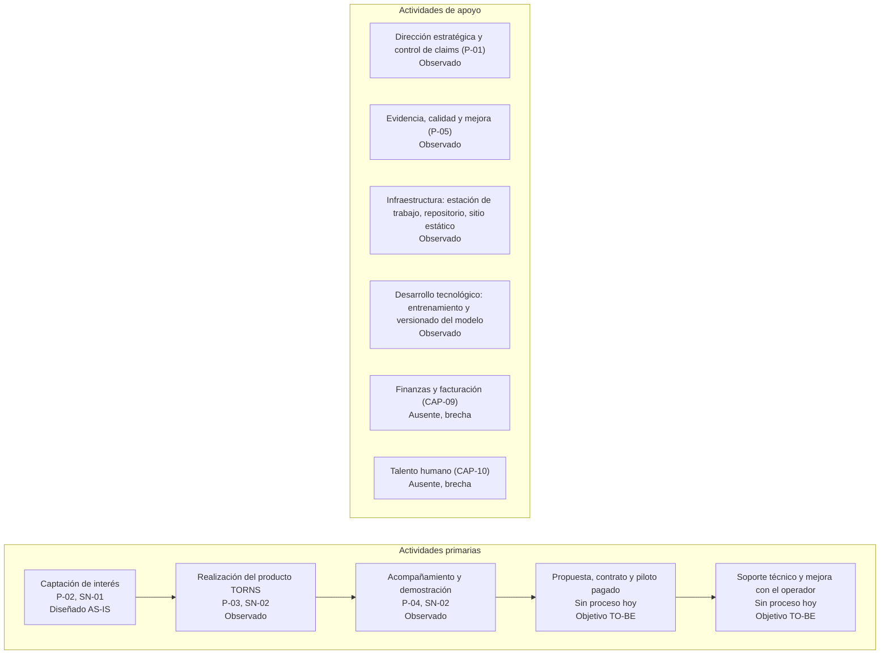

# Cadena de valor de LIRN (borrador de apoyo, AS-IS con proyección TO-BE)

Actividades primarias tomadas de los tres procesos misionales (P-02, P-03, P-04) y de apoyo de P-01, P-05 y de la infraestructura observada. Lo que no existe hoy se marca como brecha.

Disposición: dos bloques apilados, apoyo arriba y primarias abajo. El resultado final (valor entregado, Objetivo TO-BE) se describe en la lectura, no como nodo, para reducir el ancho de la imagen.

## Lectura
- Resultado declarado: oferta ajustada a la demanda medida en estación (Objetivo TO-BE, no entregado hoy).
- B1 a B3 existen como proceso documentado (Observado o Diseñado AS-IS). B4 y B5 no existen: LIRN no tiene clientes ni pilotos (Observado) y se proyectan solo como TO-BE.
- El valor que se declara como resultado final es objetivo. No se afirma como entregado hoy.
- A5 y A6 son brechas confirmadas por el mapa de capacidades.
- No hay cifras ni costos por actividad. Si el docente exige análisis de margen, queda NO CONFIRMADO.

## Pendiente para Santiago
Decidir si presentar la cadena como modelo de Porter (actividades primarias y de apoyo, como arriba) o como cadena de valor de los servicios SN-01 a SN-03. Propongo la primera porque el mapa de procesos ya tiene tipo estratégico, misional y de apoyo.
