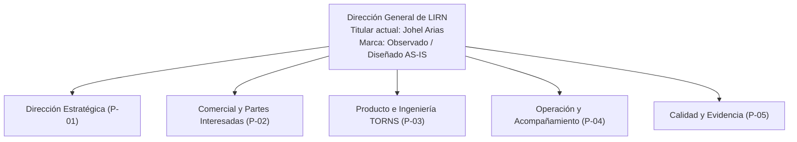
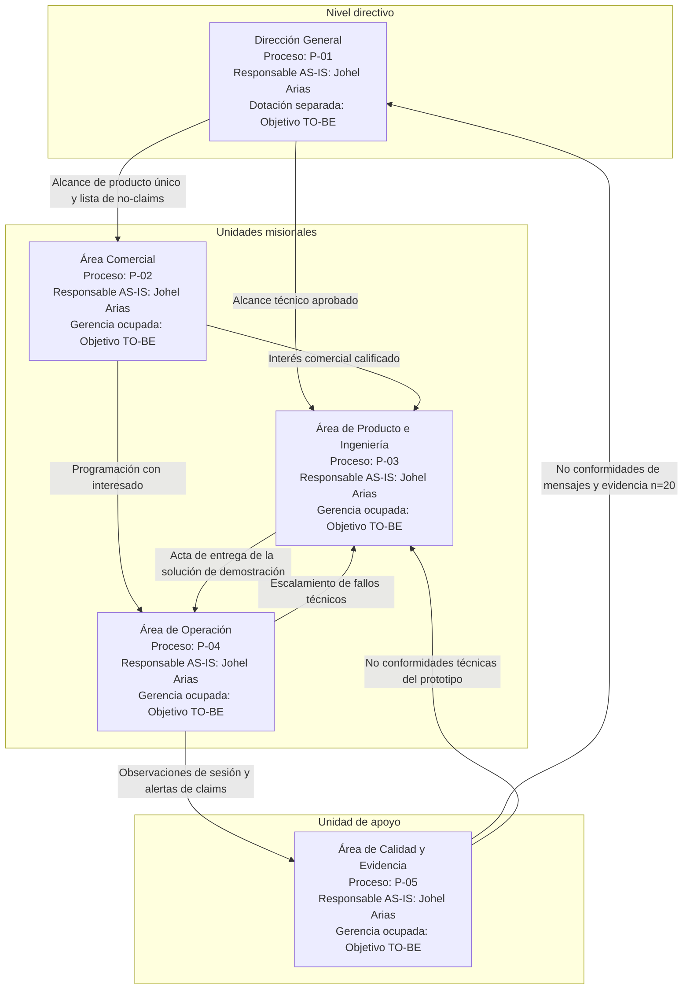
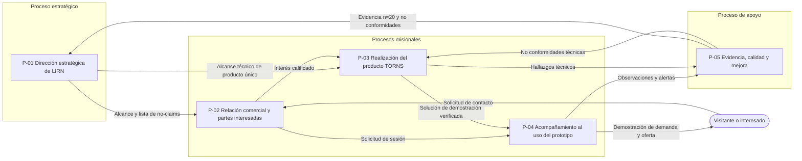
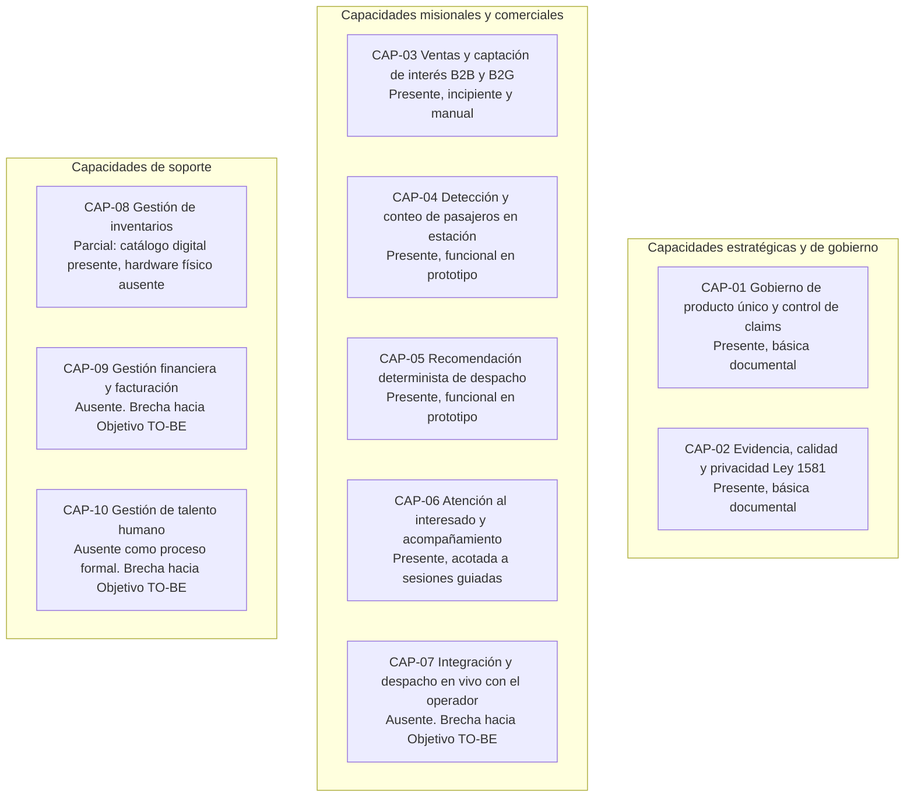
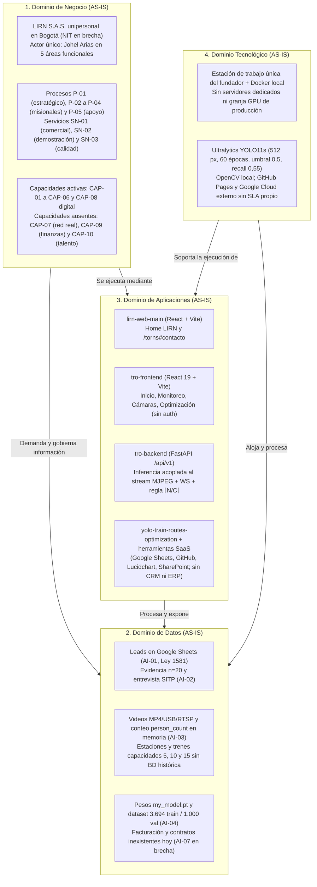

# Plan de Transformación Empresarial

Avance correspondiente al Punto 1 del Taller final de Arquitectura Empresarial. El orden de este documento sigue la entrega definida para el taller: portada, introducción, descripción de la organización y arquitectura de negocio. Dentro de la arquitectura de negocio, los apartados siguen el orden de los documentos exigidos en ese punto.

Los Puntos 2 a 5 (Arquitectura de Datos, Arquitectura de Aplicaciones, Arquitectura Tecnológica y Roadmap de Transformación), junto con conclusiones, recomendaciones, bibliografía y la pregunta final, no forman parte de este avance.

---

## Portada

| Campo | Dato |
|---|---|
| Institución | Universidad Libre |
| Asignatura | Arquitectura Empresarial. Taller final |
| Docente | Mgs. Maria del Pilar Niño Campos |
| Documento | Plan de Transformación Empresarial |
| Capítulo desarrollado | Punto 1. Arquitectura de Negocio |
| Organización | LIRN |
| Producto | TORNS |
| Autor | Johel Arias |
| Fecha | 22 de octubre de 2026 |
| Método | TOGAF. Línea base de negocio (AS-IS) |

Marcas usadas en el documento:

| Marca | Significado |
|---|---|
| Observado | Hecho presente en el prototipo, en la evidencia de investigación o en los procesos publicados. |
| Diseñado AS-IS | Decisión de empresa para describir el presente sin fingir una escala que no existe. |
| Objetivo TO-BE | Estado futuro. No se afirma como hecho de hoy. |
| NO CONFIRMADO | Dato ausente en las fuentes de la firma. No se inventa. |

---

## Introducción

Este documento describe cómo funciona hoy **LIRN** antes de proponer tecnología futura. La firma vende. El producto opera. **LIRN es la firma. TORNS es el único producto.**

TORNS es un prototipo aplicado. No es un piloto firmado. Mide cuántas personas esperan en una estación y recomienda al centro de control el tipo de vehículo y la cantidad de unidades. El equipo actual es **Johel Arias**, una persona. No hay clientes, contratos ni piloto firmado. **Transmilenio es caso de estudio, no cliente.**

El Punto 1 responde qué hace la organización, para quién trabaja, cuáles son sus objetivos y cuáles son sus procesos. Cada apartado conserva el detalle de la línea base: ficha de la empresa, misión, visión, objetivos, organigrama, activos de información, procesos modelados, capacidades, partes interesadas y el documento de Arquitectura de Negocio (AS-IS).

---

## Descripción de la organización

**LIRN** es una firma colombiana de tecnología dedicada al diseño y desarrollo de software para movilidad urbana y Sistemas Inteligentes de Transporte (ITS). Su propósito empresarial consiste en dotar a los sistemas de transporte público masivo basados en estaciones de la capacidad de ajustar su oferta operativa frente a la demanda real observada en los andenes.

La organización concentra la relación institucional, la propiedad intelectual, el gobierno de procesos y el canal comercial. El producto ejecuta la medición de pasajeros en estación y el cálculo de oferta recomendada para el centro de control.

### Ficha técnica de la organización

| Atributo empresarial | Definición en la arquitectura de negocio | Marca de hecho |
|---|---|---|
| **Nombre de la organización** | LIRN (razón social proyectada: LIRN S.A.S.). El nombre integra el concepto *Line* (líneas de metro y transporte masivo) con las siglas finales de su producto (*RN* de TORNS). | Observado (marca institucional) / Diseñado AS-IS (razón social) |
| **Forma jurídica y domicilio** | Sociedad por Acciones Simplificada (S.A.S.) bajo la Ley 1258 de 2008, con domicilio principal en Bogotá D.C., Colombia. | Diseñado AS-IS |
| **Identificación tributaria (NIT) y matrícula mercantil** | Pendiente de formalización registral ante la Cámara de Comercio de Bogotá y la DIAN. No se asigna número tributario en el estado actual. | Brecha AS-IS. NO CONFIRMADO el registro mercantil activo |
| **Sector económico** | Tecnología de la información, desarrollo de software e ingeniería aplicada a Sistemas Inteligentes de Transporte (ITS) y movilidad urbana (actividades de referencia CIIU 6201 y 6202). | Diseñado AS-IS |
| **Tamaño de la empresa** | Microempresa unipersonal, de acuerdo con los criterios del Decreto 957 de 2019 en Colombia. Equipo actual: **Johel Arias** (una persona). | Observado (equipo) / Diseñado AS-IS (marco societario) |
| **Productos o servicios** | Un único producto: **TORNS** (*Train Optimization Route and Navigation System*), acompañado del servicio precomercial de demostración guiada sobre escenarios de demanda en estación. | Observado |
| **Clientes principales actuales** | Ninguno. La firma no cuenta hoy con contratos comerciales, clientes activos, alianzas ni pilotos firmados. | Observado |
| **Segmentos de mercado objetivo** | Operadores de sistemas de transporte masivo con estaciones (segmento B2B: empresas concesionarias de operación; segmento B2G: entes gestores de movilidad y sistemas ferroviarios o BRT). | Diseñado AS-IS |
| **Marco normativo de datos personales** | Ley Estatutaria 1581 de 2012 y Decreto 1377 de 2013 (Régimen General de Protección de Datos Personales en Colombia). | Diseñado AS-IS |

### Producto o servicio: TORNS

**TORNS** es un prototipo aplicado. No es un piloto firmado. Conecta lo que ocurre en el andén de una estación con la toma de decisiones del centro de control mediante dos mecanismos acoplados (Observado):

1. **Medición de demanda en estación por visión por computadora.** El sistema procesa flujos de video de estación mediante el modelo entrenado `my_model.pt` (arquitectura YOLO11s, entrenado a resolución de 512 píxeles durante 60 épocas sobre 3.694 imágenes de entrenamiento y 1.000 de validación). Con un umbral de confianza de 0,5, detecta instancias de la clase `person` y entrega el conteo puntual de pasajeros presentes (`person_count`). Precisión 0,73, recall 0,55, mAP50 0,64. El prototipo cuenta personas. No calcula densidad por área.
2. **Recomendación determinista de oferta al centro de control.** A partir de la carga medida \(N\) en la estación, el motor de despacho evalúa las capacidades configuradas en el prototipo (5, 10 y 15 pasajeros por unidad de referencia), selecciona el tipo de tren más pequeño que cubra la demanda y aplica la cota inferior de empaquetamiento \(\lceil N / C \rceil\) bajo un esquema voraz (*greedy*). El resultado indica qué tipo de unidad y cuántas unidades despachar.

### Clientes principales y segmentos de mercado

En el estado actual (Observado), LIRN no posee clientes facturados ni convenios operativos vigentes. **Transmilenio es caso de estudio, no cliente.** Su operación en Bogotá se utiliza como problema público de referencia porque ilustra el desajuste entre frecuencias programadas por horario fijo y la demanda real acumulada en plataforma.

Durante el descubrimiento de mercado (Observado) se evaluaron siete segmentos bajo cinco criterios ponderados: tiempo de conversión (15 %), potencial de ingresos (30 %), impacto económico del problema (15 %), potencial de expansión (30 %) y madurez de la necesidad (10 %).

| Segmento evaluado | Tipo | Rol decisor o afectado | Valoración ponderada (sobre 5,00) | Clasificación en la arquitectura de negocio |
|---|---|---|---|---|
| **Operadores de transporte** | B2B | Empresas concesionarias responsables de operar y distribuir la flota | **4,15** | Segmento cliente prioritario 1 (Diseñado AS-IS) |
| **Sistema Metro de Bogotá** | B2G | Entidad responsable de la operación y planificación ferroviaria | **4,00** | Segmento cliente prioritario 2 (Diseñado AS-IS) |
| **Administradores de estaciones** | B2B | Supervisores de operación y flujo en plataforma | **2,70** | Segmento secundario e influenciador operativo |
| **Entidades de movilidad** | B2G | Autoridades de planeación y regulación del transporte urbano | **2,55** | Segmento institucional y regulador del entorno |
| **Usuarios frecuentes del transporte** | B2C | Ciudadanos que viajan 3 o más veces por semana | **2,40** | Usuario final afectado por el problema (sin pago directo a LIRN) |
| **Trabajadores** | B2C | Pasajeros con desplazamiento pendular diario | **2,10** | Usuario final afectado por el problema (sin pago directo a LIRN) |
| **Estudiantes universitarios** | B2C | Pasajeros en franjas de hora pico | **1,40** | Usuario final afectado por el problema (sin pago directo a LIRN) |

La validación empírica del problema se apoya en dos fuentes primarias (Observado):

- **Entrevista a controlador SITP (rol, no nombre).** La gestión de contingencias en troncal (vehículo bloqueado, código TQ 04, o saturación de plataforma, código TP 19) depende de reportes radiales manuales y maniobras reactivas (TP 69, TP 70, TP 59, TP 56 y TP 29). Eso expone a los operadores a pérdida de horas-hombre y a multas operativas del ente gestor.
- **Encuesta 17 de agosto de 2026, n=20.** Aplicada a usuarios de transporte masivo en Bogotá. Diez preguntas de opción única, opción múltiple y respuesta abierta. Es investigación del equipo, no un estudio de un operador.

  | Tema | Resultado |
  |---|---|
  | Frecuencia de uso | El 50 % (10 personas) usa el sistema 3 o más veces por semana y el 30 % lo hace a diario. |
  | Franjas horarias | El 80 % viaja entre 4:00 y 7:30 p. m. y el 60 % entre 6:00 y 8:30 a. m. |
  | Hora fija de llegada | El 80 % tiene hora de llegada. En el 35 % llegar tarde tiene consecuencias (descuento, llamado de atención o perder clase). |
  | Recencia | El 55 % dejó pasar buses llenos en los últimos 7 días y el 80 % dentro del último mes. |
  | Recurrencia | Al 65 % le ocurre varias veces por semana. Entre los 10 usuarios que viajan 3 o más veces por semana, 9 lo sufren varias veces por semana. |
  | Tiempo de un evento | El 70 % pierde 15 minutos o más y el 35 % más de media hora. |
  | Tiempo estimado al mes | Promedio de 3 horas por persona. Un 25 % supera las 6 horas mensuales. La cifra cruza duración declarada y frecuencia declarada. |
  | Estrategias actuales | El 75 % sale más temprano, el 30 % paga taxi o aplicación y el 25 % declara no hacer nada. |
  | Gasto en alternativas | El 90 % gastó algo el mes anterior y el 65 % gastó 50.000 COP o más. |
  | Cómo nombran el problema | El 40 % señala el desbalance entre oferta y demanda, el 25 % el estrés y el 20 % la puntualidad. |
  | Respuesta abierta | De 14 textos (6 personas no contestaron), la aglomeración y no poder subir aparece en 5 y el trancón en 4. |

---

## Arquitectura de Negocio

### Misión y visión

Las declaraciones estratégicas están aprobadas como línea base de gobierno (Observado, proceso P-01).

**Misión actual**

> Hacer que el transporte masivo ajuste su oferta a la demanda real de cada estación, midiendo quién espera ahora y no solo lo que el horario predijo.

**Visión actual**

> Que cada estación de un sistema masivo opere con la demanda que ocurre, no con la que se supuso.

### Objetivos estratégicos

Los cinco objetivos articulan el paso desde la línea base (AS-IS) hacia la arquitectura a cinco años (TO-BE). Están diseñados como AS-IS de dirección. El quinto objetivo describe un horizonte futuro y no se afirma como hecho de hoy.

| Código | Objetivo estratégico | Proceso principal que lo habilita | Horizonte de realización | Marca |
|---|---|---|---|---|
| **OE-01** | Convertir el prototipo TORNS en un producto demostrable y controlado para un centro de control. | P-03 Realización del producto TORNS y P-04 Acompañamiento al uso del prototipo | Corto y mediano plazo (base en AS-IS, consolidación en TO-BE) | Diseñado AS-IS |
| **OE-02** | Abrir un canal comercial honesto hacia operadores B2B y B2G, sin afirmar cliente. | P-02 Relación comercial y partes interesadas | Corto plazo (canal de contacto activo; evolución a CRM en TO-BE) | Diseñado AS-IS |
| **OE-03** | Proteger datos personales y evidencia según la Ley 1581 de 2012 y el mapa de procesos. | P-01 Dirección estratégica de LIRN y P-05 Evidencia, calidad y mejora | Permanente (control documental hoy, sistematización en TO-BE) | Diseñado AS-IS |
| **OE-04** | Cerrar la brecha entre demanda medida y oferta recomendada como propuesta de valor única. | P-01 Dirección estratégica de LIRN y P-03 Realización del producto TORNS | Corto a largo plazo (regla determinista hoy; evaluación en estación en TO-BE) | Diseñado AS-IS |
| **OE-05** | Preparar la firma para un primer piloto pagado en el horizonte TO-BE, no como hecho actual. | P-01 a P-05 | Mediano y largo plazo | Diseñado AS-IS / Objetivo TO-BE |

### Organigrama

La estructura se documenta en dos vistas. La primera muestra la dotación real. La segunda muestra las unidades funcionales que ejecutan los procesos. En el presente, **Johel Arias** es responsable de las cinco áreas. La ocupación de esas áreas por gerencias distintas es un Objetivo TO-BE y no se afirma como hecho de hoy.

La página pública del producto conserva tres nombres de la etapa académica inicial. Para el gobierno actual de la firma, el equipo vigente es exclusivamente Johel Arias. La actualización de esa banda pública queda registrada como brecha de alineación documental.

#### Vista jerárquica de la planta actual

#### Vista funcional: dirección, áreas y relaciones

#### Áreas, cargos y relaciones

| Área | Nivel | Proceso | Responsable AS-IS | Rol proyectado (Objetivo TO-BE) | Relaciones |
|---|---|---|---|---|---|
| **Dirección General** | Dirección estratégica | P-01 | Johel Arias | Director General | Emite hacia Comercial y Producto el alcance de producto único (TORNS) y la lista de claims prohibidos. Recibe de Calidad las no conformidades sobre mensajes públicos y la evidencia autorizada (n=20). |
| **Área Comercial** | Departamento misional | P-02 | Johel Arias | Líder Comercial B2B y B2G. Suplente previsto: Dirección | Recibe de Dirección las reglas de comunicación. Captura solicitudes del canal público y transfiere a Producto y Operación la nota de interés calificado cuando un prospecto pide ver el prototipo. |
| **Área de Producto e Ingeniería** | Departamento misional | P-03 | Johel Arias | Líder de Producto e Ingeniería. Suplente previsto: Operación | Recibe de Dirección el alcance y de Comercial el interés calificado. Prepara el modelo, la API y la interfaz de despacho, y los entrega mediante acta interna a Operación. Recibe de Calidad y Operación los reportes de fallos técnicos. |
| **Área de Operación** | Departamento misional | P-04 | Johel Arias | Coordinación de demostración. Suplente previsto: Producto | Recibe de Producto la solución verificada y de Comercial las solicitudes de acompañamiento. Conduce sesiones guiadas de conteo y recomendación sin operar la red real. Escala fallos a Producto o desviaciones de alcance a Calidad. |
| **Área de Calidad y Evidencia** | Departamento de apoyo | P-05 | Johel Arias | Calidad y cumplimiento. Suplente previsto: Dirección | Custodia la encuesta del 17 de agosto de 2026 (n=20) y las notas de la entrevista al controlador SITP. Audita mensajes públicos y sesiones de Operación. Abre y cierra no conformidades que obligan a Dirección y a Producto. |

### Activos de información

Se identifican siete activos. Cada uno que involucra o puede involucrar datos personales se clasifica según la Ley Estatutaria 1581 de 2012 y el Decreto 1377 de 2013.

#### Criterios de clasificación

Seguridad y acceso:

- **Público.** Información aprobada por Dirección (P-01) para divulgación en la comunicación de LIRN y TORNS.
- **Interno.** Información operativa, técnica o metodológica de uso de la firma.
- **Confidencial.** Información de terceros o de prospectos, con acceso restringido.
- **Reservado.** Propiedad intelectual crítica del producto TORNS.

Datos personales (Ley 1581 de 2012):

- **Dato público.** Calificado así por la ley o la Constitución. Ejemplo: nombre y rol empresarial del responsable.
- **Dato semiprivado.** No es íntimo ni público, y su conocimiento interesa al titular y a un grupo determinado. Ejemplo: correo y organización de un prospecto B2B.
- **Dato privado.** Relevante para el titular. Ejemplo: correo personal o mensaje individual del formulario.
- **Dato sensible.** Afecta la intimidad o incluye imagen de personas captada en video.

#### Inventario clasificado

| ID | Activo | Descripción y soporte actual | Proceso custodio | Clasificación de seguridad | Datos personales | Tratamiento bajo Ley 1581 de 2012 | Marca |
|---|---|---|---|---|---|---|---|
| **AI-01** | Registro de solicitudes y prospectos (leads) | Formulario de contacto de la página de TORNS: nombre, correo electrónico, organización opcional y mensaje. Se recibe en Google Sheets mediante Apps Script cuando el canal está configurado. | P-02 | Confidencial | Sí | Datos personales privados y semiprivados. LIRN es Responsable del Tratamiento. Uso limitado a responder el interés comercial de P-02, sin cesión a terceros ni perfilamiento automatizado. | Observado / Diseñado AS-IS |
| **AI-02** | Evidencia de validación del problema | Encuesta del **17 de agosto de 2026, n=20**, y notas de la entrevista al controlador SITP documentada por rol, sin nombre personal. | P-05 | Interno. La síntesis estadística autorizada es pública en la página de TORNS. | No, en el activo consolidado | Datos estadísticos anonimizados y registro de rol. No se publica identificación de encuestados ni el nombre del controlador. | Observado |
| **AI-03** | Video de estaciones y métricas de conteo | Videos de demostración, cámara USB o RTSP, stream de video anotado y mensajes con `video_id`, `timestamp`, `total_objects`, `person_count` y `label_counts`. | P-03 y P-04 | Interno / Confidencial | Potencialmente sí (imagen de personas) | Dato potencialmente sensible. El prototipo minimiza el tratamiento: detecta la caja de la clase `person` para obtener `person_count`, sin reconocimiento facial, sin biometría identificativa y sin seguimiento individual persistente. | Observado |
| **AI-04** | Pesos del modelo y dataset curado | Archivo `my_model.pt` (YOLO11s, 512 px, 60 épocas; precisión 0,73, recall 0,55, mAP50 0,64) y partición de 3.694 imágenes de entrenamiento y 1.000 de validación. | P-03 | Reservado | No, en los pesos. Imagen curada en el dataset de entrenamiento. | Los pesos son tensores numéricos. Las imágenes de entrenamiento provienen de conjuntos de detección de peatones sin vinculación a titulares identificados. | Observado |
| **AI-05** | Código fuente de las cuatro superficies | Sitio comercial (`lirn-web-main`), aplicación operativa (`tro-frontend`), API y regla de despacho (`tro-backend`) y entrenamiento (`yolo-train-routes-optimization`). | P-03 | Interno / Reservado | No | No aplica la Ley 1581 de 2012. Es propiedad intelectual y lógica del producto. | Observado |
| **AI-06** | Gobierno, fichas de proceso y registro de empresa | Alcance de producto único, lista de claims prohibidos, procesos P-01 a P-05 y diagramas BPMN. | P-01 y P-05 | Interno. El diagrama BPMN está publicado para evaluación. | Sí, mínimos | Dato público empresarial: el nombre de Johel Arias como responsable y autor. | Observado |
| **AI-07** | Facturación, contabilidad y contratos | Libros, facturación electrónica, contratos B2B o B2G y acuerdos de nivel de servicio. | Gestión financiera futura | No existe hoy | No existe hoy | Brecha declarada. Sin clientes ni piloto firmado no hay facturación ni contratos. En el Objetivo TO-BE sería un activo confidencial. | Observado (ausencia) / Brecha |

### Mapa de procesos

El mapa fue aprobado el 13 de septiembre de 2026 (Observado), con estructura de un proceso estratégico, tres misionales y uno de apoyo, modelados en BPMN. El tablero publicado está en [procesos de empresa LIRN](https://lucid.app/lucidchart/4bc5f4f1-c350-40a4-b752-63eb17d2cb77/edit).

#### Interacción entre procesos

#### Catálogo de procesos

| Código | Nombre | Tipo | Dueño funcional (hoy: Johel Arias) | Objetivo | Entradas | Salidas | Indicadores |
|---|---|---|---|---|---|---|---|
| **P-01** | Dirección estratégica de LIRN | Estratégico | Dirección | Mantener un solo producto (TORNS), custodiar misión y visión, y controlar que la comunicación pública no incurra en claims prohibidos. | Misión y visión; mensajes públicos; evidencia n=20; no conformidades de P-05. | Alcance de producto para P-02 y P-03; lista de claims prohibidos; decisión de un solo producto. | Un solo producto ofertado (meta: Sí). Claims prohibidos detectados (meta: 0 abiertos). Revisiones de dirección (calendario fijo: NO CONFIRMADO). |
| **P-02** | Relación comercial y partes interesadas | Misional | Comercial | Recibir y calificar interés por TORNS en el canal público, sin fingir cliente ni piloto. | Solicitud de contacto; alcance y no-claims de P-01; estado del canal. | Solicitud registrada; fallo honesto si el canal no está disponible; respuesta alineada al alcance; interés calificado hacia P-03. | Solicitudes recibidas (meta: NO CONFIRMADO). Rechazos por canal no disponible. Respuestas emitidas. No es conversión de cliente. |
| **P-03** | Realización del producto TORNS | Misional | Producto | Entregar la medición de demanda en estación y la propuesta de oferta al centro de control, como prototipo aplicado. | Alcance de P-01; interés calificado de P-02; fuente de video; no conformidades de P-05. | Solución de demostración para P-04; métricas de demanda; oferta propuesta; no conformidad si falla. | Solución verificada (meta: Sí antes de entrega). Fuentes de medición disponibles (número fijo: NO CONFIRMADO). Oferta propuesta disponible (meta: Sí en el prototipo). |
| **P-04** | Acompañamiento al uso del prototipo | Misional | Operación | Mostrar demanda medida y oferta propuesta, sin afirmar operación en vivo del operador. | Solución entregada por P-03; solicitud de sesión; métricas y oferta del prototipo. | Informe de acompañamiento; escalamiento a P-03 (fallo técnico) o a P-05 (claim indebido). | Sesiones realizadas (meta: NO CONFIRMADO). Solución disponible al inicio (meta: Sí). Escalamientos por claim indebido (meta: 0). |
| **P-05** | Evidencia, calidad y mejora | Apoyo | Calidad | Conservar la evidencia autorizada (n=20 y entrevista SITP) y gestionar no conformidades para P-01 y P-03. | Encuesta del 17 de agosto de 2026; entrevista al controlador SITP; hallazgos de P-01, P-03 y P-04. | Evidencia vigente con leyenda de investigación; no conformidades abiertas o cerradas; lecciones hacia P-01 y P-03. | Evidencia n=20 presente con fecha 17 de agosto de 2026 (meta: Sí). No conformidades abiertas (meta numérica: NO CONFIRMADO). Claims de impacto inventados (meta: 0). |

Queda fuera de estos procesos: instalación de cámaras en campo, integración con el control real de un operador, despacho sobre la red del operador, CRM, ERP, facturación y afirmación de piloto firmado.

#### Diagramas BPMN

**P-01. Dirección estratégica de LIRN (estratégico)**

**P-02. Relación comercial y partes interesadas (misional)**

**P-03. Realización del producto TORNS (misional)**

**P-04. Acompañamiento al uso del prototipo (misional)**

**P-05. Evidencia, calidad y mejora (apoyo)**

### Mapa de capacidades

Una capacidad de negocio define qué sabe hacer la organización para ejecutar su estrategia. El mapa incluye las capacidades del giro de LIRN y las cinco que pide el taller: ventas, atención al cliente, gestión financiera, gestión de inventarios y gestión de talento humano. Las capacidades ausentes se declaran como brecha. No se fingen.

| Código | Capacidad | Categoría | Estado AS-IS | Proceso | Cómo opera hoy, o por qué es brecha | Evolución en Objetivo TO-BE | Marca |
|---|---|---|---|---|---|---|---|
| **CAP-01** | Dirección de producto único y gobierno de marca | Estratégica | Presente (básica) | P-01 | Mantiene la separación LIRN / TORNS, custodia misión y visión, y aplica la lista de claims prohibidos. | Formalizar el gobierno de la S.A.S. y alinear la copia pública de tres nombres con el equipo real. | Observado |
| **CAP-02** | Evidencia, calidad y cumplimiento | Apoyo | Presente (básica) | P-05 | Custodia la encuesta n=20 del 17 de agosto de 2026 y la entrevista SITP. Gestiona no conformidades de forma documental. | Política registrada de tratamiento de datos y trazabilidad de no conformidades. | Observado |
| **CAP-03** | Ventas: captación y calificación de interés B2B y B2G | Misional | Presente (incipiente) | P-02 | Recibe prospectos por el formulario público hacia Google Sheets y los califica de forma manual. No hay cierre de contratos. | CRM, seguimiento de propuestas y gestión contractual del primer piloto pagado. | Observado / Diseñado AS-IS |
| **CAP-04** | Detección y conteo de demanda en estación | Misional | Presente (funcional en prototipo) | P-03 | Inferencia con `my_model.pt` (YOLO11s, umbral 0,5) y entrega de `person_count`. | Evaluación en estación, mejora del recall 0,55 y desacople de la inferencia respecto del stream. | Observado |
| **CAP-05** | Recomendación de oferta y cálculo de despacho | Misional | Presente (funcional en prototipo) | P-03 | Regla \(\lceil N / C \rceil\) sobre capacidades 5, 10 y 15, eligiendo el vehículo más pequeño suficiente. | Parametrizar capacidades reales de flota y persistir el historial de recomendaciones. | Observado |
| **CAP-06** | Atención al cliente, ejercida como acompañamiento del prototipo | Misional | Presente (acotada a la etapa precomercial) | P-04 | Sin clientes firmados, la atención se ejerce en sesiones guiadas de demostración. No hay mesa de ayuda ni acuerdo de nivel de servicio. | Soporte B2B, acuerdos de nivel de servicio y capacitación al centro de control durante un piloto. | Observado / Diseñado AS-IS |
| **CAP-07** | Integración y despacho en vivo sobre la red del operador | Misional futura | Ausente (brecha) | Fuera de P-03 y P-04 hoy | El prototipo no se conecta al control, al SAE ni a la radio de ningún operador. | Interfaz segura, con identidad de operador, hacia el tablero del centro de control en un piloto. | Observado (ausencia) / Objetivo TO-BE |
| **CAP-08** | Gestión de inventarios | Apoyo | Parcial | P-03 | No hay inventario físico de cámaras ni de servidores. Sí hay catálogo digital de videos, modelos de tren (5, 10 y 15) y pesos del modelo. | Registro formal de versiones del modelo y de fuentes de video autorizadas por estación. | Observado / Brecha en inventario físico |
| **CAP-09** | Gestión financiera, contable y facturación | Apoyo | Ausente (brecha) | Brecha organizacional | No hay facturas, ingresos operativos ni software contable, porque no hay contratos vigentes. | NIT, matrícula mercantil, facturación electrónica y control de costos. | Observado (ausencia) / Brecha |
| **CAP-10** | Gestión de talento humano | Apoyo | Ausente como proceso formal (brecha) | Brecha organizacional | Una sola persona concentra las cinco áreas. No hay nómina ni selección activa. | Perfiles para Comercial, Ingeniería, Operación y Calidad cuando escale la firma. | Observado (ausencia) / Brecha |

### Partes interesadas

Una parte interesada es cualquier persona, grupo, área u organización que puede afectar, ser afectada o tener interés en una decisión de esta arquitectura. La clasificación incluye el nivel de influencia.

| ID | Parte interesada | Categoría | Relación con LIRN y TORNS | Interés principal | Influencia | Marca |
|---|---|---|---|---|---|---|
| **SH-01** | Johel Arias, fundador y director general | Interna. Cubre Dirección, Comercial, Producto, Operación y Calidad | Único integrante actual y autor del prototipo y de los procesos. | Viabilidad de TORNS, rigor de los no-claims y preparación hacia un primer piloto pagado. | **Alta** | Observado / Diseñado AS-IS |
| **SH-02** | Universidad Libre y docente del taller | Externa. Academia | Evalúa el plan bajo TOGAF. | Coherencia entre negocio, datos, aplicaciones, tecnología y roadmap, con trazabilidad verificable. | **Alta** | Observado |
| **SH-03** | Operadores concesionarios, incluido el rol de controlador operativo entrevistado en el SITP | Externa. Segmento B2B. No son clientes actuales | Ejecutan rutas y sufren desajuste de frecuencia y multas operativas. | Conteo oportuno en estación y recomendación de despacho, en lugar de coordinación reactiva por radio. | **Alta** sobre requisitos del producto. **Media** en la operación actual, porque no hay contrato. | Observado / Diseñado AS-IS |
| **SH-04** | Administradores y supervisores de estaciones | Externa. Segmento B2B secundario | Vigilan la saturación de plataforma (código TP 19). | Alerta temprana de acumulación de pasajeros. | **Media** | Diseñado AS-IS |
| **SH-05** | Entes gestores y sistemas ferroviarios. TransMilenio S.A. como referente público. Sistema Metro de Bogotá como segmento B2G | Externa. No son clientes actuales | Planifican el sistema, supervisan el servicio y pueden aplicar multas a concesionarios. | Estándares de servicio, protección de datos e interoperabilidad futura. | **Media** en el AS-IS. **Alta** en un piloto B2G futuro. | Observado / Diseñado AS-IS |
| **SH-06** | Visitantes del sitio y prospectos del formulario | Externa. Canal comercial | Consultan la propuesta y dejan datos de contacto. | Información veraz sobre el prototipo, respuesta a la solicitud y protección de datos. | **Media** | Observado |
| **SH-07** | Pasajeros, incluida la muestra n=20 del 17 de agosto de 2026 | Externa. Beneficiarios indirectos | Padecen esperas y sobrecostos cuando el vehículo pasa lleno. | Menor espera en estación. No compran el software. | **Baja** en la decisión de compra. **Media** como evidencia del problema. | Observado |
| **SH-08** | GitHub, Google, Roboflow y Ultralytics | Externa. Proveedores técnicos | Alojan el sitio y el código, reciben el formulario y aportan la base de visión. | Continuidad del servicio y cumplimiento de licencias. | **Media** | Observado |

Lectura de poder e interés:

- **Cercanía de gestión.** SH-01 y SH-02 deciden el diseño y la aceptación de este taller. SH-03 aporta los requisitos de dominio.
- **Alineación.** SH-05, SH-06 y SH-08 condicionan el marco legal, el canal de contacto y la continuidad técnica.
- **Evidencia.** SH-04 y SH-07 sustentan el problema de negocio custodiado en P-05. Lead no es cliente.

### Arquitectura de Negocio (AS-IS)

#### Propósito del documento AS-IS

El documento de **Arquitectura de Negocio (AS-IS)** representa el estado actual e integral de **LIRN** desde las cuatro perspectivas o dominios de la Arquitectura Empresarial bajo TOGAF: **Negocio, Datos, Aplicaciones y Tecnología**. Su propósito no es presentar un escenario idealizado ni relegar las restricciones operativas a una nota marginal, sino describir con exactitud cómo opera hoy la firma en la realidad: qué estructura y procesos ejecuta, qué capacidades existen o faltan, qué información utiliza y cómo se almacena, qué sistemas soportan la operación diaria, sobre qué infraestructura tecnológica descansan y cómo la articulación de estos cuatro dominios habilita el cumplimiento de la misión institucional y genera valor para las partes interesadas.

---

#### 1. Dominio de Arquitectura de Negocio (Estado actual AS-IS)

El dominio de negocio define cómo se organiza LIRN hoy, qué procesos ejecuta, qué servicios entrega, qué capacidades tiene operativas y dónde se sitúan sus fronteras reales:

- **Estructura organizacional y gobierno real (`Observado` / `Diseñado AS-IS`):** LIRN opera en Bogotá D.C. bajo el marco de una Sociedad por Acciones Simplificada (S.A.S.) unipersonal cuya formalización registral (NIT y matrícula mercantil ante la Cámara de Comercio de Bogotá y la DIAN) aún no se ha ejecutado y constituye una condición real del presente. La planta física está conformada por una única persona (**Johel Arias**), quien asume la Dirección General y ejecuta directamente las cinco áreas funcionales de la firma: Dirección (`P-01`), Comercial (`P-02`), Producto e Ingeniería (`P-03`), Operación (`P-04`) y Calidad (`P-05`). No existen gerencias intermedias ocupadas ni nómina administrativa. En la página pública `/torns` subsiste una banda informativa con tres nombres heredados de la fase académica inicial, lo cual representa una desalineación documental del AS-IS frente al equipo real de una sola persona.
- **Ejecución actual de los procesos de negocio (`Observado`):**
  - *Gobierno estratégico (`P-01`):* Mantiene a TORNS como único producto, custodia la misión y la visión aprobadas y aplica la regla de control de claims (prohibición de afirmar clientes, contratos, pilotos firmados, alianzas o métricas de ahorro comercial no probadas).
  - *Ciclo comercial (`P-02`):* Recibe solicitudes de contacto originadas en `/torns#contacto`, verifica manualmente que los datos estén completos y responde al interesado dentro del alcance del prototipo. **Lead no es cliente:** hoy la firma registra cero clientes firmados y cero ingresos por ventas. Transmilenio opera exclusivamente como caso de estudio y referente del problema público.
  - *Realización y acompañamiento del producto (`P-03` y `P-04`):* Prepara el entorno del prototipo TORNS y conduce sesiones guiadas de demostración donde un usuario con rol de centro de control observa el conteo de pasajeros en estación y la recomendación de despacho, sin intervenir la operación en vivo ni la flota real de ningún concesionario.
  - *Aseguramiento de evidencia y calidad (`P-05`):* Custodia los dos respaldos empíricos de la firma (la encuesta del 17 de agosto de 2026 con `n=20` y la entrevista al controlador de SITP documentada por rol) y gestiona de forma documental las no conformidades técnicas o de mensaje público.
- **Servicios de negocio que entrega hoy la organización (`Observado` / `Diseñado AS-IS`):**
  1. **`SN-01` Información institucional y recepción de interés comercial (`P-02`):** Exposición pública de la propuesta de valor de LIRN y TORNS y captura honesta de prospectos B2B y B2G, sin pasarela de pagos ni demostración simulada.
  2. **`SN-02` Demostración guiada de medición de demanda y recomendación de oferta (`P-03` y `P-04`):** Ejecución en tiempo real del ciclo estación hacia cámara, conteo `person_count` y cálculo determinista de unidades \(\lceil N / C \rceil\) sobre capacidades de referencia (5, 10 y 15 pasajeros).
  3. **`SN-03` Verificación de evidencia y control de no-claims (`P-01` y `P-05`):** Control interno que asegura que toda cifra publicada provenga de la encuesta `n=20`, de la entrevista SITP o de las métricas reales del modelo entrenado.
- **Estado real de las capacidades de negocio (`Observado`):** La operación actual sostiene capacidades funcionales de gobierno de marca (`CAP-01`), custodia documental de evidencia y privacidad (`CAP-02`), captación manual de interés comercial (`CAP-03`), detección de personas en video (`CAP-04`), cálculo determinista de despacho (`CAP-05`), acompañamiento en sesiones de demostración (`CAP-06`) y gestión de catálogo digital de fuentes y modelos (`CAP-08` digital). Al mismo tiempo, el AS-IS de negocio carece hoy de cuatro capacidades empresariales: no existe integración ni despacho en vivo sobre la red de un operador (`CAP-07`), no hay inventario físico de cámaras ni hardware en estaciones (`CAP-08` físico), no opera un proceso de gestión financiera, contabilidad ni facturación electrónica (`CAP-09`), y no existe gestión formal de talento humano ni nómina (`CAP-10`).

---

#### 2. Dominio de Arquitectura de Datos (Estado actual AS-IS)

El dominio de datos describe qué información existe hoy en LIRN, cómo se estructura, cómo circula entre los procesos y bajo qué condiciones reales de persistencia y privacidad opera:

- **Datos comerciales y de partes interesadas (`AI-01` y `AI-02`, `Observado`):**
  - *Prospectos comerciales (`AI-01`):* Cada solicitud enviada en `/torns#contacto` contiene nombre, correo electrónico, organización opcional y mensaje. Son datos personales privados y semiprivados regulados por la Ley Estatutaria 1581 de 2012. En el AS-IS se almacenan como filas en una hoja de cálculo de Google Sheets sin modelo relacional de seguimiento comercial, sin historial automatizado de interacciones y sin un aviso de privacidad formalizado aún como registro auditable dentro del flujo web.
  - *Evidencia de validación (`AI-02`):* Comprende las 20 respuestas válidas de la encuesta del 17 de agosto de 2026 en Google Forms y las notas de la entrevista al controlador operativo del SITP (donde se documentan los códigos radiales `TP 19`, `TQ 04`, `TP 69`, `TP 70`, `TP 59`, `TP 56` y `TP 29` sin registrar el nombre propio del entrevistado). Se conservan como archivos documentales estáticos custodiados por `P-05`.
- **Datos operativos de estación, conteo y despacho (`AI-03`, `Observado`):**
  - *Fuentes de video y fotogramas:* El sistema consume archivos de video pregrabados alojados localmente en el backend o flujos de cámara USB/RTSP. Aunque la imagen de personas en video es un dato potencialmente sensible bajo la Ley 1581 de 2012, el AS-IS aplica minimización técnica: procesa los fotogramas en memoria para detectar la clase `person` y no almacena rostros ni identificadores biométricos.
  - *Métricas de detección en tiempo real:* Por cada fotograma procesado, el backend construye un objeto JSON con cinco atributos: `video_id`, `timestamp`, `total_objects`, `person_count` y `label_counts`.
  - *Datos de estaciones, flota y despacho:* El backend mantiene el catálogo de estaciones, su carga puntual de pasajeros \(N\) alimentada por `person_count` y el catálogo de modelos de tren con capacidades fijas de 5, 10 y 15 pasajeros, sobre los cuales genera la recomendación de despacho.
  - *Condición real de persistencia en el AS-IS:* **No existe base de datos transaccional ni histórica en operación.** Los conteos `person_count`, el estado de ocupación de las estaciones y los planes de despacho recomendados viven únicamente en la memoria volátil del proceso de ejecución del backend mientras dura la sesión. Al reiniciar el servicio o cerrar el flujo de video, el historial operativo se pierde, por lo que hoy no es posible consultar series de tiempo históricas por estación ni auditar despachos pasados.
- **Activos algorítmicos, código y datos empresariales ausentes (`AI-04` a `AI-07`, `Observado`):**
  - Los pesos entrenados `my_model.pt` y el conjunto de datos curado (3.694 imágenes de entrenamiento y 1.000 de validación procedentes de Roboflow `coco-person` y etiquetado propio en Label Studio) se almacenan como archivos en el sistema de ficheros y repositorio del proyecto (`AI-04`).
  - El código fuente de las cuatro superficies (`AI-05`) y las fichas, guías e imágenes BPMN de los procesos `P-01` a `P-05` (`AI-06`) residen en archivos de repositorio y documentos en la nube.
  - **Ausencia de datos financieros y contractuales (`AI-07`):** En coherencia con la ausencia de clientes firmados y de NIT activo, en el AS-IS de datos no existen tablas ni registros de facturación, cuentas por cobrar, contratos comerciales ni acuerdos de nivel de servicio (SLA).

---

#### 3. Dominio de Arquitectura de Aplicaciones (Estado actual AS-IS)

El dominio de aplicaciones representa el comportamiento y las interacciones reales de los sistemas de software propios y de terceros que hoy soportan a LIRN y TORNS. La plataforma actual no es una malla de microservicios distribuidos, sino cuatro superficies de software en el repositorio apoyadas por servicios SaaS puntuales:

- **Superficie 1. Sitio comercial institucional (`lirn-web-main`, `Observado`):** Aplicación web estática construida en React y Vite. Publica la portada corporativa de LIRN y la página de producto `/torns` con la narrativa del problema, la evidencia autorizada y el formulario de contacto. No ejecuta lógica operativa del sistema de transporte. Cuando la variable `VITE_CONTACT_ENDPOINT` está definida, envía los datos del formulario mediante una petición HTTP hacia un script de Google Apps Script que inserta el registro en Google Sheets; cuando el endpoint no está disponible, muestra un aviso honesto de fallo sin fingir recepción.
- **Superficie 2. Aplicación operativa de centro de control (`tro-frontend`, `Observado`):** Aplicación de página única (SPA) desarrollada en React 19 y Vite, estructurada en cuatro vistas operativas: Inicio, Monitoreo, Cámaras y Optimización. Consume el video anotado renderizándolo directamente como etiqueta `` conectada al endpoint MJPEG del backend, recibe métricas en vivo por WebSocket y consulta o solicita recomendaciones de despacho por REST. En su estado AS-IS real, **carece de módulo de autenticación, control de sesiones y perfiles de usuario (RBAC)**, por lo que cualquier operador con acceso a la red local de demostración accede a todas las vistas sin credenciales.
- **Superficie 3. API de backend, visión y despacho (`tro-backend`, `Observado`):** Servicio monolítico modular construido en Python (versión 3.11 o superior) sobre FastAPI, bajo el prefijo `/api/v1` con tres enrutadores (`/health`, `/videos` y `/routing`). Concentra tres responsabilidades técnicas:
  1. Lee la fuente de video con OpenCV y ejecuta inferencia con Ultralytics sobre `my_model.pt` en `GET /api/v1/videos/{video_id}/stream`, devolviendo un stream HTTP `multipart/x-mixed-replace` (MJPEG) con las cajas dibujadas.
  2. Publica en `WS /api/v1/videos/ws/{video_id}/detections` el conteo `person_count` y las métricas por fotograma.
  3. Actualiza la demanda de la estación a partir del conteo del stream y ejecuta en `GET /api/v1/routing/stations/status` y `POST /api/v1/routing/dispatch` la regla determinista que elige el vehículo más pequeño suficiente (capacidades 5, 10 y 15) y calcula \(\lceil N / C \rceil\).
  - *Acoplamiento arquitectónico real del AS-IS:* **La inferencia y la actualización de demanda están acopladas al consumo visual del stream MJPEG.** Si ningún navegador mantiene abierta la ruta `GET /api/v1/videos/{video_id}/stream`, el backend no ejecuta inferencia en segundo plano ni actualiza automáticamente la carga de las estaciones. Además, el servicio no cuenta hoy con una suite de pruebas automatizadas de backend ni con conectores hacia sistemas externos de despacho (SAE o SCADA) de un operador real.
- **Superficie 4. Entorno de entrenamiento de visión (`yolo-train-routes-optimization`, `Observado`):** Conjunto de notebooks, configuración de dataset y scripts de entrenamiento sobre Ultralytics YOLO11s que produce el archivo de pesos `my_model/my_model.pt`. Opera como un componente fuera de línea (*offline*): el modelo entrenado se copia manualmente como artefacto estático hacia el backend, sin un pipeline automatizado de reentrenamiento o despliegue continuo de modelos (MLOps).
- **Aplicaciones de soporte y vacíos aplicativos en el AS-IS (`Observado`):** La operación se apoya en Google Sheets y Google Apps Script (como receptor elemental de prospectos), GitHub (control de versiones), Lucidchart (modelado BPMN de `P-01` a `P-05`), SharePoint y correo electrónico. En el estado actual **no existen sistemas CRM, ERP, software de facturación electrónica ni herramientas ITSM de mesa de ayuda**, por lo que Google Sheets asume de forma manual e improvisada el rol de registro comercial. Asimismo, en el código fuente subsisten nombres técnicos de carpetas e identificadores heredados (`tro-frontend`, `tro-backend`) que difieren de la identidad vigente LIRN y TORNS.

---

#### 4. Dominio de Arquitectura Tecnológica (Estado actual AS-IS)

El dominio tecnológico describe la infraestructura física, de virtualización, de red, de almacenamiento y de cómputo sobre la cual corren hoy las aplicaciones y los datos de LIRN:

- **Infraestructura de cómputo y ejecución operativa (`Observado`):** Toda la ejecución activa del producto TORNS (`tro-frontend`, `tro-backend` e inferencia del modelo `my_model.pt`) reside en **una única estación de trabajo local perteneciente al fundador (Johel Arias)**, orquestada mediante contenedores Docker locales y entorno de desarrollo local. No existen hoy servidores dedicados en centro de datos, clústeres en la nube ni instancias con GPU de producción para el backend.
- **Procesamiento de video e inferencia de inteligencia artificial (`Observado`):** La captura de video se realiza con OpenCV leyendo archivos locales MP4 en `tro-backend/src/app/assets/` o dispositivos locales USB/RTSP conectados al equipo de demostración. No existen cámaras físicas instaladas en estaciones de transporte público ni enlaces de red dedicados hacia patios o troncales. El modelo `my_model.pt` (YOLO11s entrenado a 512 píxeles por 60 épocas con umbral de confianza de 0,5) alcanza en validación una precisión de `0,73`, un `mAP50` de `0,64` y un **recall de `0,55`**. En la operación tecnológica real del AS-IS, ese recall implica que el sistema tiende a subcontar pasajeros cuando existen oclusiones o alta densidad en el encuadre, y no ha sido sometido aún a evaluación de estrés en condiciones de iluminación y ángulo de una estación real.
- **Servicios en nube, red y dependencias externas (`Observado`):** El único componente desplegado en nube pública es el sitio comercial estático (`lirn-web-main`), alojado en **GitHub Pages**, junto con el webhook de **Google Apps Script y Google Sheets** que recibe el formulario de contacto y los tableros documentales en **Lucidchart** y **SharePoint**. La comunicación entre `tro-frontend` y `tro-backend` ocurre por HTTP (REST y stream MJPEG) y WebSocket sobre red local, sin terminación TLS/HTTPS dedicada para entornos productivos de misión crítica ni cortafuegos de aplicación (WAF).
- **Resiliencia, respaldo y continuidad tecnológica en el AS-IS (`Observado`):** La infraestructura actual presenta una concentración total de riesgo operativo (*single point of failure*) en la estación de trabajo y en la disponibilidad de una sola persona. Aunque el código fuente está versionado en Git, **no existe una política formal ni automatizada de copias de seguridad (backups)** para los datos de contacto en Google Sheets, los videos de prueba o los pesos entrenados, ni existe separación física de entornos entre laboratorio de desarrollo y consola de demostración comercial.

---

#### 5. Síntesis integrada de los cuatro dominios en la Línea Base (AS-IS)

La siguiente matriz consolida el estado real de los cuatro dominios de la Arquitectura Empresarial de LIRN y muestra cómo se articulan hoy para sostener los procesos `P-01` a `P-05`, cumplir la misión y generar valor para las partes interesadas:

| Dominio TOGAF | Estado operativo real hoy (Línea base AS-IS) | Procesos y capacidades que soporta | Cómo habilita hoy la misión, la visión y los objetivos estratégicos |
|---|---|---|---|
| **1. Negocio** | S.A.S. unipersonal en Bogotá con NIT y matrícula en brecha. Un único actor (**Johel Arias**) ejecuta las 5 áreas funcionales y los procesos `P-01` a `P-05`. Cero clientes y cero contratos firmados; Transmilenio como caso de estudio. Tres servicios activos (`SN-01`, `SN-02`, `SN-03`). Capacidades `CAP-01` a `CAP-06` operativas a escala precomercial; `CAP-07`, `CAP-09` y `CAP-10` ausentes. | `P-01` a `P-05` · `CAP-01` a `CAP-06` y `CAP-08` (digital) | Asegura el gobierno de un único producto (TORNS), mantiene un canal comercial honesto sin claims falsos (**OE-02**, **OE-03**) y conduce demostraciones guiadas del ciclo demanda hacia oferta (**OE-01**, **OE-04**), dejando trazada la ruta hacia el primer piloto pagado (**OE-05**). |
| **2. Datos** | Siete activos identificados (`AI-01` a `AI-07`): leads con datos personales (Ley 1581) en Google Sheets; evidencia estática `n=20` (17 de agosto de 2026) y entrevista SITP; conteos `person_count`, carga de estación y despachos **en memoria volátil sin base de datos histórica**; capacidades fijas de tren (5, 10 y 15); pesos `my_model.pt` y dataset (3.694 / 1.000); facturación y contratos inexistentes hoy. | `P-02`, `P-03`, `P-04`, `P-05` · `CAP-02`, `CAP-03`, `CAP-04`, `CAP-05`, `CAP-08` | Permite sustentar con evidencia empírica el problema público en Bogotá, registrar el interés de prospectos B2B/B2G y transformar el número de pasajeros detectados ahora en un cálculo objetivo de unidades \(\lceil N / C \rceil\). |
| **3. Aplicaciones** | Cuatro superficies propias: `lirn-web-main` (sitio comercial React + Vite), `tro-frontend` (consola React 19 con 4 vistas, **sin autenticación de operador**), `tro-backend` (API FastAPI `/api/v1` donde **la inferencia está acoplada a abrir el stream MJPEG**, WebSocket de métricas y regla determinista de despacho) y `yolo-train-routes-optimization` (entrenamiento offline). Apoyadas por Google Sheets (usado como registro comercial por ausencia de CRM y ERP), GitHub, Lucidchart y SharePoint. | `P-01`, `P-02`, `P-03`, `P-04`, `P-05` · `CAP-03`, `CAP-04`, `CAP-05`, `CAP-06` | Materializa la separación entre vitrina institucional (LIRN vende) y producto operativo (TORNS mide y recomienda), entregando al usuario de centro de control un flujo funcional de extremo a extremo en entorno de demostración. |
| **4. Tecnología** | Ejecución concentrada en la **estación de trabajo local del fundador** con contenedores Docker locales, OpenCV sobre videos locales o cámara USB/RTSP y modelo YOLO11s (`my_model.pt`, umbral 0,5, precisión 0,73, **recall 0,55**, mAP50 0,64). Sitio estático en GitHub Pages. Sin servidores ni GPU de producción en nube, sin cámaras instaladas en estaciones reales y sin política automatizada de respaldo. | `P-02`, `P-03`, `P-04` · `CAP-03`, `CAP-04`, `CAP-05` | Viabiliza la operación del prototipo aplicado y la presencia web pública a costo de infraestructura cercano a cero, coherente con una microempresa unipersonal sin facturación activa, y provee la línea base exacta sobre la cual se diseñarán las ondas M2, M3, M4 y M5. |

#### Generación de valor para las partes interesadas desde el AS-IS

1. **Para los operadores concesionarios y el rol de controlador operativo (`SH-03`) y administradores de estación (`SH-04`):** El AS-IS demuestra con software funcional cómo pasar de reportes radiales manuales y reactivos (`TP 19`, `TQ 04`, `TP 29`) a una medición visual automatizada (`person_count`) conectada con una regla matemática de asignación (\(\lceil N / C \rceil\)).
2. **Para los entes gestores (`SH-05`), prospectos del canal comercial (`SH-06`) y pasajeros (`SH-07`):** Presenta una propuesta respaldada por evidencia ciudadana real (`n=20`) y acotada por el cumplimiento de la Ley 1581 de 2012 y la minimización de datos en video (conteo de personas sin biometría identificativa).
3. **Para la Dirección de LIRN (`SH-01`) y la evaluación académica de Arquitectura Empresarial (`SH-02`):** Entrega un diagnóstico AS-IS íntegro y verificable en los cuatro dominios TOGAF, donde la realidad técnica y organizacional actual queda descrita sin omisiones y sirve como cimiento directo para la Arquitectura de Datos (Punto 2), Aplicaciones (Punto 3), Tecnología (Punto 4) y el Roadmap de Transformación (Punto 5).

### Justificación de la línea base

#### Sociedad por Acciones Simplificada unipersonal en Bogotá

La Ley 1258 de 2008 permite una S.A.S. con un único accionista. El equipo real es Johel Arias (Observado). Esa figura da personalidad jurídica sin socios ficticios. También separa el patrimonio y fija al responsable del tratamiento de datos frente a la Ley 1581 de 2012, de modo que la firma pueda suscribir acuerdos futuros con operadores B2B y entidades B2G. El domicilio en Bogotá coincide con la evidencia (encuesta n=20 y el acercamiento en la troncal de la Calle 26, entorno Salitre El Greco) y con los dos segmentos prioritarios. El NIT y la matrícula siguen como brecha. No se inventa un número.

#### Organigrama funcional sin gerencias ocupadas

En TOGAF, el rol es una responsabilidad estable y el actor es la persona que la ejerce. Hoy un solo actor ejecuta cinco roles, porque los procesos P-01 a P-05 tienen dueños funcionales distintos: Dirección, Comercial, Producto e Ingeniería, Operación y Calidad. Omitir la vista funcional dejaría los procesos sin responsable. Inventar cinco gerentes en nómina sería un claim falso. Cuando la firma crezca, el Objetivo TO-BE consiste en delegar áreas ya delimitadas, sin redibujar los procesos.

#### Mercado descrito sin cliente firmado

Comprar tecnología para un centro de control exige validar el problema, una prueba controlada y una contratación cuyos plazos superan los 90 días. Una solicitud en el formulario es un prospecto de P-02, no una venta. Transmilenio aporta el problema público y las reglas operativas analizadas, y no tiene vínculo contractual con LIRN. Reconocer cero clientes firmados explica por qué no hay facturación ni contratos, por qué no hay ERP y por qué el primer piloto pagado permanece en el horizonte futuro.
