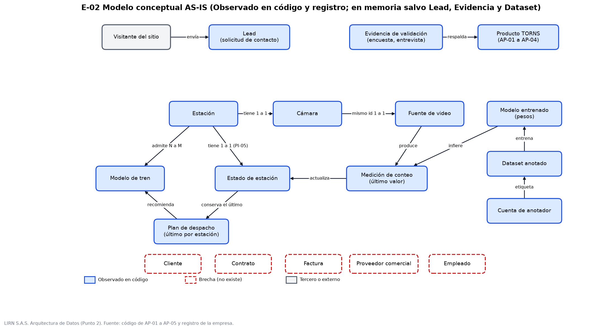
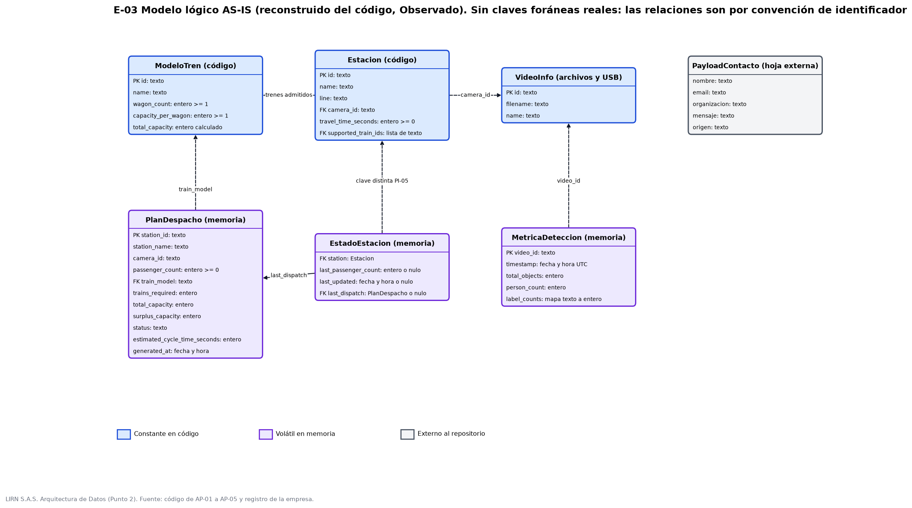
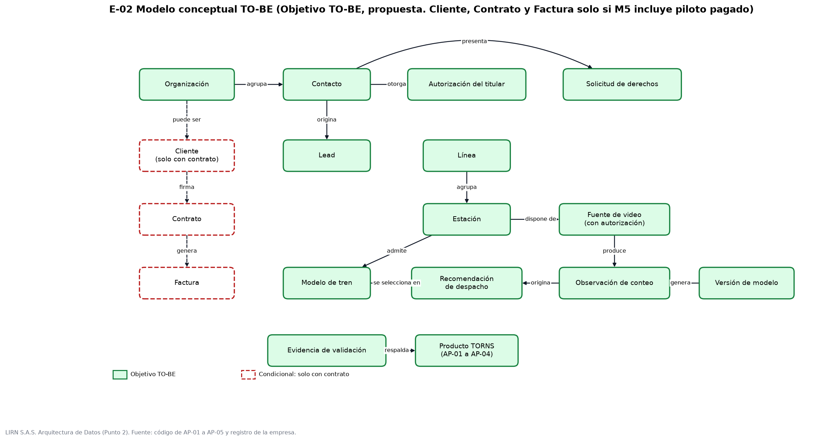
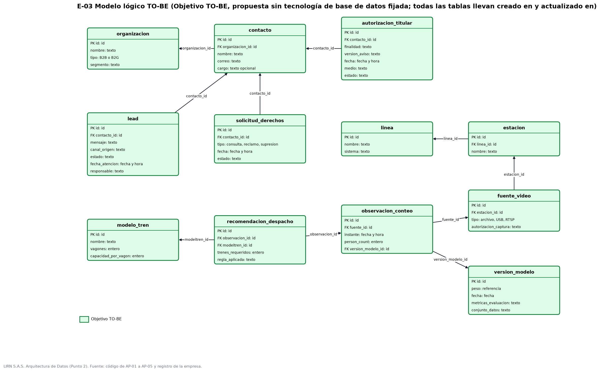
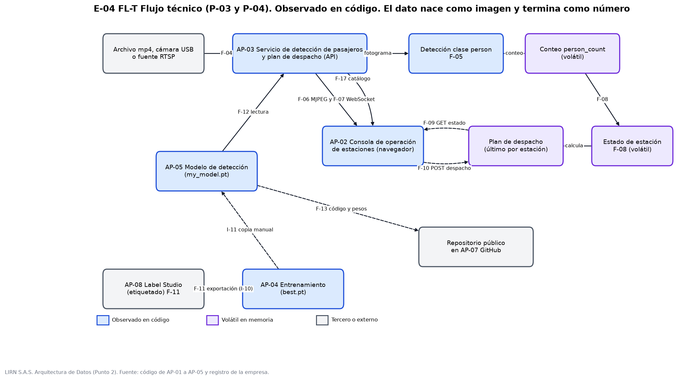
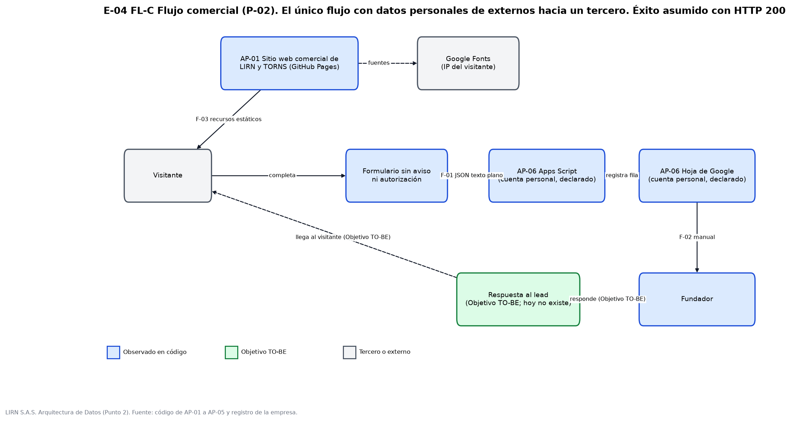
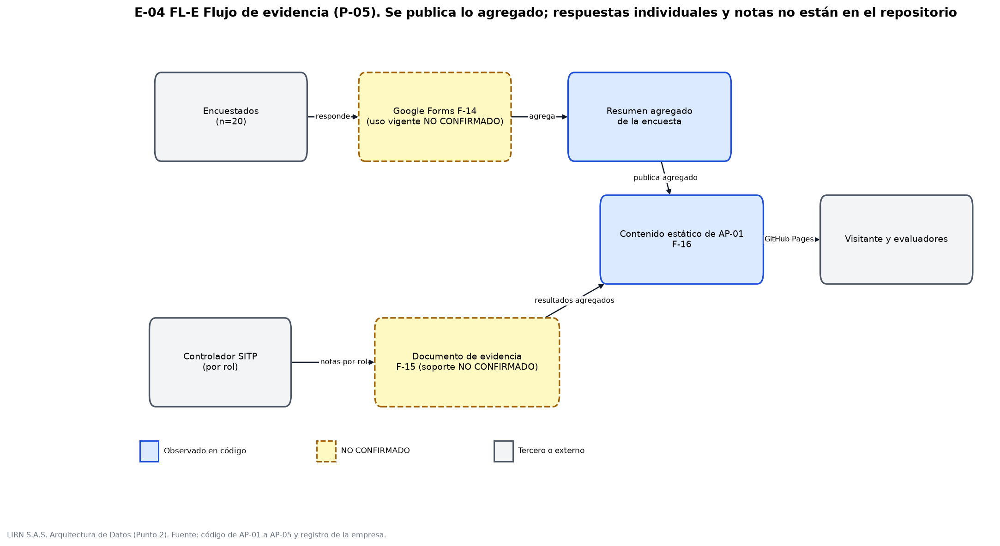

# Punto 2. Arquitectura de Datos de LIRN S.A.S.

Fase C del ADM de TOGAF, dominio de Datos. Corte de la evidencia: 1 de noviembre de 2026.

Cada afirmación lleva una de estas marcas. **Observado**: verificado en el código de las aplicaciones o en el registro de la empresa; cuando la fuente es una declaración de Santiago Arias, fundador, se indica "por declaración del dueño" con su fecha. **Diseñado AS-IS**: parámetro de demostración del prototipo, sin correspondencia con un operador real. **Objetivo TO-BE**: propuesta que hoy no existe. **NO CONFIRMADO**: no verificable con la evidencia disponible. **Brecha**: elemento exigido que no existe.

Las aplicaciones se nombran con los códigos del Inventario de aplicaciones de la Fase C: AP-01 Sitio web comercial de LIRN y TORNS, AP-02 Consola de operación de estaciones, AP-03 Servicio de detección de pasajeros y plan de despacho (API), AP-04 Entrenamiento del modelo de detección, AP-05 Modelo de detección, AP-06 Hoja de cálculo con Apps Script, AP-07 GitHub y AP-08 Label Studio. Los activos de información AI-01 a AI-07 y los procesos P-01 a P-05 son los de la Arquitectura de Negocio.

## 1. Alcance y punto de partida

LIRN es una microempresa unipersonal sin clientes, contratos ni facturación (Observado, registro de la empresa). Su único producto, TORNS, es un prototipo que cuenta personas en video y calcula una recomendación de despacho de trenes. En consecuencia, la arquitectura de datos actual tiene dos zonas con naturaleza distinta: un frente comercial que recoge leads desde el sitio web y un frente técnico cuyo estado vive casi por completo en la memoria de AP-03 (Observado). Los datos administrativos que pide el enunciado (clientes, proveedores comerciales, facturación, empleados y contratos) se documentan como brecha y no como tablas vacías.

## 2. Inventario de datos

El inventario identifica 23 conjuntos de datos (D-01 a D-23) y los ubica dentro de los siete activos de información ya clasificados, sin crear activos nuevos. El detalle completo, con atributos, soporte, custodio funcional y evidencia por línea de código, está en la hoja de cálculo Inventario de datos (E-01, carpeta tablas) que acompaña esta sección.

| Elemento del enunciado | Conjuntos | Activo | Situación | Marca |
|---|---|---|---|---|
| Leads | D-01 | AI-01 | Nombre, correo, organización, mensaje y origen. Se guardan en AP-06, en la cuenta personal de Google del fundador | Observado (formulario) / Observado por declaración del dueño, 1 nov 2026 (hoja) |
| Clientes | D-18 | Sin activo | No existen. Un lead solo pasa a cliente con contrato | Brecha |
| Productos | D-12, D-13, D-14, D-16, D-17 | AI-04, AI-05, AI-06 | Pesos del modelo, dataset y anotaciones, cuenta de anotador, código y documentación | Observado |
| Proveedores | D-19 | AI-05 (técnicos) | Proveedores técnicos sin contrato (GitHub, Google, Roboflow, Ultralytics); proveedores comerciales inexistentes | Observado (técnicos) / Brecha (comerciales) |
| Facturación | D-20, D-23 | AI-07 | No hay facturación. Tampoco NIT ni matrícula mercantil | Brecha |
| Empleados | D-21 | Sin activo | Un integrante, sin nómina ni proceso de talento humano | Observado (equipo) / Brecha |
| Contratos | D-22 | AI-07 | No existen | Brecha |
| Estación | D-07 | AI-05 | Seis estaciones fijadas como constantes en AP-03 | Observado / Diseñado AS-IS |
| Cámara | D-04, D-08 | AI-03 | Cuatro videos mp4 de Pexels, cámara USB o fuente RTSP. Las pruebas con las cámaras físicas usb0 y usb1 no tienen documentación | Observado / Observado por declaración del dueño (Pexels) / NO CONFIRMADO (usb0 y usb1) |
| Conteo | D-05, D-06, D-10, D-15 | AI-03 | Fotograma, métrica, estado de estación y registros de ejecución. Solo el último valor, en memoria | Observado |
| Modelo de tren | D-09 | AI-05 | Tres modelos con vagones y capacidad por vagón | Observado / Diseñado AS-IS |
| Plan de despacho | D-11 | AI-03 | Último plan por estación, en memoria | Observado |
| Evidencia | D-02, D-03 | AI-02 | Encuesta del 17 de agosto de 2026 (n=20) y entrevista a un controlador SITP, por rol | Observado (registro) / NO CONFIRMADO (respuestas individuales y soporte de las notas) |

Dos hallazgos del inventario condicionan el resto de la sección. Primero, la base SQLite de Label Studio (AP-08) está versionada en el repositorio público de AP-04 y contiene una cuenta de usuario con nombre, correo, teléfono y credencial (D-14, Observado; los valores no se reproducen). Segundo, el dataset de entrenamiento no está en el repositorio: las cifras de 3.694 imágenes de entrenamiento y 1.000 de validación constan en la salida del cuaderno de AP-04 (Observado), y su origen es el conjunto coco-person de Roboflow Universe con licencia MIT, entrenado el 15 de noviembre de 2025 (Observado por declaración del dueño). Ese conjunto no contiene imágenes de estaciones, por lo que sus métricas no describen el desempeño en andén.

## 3. Modelo de datos

### 3.1 Modelo conceptual AS-IS

El modelo gira alrededor de la estación. Cada estación tiene una cámara, y la cámara comparte identificador con su fuente de video. La fuente produce mediciones de conteo a partir de los pesos del modelo; la medición actualiza el estado de la estación, y el estado conserva un único plan de despacho que recomienda un modelo de tren (Observado). En el frente comercial, el visitante envía leads sin control de duplicados. Cliente, Contrato, Factura, Proveedor comercial y Empleado se dibujan con trazo punteado porque no existen (Brecha).

### 3.2 Modelo lógico AS-IS

El modelo lógico se reconstruyó desde los esquemas de AP-03 y AP-01 porque el producto no tiene base de datos (Observado). Las relaciones existen solo por convención de identificador y no como claves foráneas. Tres rasgos lo definen: el plan de despacho se indexa por estación y guarda solo el último; la métrica de detección se indexa por video y guarda solo la última; y el estado inicial usa la clave de catálogo station_sur mientras la actualización por cámara usa station_sur_usb0, lo que crea dos registros para la misma estación (PI-05, Observado en una copia aislada del servicio). El esquema de la hoja de leads tiene las columnas timestamp, nombre, email, organizacion, mensaje y origen (Observado por declaración del dueño, 1 de noviembre de 2026).

### 3.3 Modelo conceptual y lógico TO-BE

La propuesta (Objetivo TO-BE) no fija tecnología de base de datos. Separa el lead en organización, contacto, lead, autorización del titular y solicitud de derechos; normaliza línea, estación, fuente de video y modelo de tren; y convierte la medición y el plan en registros históricos. La observación de conteo la produce AP-03b, componente de inferencia continua, mediante el evento IT-07; la recomendación de despacho la produce AP-03a, la API de despacho, y referencia la observación de la que se deriva. Ambos componentes son la separación de AP-03 que propone la Arquitectura de Aplicaciones. La versión del modelo queda como entidad propia para trazar qué pesos produjeron cada conteo. Cliente, Contrato, Acta del piloto y Factura son entidades condicionales: se crean solo si la hoja de ruta incluye un piloto pagado.

Reglas de integridad propuestas (Objetivo TO-BE): un identificador de estación único en catálogo, estado e interfaz; cada fuente de video pertenece a una sola estación; y ninguna recomendación se calcula a partir de un conteo manual sin autenticación ni rango válido. El contenido de label_counts queda abierto hasta confirmar si incluye etiquetas distintas de person.

## 4. Flujos de información

Los flujos se agrupan en tres familias: técnico (FL-T, procesos P-03 y P-04), comercial (FL-C, P-02) y de evidencia (FL-E, P-05). La matriz completa de origen, dato, canal, destino, persistencia y evidencia está en la hoja Matriz de flujos (E-04, carpeta tablas).

| Id | Origen | Dato | Destino | Persistencia | Marca |
|---|---|---|---|---|---|
| F-01 | Visitante en AP-01 | Nombre, correo, organización, mensaje y origen, como JSON enviado en texto plano | AP-06 | En la hoja. El sitio da el envío por exitoso con una respuesta HTTP 200, sin acuse de registro | Observado (código) / Observado por declaración del dueño (hoja) |
| F-02 | AP-06 | Lead | Sin respuesta al lead | No aplica | Observado por declaración del dueño, 1 nov 2026 |
| F-03 | AP-01 en GitHub Pages | Recursos del sitio; la IP del visitante llega a Google Fonts | Navegador del visitante | No | Observado |
| F-04 | Archivo mp4, cámara USB o RTSP | Fotogramas | Memoria de AP-03 | Volátil | Observado / NO CONFIRMADO (pruebas usb0 y usb1) |
| F-05 | Memoria de AP-03 | Fotograma y cajas de la clase person | Resumen de conteo | Volátil | Observado |
| F-06 | AP-03 | Fotograma anotado (MJPEG) | AP-02 | No | Observado |
| F-07 | AP-03 | Métrica de detección por WebSocket. Solo se emite mientras algún cliente consume F-06 | AP-02 | Cola de cinco mensajes | Observado |
| F-08 | Proceso de streaming | person_count por cámara | Estado de estación | Volátil | Observado |
| F-09 | AP-02 | Consulta de estado | Estado y último plan | No | Observado |
| F-10 | AP-02 | Conteo manual, sin autenticación | Plan de despacho | Volátil | Observado |
| F-11 | AP-08 | Etiquetas exportadas | Cuaderno de AP-04, que produce best.pt | Persistente | Observado |
| F-12 | AP-05 (my_model.pt, copia manual de best.pt) | Archivo de pesos | AP-03 | Persistente | Observado |
| F-13 | Equipo del fundador | Código y artefactos, incluida la base de AP-08 | Repositorio público en AP-07 | Persistente | Observado |
| F-14 | Encuestados | Respuestas | Resumen agregado | Persistente | Observado (registro) / NO CONFIRMADO (uso vigente de Google Forms) |
| F-15 | Controlador SITP | Notas por rol | Documento de evidencia | Persistente | Observado (registro) / NO CONFIRMADO (soporte) |
| F-16 | Evidencia agregada | Resultados agregados | Visitantes y evaluadores, vía AP-01 | Persistente | Observado |
| F-17 | AP-03, lectura de D-04 | Identificador, archivo y nombre visible de cada fuente | AP-02 | No | Observado |

En el flujo técnico el dato nace como imagen y termina como número. AP-03 captura el fotograma, lo pasa por los pesos de AP-05, obtiene un conteo de personas y recalcula el plan de la estación asociada a la cámara. AP-02 recibe el video anotado, las métricas y el catálogo de fuentes, y puede forzar un plan con un conteo manual. Ningún resultado sobrevive a un reinicio del proceso (Observado). La cadena de entrenamiento es manual: AP-08 exporta etiquetas, AP-04 entrena y produce best.pt, y alguien copia ese archivo como my_model.pt para que AP-03 lo lea (Observado).

El flujo comercial es el único que lleva datos personales de terceros hacia un proveedor externo. El formulario de AP-01 no muestra aviso ni casilla de autorización y envía el lead a AP-06 (Observado). El texto del formulario promete una respuesta por el mismo canal, pero hoy los leads solo se recopilan (Observado por declaración del dueño, 1 de noviembre de 2026). Por eso la respuesta al lead aparece en el diagrama como Objetivo TO-BE y no como un flujo existente.

En el flujo de evidencia se publica solo lo agregado. Las respuestas individuales de la encuesta y las notas de la entrevista no están en el repositorio (NO CONFIRMADO).

## 5. Problemas de información

| Categoría del enunciado | Problema | Evidencia y efecto | Marca |
|---|---|---|---|
| Información incompleta | PI-01. Sin historial de conteos ni de planes | Diccionarios en memoria de AP-03. Sin historial no se puede auditar una recomendación ni medir el prototipo | Observado |
| Información incompleta | PI-02 y PI-16. Lead sin estado, responsable, autorización ni respuesta | Cuerpo del envío en AP-01. El formulario promete una respuesta que no ocurre | Observado / Observado por declaración del dueño |
| Información incompleta | PI-03. Sin diccionario de datos, propietario ni retención | Ausencia en los cuatro repositorios y en el registro | Observado (ausencia) |
| Información incompleta | PI-04. Dataset fuera del repositorio | Cifras en el cuaderno; origen declarado por el dueño; sin imágenes de estación | Observado / Brecha |
| Información incompleta | PI-15. Encuesta sin soporte individual ni autorización visible | Registro de la empresa | NO CONFIRMADO |
| Información incompleta | PI-17. Sin NIT ni matrícula | El aviso de privacidad no puede identificar legalmente al Responsable | Observado (declaración del autor) |
| Información inconsistente | PI-05. Clave de estación distinta entre catálogo y estado | Dos registros para la misma estación; despacho dirigido que devuelve no encontrado | Observado (copia aislada) |
| Información inconsistente | PI-06. Estación con cámara usb1 sin fuente publicada | Catálogo frente a servicio de video | Observado |
| Información inconsistente | PI-08 y PI-09. Comentario de "densidad" y datos de demostración sin rótulo | Se cuentan personas, no densidad; estaciones y trenes podrían leerse como reales | Observado |
| Duplicidad de datos | PI-10. Videos duplicados entre AP-03 y AP-04, dos estados por estación y leads sin control de duplicados | Misma suma de verificación en ambos repositorios | Observado / por verificar en la hoja |
| Archivos aislados | PI-11 y PI-12. Hoja de leads, encuesta, diagramas y documentos en servicios separados sin catálogo | Registro de la empresa | Observado / Brecha |
| Archivos aislados | PI-13. Datos personales de AP-08 en repositorio público | Base SQLite versionada en AP-04 | Observado |
| Integridad y seguridad | PI-14. Despacho sin autenticación ni límite superior, CORS abierto | Un conteo falso altera el estado en memoria | Observado |
| Integridad y seguridad | PI-18. Sin despliegue fuera del equipo del fundador ni respaldos | Todo el dato operativo depende de un solo equipo | Observado por declaración del dueño, 1 nov 2026 |

## 6. Clasificación de la información y Ley 1581 de 2012

Se aplican los criterios de la Arquitectura de Negocio: seguridad corporativa en cuatro niveles (Público, Interno, Confidencial, Reservado) y dato personal en público, semiprivado, privado y sensible. LIRN actúa como Responsable del Tratamiento. Google aloja AP-06 en la cuenta personal del fundador sin contrato de encargo; su calificación como Encargado y la posible transferencia internacional quedan NO CONFIRMADO y se tratan como riesgo.

| Conjunto | Seguridad | Dato personal | Tratamiento | Marca |
|---|---|---|---|---|
| D-01 Lead | Confidencial | Sí. Nombre y correo semiprivados o privados; el mensaje libre puede contener datos adicionales | Recolectado sin aviso ni autorización | Observado |
| D-04 y D-05 Video y fotograma | Interno | Posible (imagen de personas). No es sensible porque TORNS no identifica personas | Videos de Pexels; sin persistencia de fotogramas | Observado / Observado por declaración del dueño |
| D-06 a D-11 Conteo, estación y plan | Interno | No; el conteo es agregado | Sin restricción especial | Observado |
| D-12 y D-13 Modelo y dataset | Reservado | Posible en las imágenes del dataset | Licencia MIT declarada; vigencia de la licencia de cada video sin verificar | Observado por declaración del dueño |
| D-14 Cuenta de anotador | Confidencial | Sí: identificación, contacto y credencial | Publicada en repositorio público: riesgo alto de privacidad | Observado |
| D-02 y D-03 Evidencia | Interno, resumen público | No en lo agregado | Respuestas individuales sin verificar | Observado / NO CONFIRMADO |

| Principio de la Ley 1581 | Situación actual | Control propuesto (Objetivo TO-BE) |
|---|---|---|
| Finalidad y libertad | El formulario no informa finalidad ni pide autorización (Observado) | Aviso corto, casilla de autorización y enlace a la política (RD-03) |
| Veracidad o calidad | Leads sin estado ni control de duplicados (Observado) | Registro estructurado del lead con estado y fecha de atención (RD-04) |
| Transparencia y acceso | No hay canal, procedimiento ni responsable para consultas y reclamos (Observado) | Procedimiento de derechos con registro de solicitudes (RD-05) |
| Acceso y circulación restringida | Solo el fundador accede a AP-06, sin control documentado (Observado por declaración del dueño) | Lista de accesos y respaldo documentado (RD-06) |
| Seguridad y confidencialidad | Datos personales en repositorio público y despacho sin autenticación (Observado) | Saneamiento del repositorio y de su historial, y autenticación de la entrada (RD-02, RD-08) |

La identificación del Responsable en el aviso y en la política depende de la formalización registral, que no se ha ejecutado (PI-17). Los plazos de retención y la obligación de inscribir bases de datos ante la autoridad quedan NO CONFIRMADO y pasan como decisiones a la hoja de ruta.

## 7. Pendientes NO CONFIRMADO

1. Pruebas con las cámaras físicas usb0 y usb1: declaradas, sin documentación.
2. Uso vigente de Google Forms para la encuesta y soporte de las respuestas individuales.
3. Contenido de label_counts más allá de la clase person.
4. Calificación de Google como Encargado y transferencia internacional de los leads.
5. Obligación de inscripción de bases de datos y plazos de retención.
6. Soporte documental de las notas de la entrevista.
