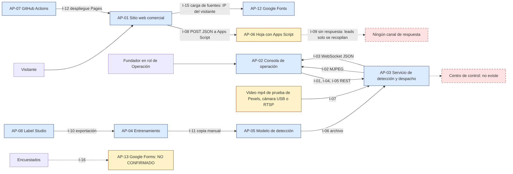
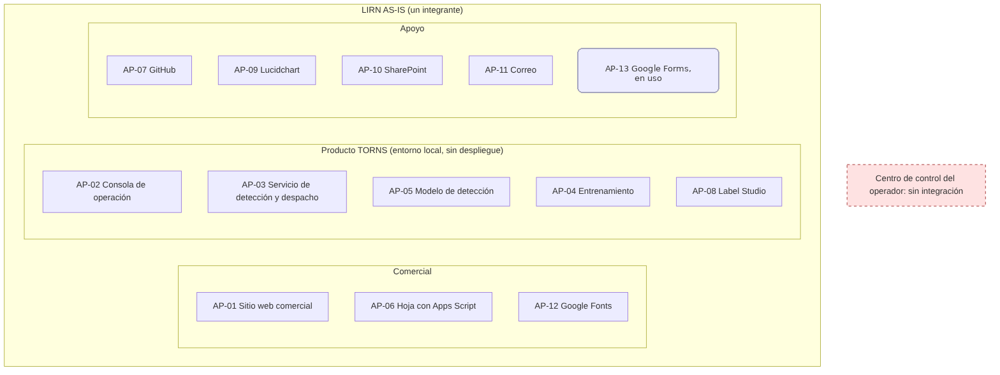
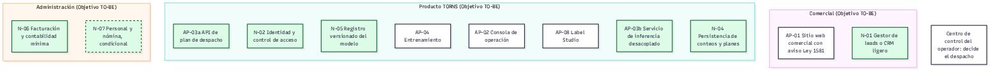
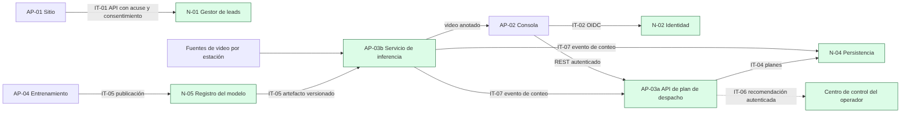

# Punto 3. Arquitectura de Aplicaciones

Fase C del ADM de TOGAF, dominio de aplicaciones. Este capítulo identifica los sistemas que usa LIRN para operar la firma y el producto TORNS, la forma en que se comunican, los problemas que presentan y la propuesta de interoperabilidad. Corte de evidencia: código de las ramas principales de los repositorios públicos de la firma, leído entre el 28 de octubre y el 1 de noviembre de 2026, y declaraciones del dueño del 1 de noviembre de 2026.

Marcas usadas: **Observado** (presente en código, configuración o declaración del dueño), **Diseñado AS-IS** (decisión de empresa para describir el presente), **Objetivo TO-BE** (estado futuro, no existe hoy) y **NO CONFIRMADO** (sin soporte en las fuentes de la firma).

## 3.1 Contexto

<!-- reescribir Santiago -->
LIRN tiene un único integrante, Johel Santiago Arias, que ejerce los roles de Dirección, Comercial, Producto, Operación y Calidad (Observado). Por eso el área usuaria de cada aplicación se expresa como rol del fundador. Ninguna aplicación tiene usuarios de un operador de transporte, porque no existe piloto ni contrato (Observado).

<!-- reescribir Santiago -->
Solo el sitio web comercial está publicado, mediante GitHub Pages. La consola de operación y el servicio de detección corren únicamente en el equipo local del fundador (Observado). Azure y GCP se mantienen como alternativas de despliegue, con decisión pendiente (Objetivo TO-BE; alternativas declaradas por el dueño el 1 de noviembre de 2026; su análisis corresponde a la Arquitectura Tecnológica; costos NO CONFIRMADO).

## 3.2 Inventario de aplicaciones

| Código | Aplicación | Función | Área usuaria | Tipo | Estado | Marca |
|---|---|---|---|---|---|---|
| AP-01 | Sitio web comercial de LIRN y TORNS (lirn-web-main) | Presenta la firma y el producto TORNS y recibe mensajes de interés mediante un formulario de contacto | Visitantes externos; rol Comercial (fundador) | Propia (web estática) | En uso; publicado por GitHub Pages | Observado |
| AP-02 | Consola de operación de estaciones (tro-frontend) | Muestra video con detecciones, métricas por cámara, estado de estaciones y plan de despacho | Rol de Operación y de Producto (fundador) en demostración; sin usuarios de operador | Propia (aplicación web) | Prototipo en entorno local; sin despliegue | Observado; sin despliegue; Observado por declaración del dueño (1 de noviembre de 2026) |
| AP-03 | Servicio de detección de pasajeros y plan de despacho, API (tro-backend) | Ejecuta la detección sobre video, publica métricas por WebSocket y aplica la regla determinista de despacho. Videos de prueba obtenidos de Pexels; Observado por declaración del dueño (1 de noviembre de 2026). | Consumido por AP-02; rol de Producto | Propia (servicio REST y WebSocket) | Prototipo en entorno local; sin despliegue | Observado |
| AP-04 | Entrenamiento del modelo de detección (yolo-train-routes-optimization) | Prepara el conjunto de datos, entrena y exporta el modelo de detección de personas. Último entrenamiento el 15 de noviembre de 2025; Observado por declaración del dueño (1 de noviembre de 2026). Los resultados del entrenamiento quedaron versionados en el commit 825daf5 del 16 de noviembre de 2025 (Observado, historial git de yolo-train-routes-optimization). El dataset es coco-person de Roboflow con licencia MIT; Observado por declaración del dueño (1 de noviembre de 2026). En el repositorio, data.yaml solo declara la clase person y el README no menciona el origen. | Rol de Producto y de Calidad (fundador) | Propia (cuaderno y scripts) | En uso para entrenamiento; ejecución local | Observado |
| AP-05 | Modelo de detección (my_model/my_model.pt, en yolo-train-routes-optimization) | Artefacto de IA de una clase (person) consumido por AP-03 como archivo local | Consumido por AP-03 | Artefacto de IA | Versionado en el repositorio de entrenamiento | Observado |
| AP-06 | Hoja de cálculo con Apps Script (hoja de Google; endpoint configurado en VITE_CONTACT_ENDPOINT) | Recibe y guarda los mensajes del formulario con las columnas timestamp, nombre, email, organizacion, mensaje y origen; la consulta solo el dueño. Reside en la cuenta personal de Google de Santiago, sin acceso de terceros; los leads no se responden, solo se recopilan; Observado por declaración del dueño (1 de noviembre de 2026). | Rol Comercial (fundador, único consultor) | Tercero SaaS (Google) | En uso como sustituto de CRM | Observado por declaración del dueño (1 de noviembre de 2026); código del script NO CONFIRMADO en repositorios |
| AP-07 | GitHub: repositorios, Pages y Actions (github.com/5arSanti) | Control de versiones, pruebas y publicación del sitio | Rol de Producto (fundador) | Herramienta de desarrollo (SaaS) | En uso | Observado |
| AP-08 | Label Studio (en Docker; exportaciones en mydata/) | Etiquetado de imágenes del conjunto de datos del modelo de visión. Usa una cuenta de anotador con datos personales (AI-04); riesgo alto de privacidad; Observado por declaración del dueño (1 de noviembre de 2026). | Rol de Producto (fundador) | Herramienta de etiquetado (código abierto, local) | En uso para el modelo de visión | Observado (instrucciones y árbol); uso confirmado por el dueño (1 de noviembre de 2026) |
| AP-09 | Lucidchart (SaaS) | Diagramación de arquitectura y procesos | Rol de Dirección (fundador) | Tercero SaaS | En uso según el registro; adopción para el Punto 3 por evaluar | Diseñado AS-IS |
| AP-10 | SharePoint (Microsoft 365) | Almacenamiento de documentos de apoyo; no compromete la operación del producto | Rol de Dirección y Calidad (fundador) | Tercero SaaS, apoyo documental | En uso como apoyo documental | Diseñado AS-IS |
| AP-11 | Correo electrónico | Comunicación y resguardo de algunos documentos; no compromete la operación del producto. No se usa para responder leads; Observado por declaración del dueño (1 de noviembre de 2026). | Todos los roles (fundador) | Tercero SaaS, apoyo documental | En uso como apoyo documental | Diseñado AS-IS |
| AP-12 | Google Fonts (fonts.googleapis.com y fonts.gstatic.com, enlazados en AP-01) | Entrega la tipografía Manrope al navegador del visitante; al cargar el sitio, el navegador envía la IP del visitante a Google (flujo F-03 de Datos) | Visitantes externos (consumo indirecto) | Tercero SaaS (Google), servicio externo | En uso | Observado |
| AP-13 | Google Forms (formulario de la encuesta de validación) | Recoge las respuestas de la encuesta de validación (flujo F-14 de Datos); formulario «Tu experiencia diaria en el transporte masivo de Bogotá». Sigue en uso. Observado por declaración del dueño (1 de noviembre de 2026). El soporte de la entrevista (F-15) no está confirmado | Rol de Dirección y Producto (fundador) | Tercero SaaS (Google) | En uso | Observado por declaración del dueño (1 de noviembre de 2026) |

<!-- reescribir Santiago -->
Observaciones sobre el inventario:

- El servicio de detección admite como fuente un archivo de video, una cámara USB o una URL RTSP (Observado en código). Se han hecho pruebas con cámaras USB integradas en portátiles (usb0) y con cámaras USB externas (usb1). Observado por declaración del dueño (2 de noviembre de 2026): pruebas con usb0 y usb1 los días 16, 17, 18 y 20 de noviembre de 2025, en varios portátiles y PC con cámaras externas; resultados NO CONFIRMADO.
- Las métricas del modelo de detección son de entrenamiento, no de operación. Si se citan, se nombran como tales: recall de 0,55 en la última época de entrenamiento sobre imágenes genéricas (Observado; fuente: métrica de entrenamiento de la última época en results.csv de yolo-train-routes-optimization; entrenamiento del 15 de noviembre de 2025); Observado por declaración del dueño (1 de noviembre de 2026) para la fecha, el dataset coco-person de Roboflow y la licencia MIT.
- La hoja de cálculo recibe los mensajes mediante el Apps Script configurado en VITE_CONTACT_ENDPOINT. El código del script no está en los repositorios (NO CONFIRMADO).
- Google Fonts entra al inventario porque el sitio carga su tipografía desde servidores de Google y, con ello, entrega la IP de cada visitante a un tercero (Observado en código).
- Google Forms se registra por el flujo de la encuesta de validación descrito en la Arquitectura de Datos. Sigue en uso. Observado por declaración del dueño (1 de noviembre de 2026). El enlace público del formulario resuelve a la página «Tu experiencia diaria en el transporte masivo de Bogotá» (Observado el 1 de noviembre de 2026).
- No existen CRM, ERP, sistema de identidad ni mesa de servicio (Observado como ausencia).

## 3.3 Mapa de integraciones

| ID | Origen | Destino | Tipo y protocolo | Datos intercambiados | Autenticación | Flujo de Datos | Marca |
|---|---|---|---|---|---|---|---|
| I-01 | AP-02 | AP-03 | REST; HTTP GET /api/v1/videos/list, JSON | Lista de videos y cámaras | Ausente | F-17 | Observado |
| I-02 | AP-03 | AP-02 | Flujo de video; HTTP GET /videos/{id}/stream, multipart/x-mixed-replace (MJPEG) en etiqueta de imagen | Fotograma anotado JPEG | Ausente | F-06 | Observado |
| I-03 | AP-03 | AP-02 | WebSocket; WS /videos/ws/{id}/detections, JSON | video_id, timestamp, total_objects, person_count, label_counts | Ausente | F-07 | Observado |
| I-04 | AP-02 | AP-03 | REST; HTTP GET y POST /routing/*, JSON | Trenes, estaciones, estado, solicitud y plan de despacho | Ausente | F-09, F-10 | Observado |
| I-05 | AP-02 | AP-03 | REST (sondeo); HTTP GET /health, JSON | Estado de salud | Ausente | n/a | Observado |
| I-06 | AP-05 | AP-03 | Archivo; Lectura de archivo .pt por ruta relativa al monorepo | Pesos del modelo | No aplica | F-12 | Observado |
| I-07 | Fuente de video (archivos de prueba de Pexels, cámara USB o URL) | AP-03 | Captura; OpenCV sobre archivo mp4, índice o dispositivo USB, o URL RTSP | Fotogramas | No aplica | F-04 | Observado (código); Observado por declaración del dueño (2 de noviembre de 2026): pruebas con usb0 y usb1 los días 16, 17, 18 y 20 de noviembre de 2025, en varios portátiles y PC con cámaras externas; resultados NO CONFIRMADO |
| I-08 | AP-01 | AP-06 | HTTP hacia Apps Script; POST con JSON en texto plano a la URL de VITE_CONTACT_ENDPOINT; éxito por HTTP 200 sin confirmación | nombre, email, organizacion, mensaje, origen (la hoja agrega timestamp) | Ausente | F-01 | Observado en sitio; Observado por declaración del dueño (1 de noviembre de 2026); script NO CONFIRMADO en repositorios |
| I-09 | AP-06 | Ninguno | Sin integración; Los leads solo se recopilan en la hoja; no se responden ni se envían a AP-11 | Lead | No aplica | F-02 | Observado por declaración del dueño (1 de noviembre de 2026; ausencia de respuesta) |
| I-10 | AP-08 | AP-04 | Archivo; Exportaciones de etiquetas en mydata/ | Anotaciones e imágenes | No aplica | F-11 | Observado |
| I-11 | AP-04 | AP-05 | Archivo; Copia manual de best.pt a my_model/my_model.pt | Pesos del modelo | No aplica | F-12 | Observado |
| I-12 | AP-07 | AP-01 | CI/CD; GitHub Actions: instalar, probar, compilar, desplegar Pages | Sitio compilado | Token de GitHub de la plataforma | F-03, F-16 | Observado |
| I-13 | AP-01 a AP-05 (estación del fundador) | AP-07 | Control de versiones; Git sobre HTTPS | Código y artefactos | Cuenta de GitHub | F-13 | Observado |
| I-14 | AP-03 | Centro de control del operador | No existe; n/a | n/a | n/a | n/a | Observado (ausencia de integración) |
| I-15 | AP-01 (navegador del visitante) | AP-12 | Recurso externo; HTTPS GET de hoja de estilos y fuentes (preconnect a fonts.googleapis.com y fonts.gstatic.com) | IP del visitante y cabeceras del navegador hacia Google; tipografía hacia el navegador | No aplica | F-03 | Observado |
| I-16 | Encuestados | AP-13 | Formulario SaaS; Formulario web de Google | Respuestas de la encuesta; notas de entrevista fuera de aplicación | Cuenta de Google del dueño | F-14, F-15 | Uso actual: Observado por declaración del dueño (1 de noviembre de 2026); soporte de F-15 NO CONFIRMADO |

<!-- reescribir Santiago -->
Lectura del mapa:

- Ninguna integración conecta con un sistema de un operador de transporte. Las integraciones con terceros son comerciales o de apoyo: la hoja con Apps Script, Google Fonts y Google Forms. Marca: Observado; para Google Forms, Observado por declaración del dueño (1 de noviembre de 2026).
- Las integraciones entre la consola y el servicio de detección (I-01 a I-05) no tienen autenticación, y la API acepta cualquier origen por CORS (Observado).
- I-03 depende de I-02: si nadie consume el flujo de video, no hay inferencia ni métricas (Observado por lectura estática).
- I-06 e I-11 acoplan el modelo por sistema de archivos: el servicio lo ubica por una ruta relativa al monorepo y el archivo de pesos se copia a mano tras cada entrenamiento (Observado).
- I-13 publica en un repositorio público la base de Label Studio, que contiene datos personales de una cuenta de anotador; el hallazgo coincide con el problema de información PI-13 de la Arquitectura de Datos (Observado).
- I-14 registra la brecha principal: no hay integración con el centro de control del operador, y solo puede presentarse como Objetivo TO-BE.

## 3.4 Problemas de aplicaciones

<!-- reescribir Santiago -->
Criterio de severidad: Alta si afecta el cumplimiento legal, la seguridad o la capacidad central de conteo y despacho; Media si limita la continuidad, el piloto o la integración; Baja si es de consistencia o deuda técnica sin efecto operativo. Los hallazgos se reportan en el AS-IS; este proyecto no modifica código. PR-08 y PR-12 se clasifican como Alta: PR-08 afecta el despacho, porque la consulta del plan devuelve "no encontrado" (problema de información PI-05 de la Arquitectura de Datos), y PR-12 es un problema de seguridad.

| ID | Problema | Categoría | Aplicaciones | Marca | Severidad | Propuesta |
|---|---|---|---|---|---|---|
| PR-01 | La hoja de cálculo actúa como sustituto de CRM; el sitio da por recibido el mensaje con cualquier HTTP 200, sin acuse, reintento ni cola | Dependencia de hoja de cálculo; falta de integración | AP-01, AP-06 | Observado | Media | N-01, IT-01, RA-01 |
| PR-02 | Riesgo actual Ley 1581: el formulario recopila datos personales sin política de tratamiento ni casilla de autorización; los datos quedan en la cuenta personal de Google del dueño; el análisis jurídico es de Datos | Seguridad y cumplimiento (adicional) | AP-01, AP-06 | Observado en código; Observado por declaración del dueño (1 de noviembre de 2026) | Alta | IT-01 |
| PR-03 | Sin autenticación ni autorización en la API y la consola; CORS abierto con credenciales | Seguridad (adicional) | AP-02, AP-03 | Observado | Alta | N-02, IT-02 |
| PR-04 | Inferencia ligada al flujo de video: sin cliente no hay conteo, y cada cliente crea su propio ciclo de inferencia | Falta de integración (acoplamiento) | AP-02, AP-03, AP-05 | Observado (lectura estática) | Alta | AP-03b, IT-07 |
| PR-05 | Conteos, estado y planes de despacho solo en memoria; se pierden al reiniciar | Falta de persistencia (adicional) | AP-03 | Observado | Alta | N-04, IT-04 |
| PR-06 | Sin integración con el centro de control del operador | Falta de integración | AP-03 | Observado (ausencia) | Media | IT-06 |
| PR-07 | Modelo acoplado a la estructura del monorepo y copiado a mano; deriva de versiones de Ultralytics y Python entre entrenamiento y API | Falta de integración (empaquetado) | AP-03, AP-04, AP-05 | Observado; efecto en contenedor NO CONFIRMADO | Media | N-05, IT-05 |
| PR-08 | Identificadores de estación inconsistentes (station_sur frente a station_sur_usb0) y estación usb1 sin fuente en el listado | Defecto de aplicación (adicional) | AP-02, AP-03 | Observado (lectura estática; verificación pendiente) | Alta | RA-04 (corrección TO-BE) |
| PR-09 | Identidad TRO residual en nombres, descripciones y contenedores (incluye etl-migration-api heredado) | Consistencia de identidad (adicional) | AP-02, AP-03 | Observado | Baja | RA-02 |
| PR-10 | Textos sin respaldo: cifrado y acceso controlado, "despacho óptimo", "Centro de control", frames por WebSocket | Consistencia de identidad; posible duplicidad de fuentes de verdad del producto | AP-01, AP-02, AP-03 | Observado | Baja | RA-03 |
| PR-11 | Código sin uso registrado: middleware de tamaño no activado y lista de detecciones simuladas | Deuda técnica (adicional) | AP-02, AP-03 | Observado (uso de H-38 NO CONFIRMADO) | Baja | RA-05 |
| PR-12 | Sin pruebas del backend; imagen con dependencias de desarrollo, recarga automática y puerto de depuración expuesto | Calidad y seguridad (adicional) | AP-03 | Observado | Alta | Insumo para la Arquitectura Tecnológica |
| PR-13 | Sin despliegue de AP-02 ni AP-03 fuera del equipo local; sin entorno de piloto separado | Falta de plataforma (adicional, detalle en la Arquitectura Tecnológica) | AP-02, AP-03 | Observado | Media | Insumo para la Arquitectura Tecnológica (Azure y GCP como alternativas, decisión pendiente) |
| PR-14 | Herramientas personales sin gobierno formal (Label Studio local, hoja, SharePoint, correo); base de Label Studio versionada en repositorio público con una cuenta de anotador con datos personales (AI-04), riesgo alto de privacidad | Dependencia de herramientas externas | AP-06, AP-08, AP-10, AP-11 | Observado | Alta | RA-06 |
| PR-15 | Ausencia de ERP o aplicación de facturación y contabilidad | Capacidad ausente | Ninguna | Observado (ausencia) | Baja (pasa a Media cuando haya un piloto contratado) | N-06 |
| PR-16 | Cámaras físicas sin prueba documentada: el código soporta USB y RTSP, el dueño declara pruebas con usb0 (cámaras integradas en portátiles) y usb1 (cámaras USB externas) con fechas declaradas y sin resultados registrados | Evidencia (adicional) | AP-03 | Observado por declaración del dueño (2 de noviembre de 2026): pruebas con usb0 y usb1 los días 16, 17, 18 y 20 de noviembre de 2025, en varios portátiles y PC con cámaras externas; resultados NO CONFIRMADO | Media | Insumo para el Roadmap de Transformación (sesión de prueba documentada) |
| PR-17 | Leads recopilados sin respuesta ni seguimiento: el interés recibido no se convierte en gestión comercial | Proceso manual inexistente (adicional) | AP-06 | Observado por declaración del dueño (1 de noviembre de 2026) | Media | N-01 |

<!-- reescribir Santiago -->
No se observan aplicaciones duplicadas. Lo que se duplica es el texto del producto, presente en el sitio y en la consola con mensajes distintos (PR-10).

## 3.5 Propuesta de interoperabilidad (Objetivo TO-BE)

<!-- reescribir Santiago -->
Todo este apartado es Objetivo TO-BE. Horizonte, prioridad y costo los define el Roadmap de Transformación con insumos de la Arquitectura Tecnológica; aquí no se fijan cifras.

### Aplicaciones nuevas

| ID | Aplicación propuesta | Problema | Requisito de negocio (TO-BE de negocio, sec. 5 y 6) | Dependencia |
|---|---|---|---|---|
| N-01 | Gestor de leads o CRM ligero con base de datos integrada | PR-01, PR-02, PR-17 | Registro de leads con autorización; gestor de leads en reemplazo de la hoja | Arquitectura de Datos (modelo de lead y autorización); Roadmap de Transformación (riesgo y control; NO CONFIRMADO) |
| N-02 | Identidad y control de acceso de usuarios (consola y API) | PR-03 | Autenticación en AP-02 | Arquitectura Tecnológica (proveedor de identidad) |
| N-03 (AP-03b) | Servicio de inferencia desacoplado de la entrega de video; en adelante se identifica solo como AP-03b | PR-04 | AP-03b con inferencia desacoplada | Arquitectura Tecnológica (cómputo) |
| N-04 | Persistencia de conteos, estado y planes de despacho | PR-05 | Historial de conteos y recomendaciones por estación y fecha | Arquitectura de Datos (modelo lógico), Arquitectura Tecnológica (base de datos) |
| N-05 | Registro versionado del modelo | PR-07 | Versionado de modelo antes de cada entrega (P-03) | Arquitectura Tecnológica |
| N-06 | Facturación electrónica y contabilidad mínima (SaaS) | PR-15 | Contratos, actas y facturación del piloto; servicio de aplicación de P-08, Gestión financiera y facturación (CAP-09) | Formalización legal ante Cámara de Comercio y DIAN (C-01); fuente normativa: Resolución DIAN 000165 de 2023 |
| N-07 | Gestión de personal y nómina (SaaS) | Ninguno (necesidad TO-BE; no hay personal vinculado) | Servicio de aplicación de P-09, Gestión del talento humano (CAP-10); se activa solo cuando haya personal que vincular | Arquitectura de Datos (entidades colaborador y contrato_laboral, condicionales); fuentes normativas: Resolución DIAN 000013 de 2021 (nómina electrónica), Ley 100 de 1993 (afiliación y aportes a seguridad social) y Decreto 1072 de 2015 (PILA para teletrabajadores) |

### Integraciones recomendadas

| ID | Origen | Destino | Tipo | Estándar o patrón | Problema | Dependencia |
|---|---|---|---|---|---|---|
| IT-01 | AP-01 | N-01 | API con acuse de recibo | REST JSON sobre HTTPS, validación, reintento, registro de consentimiento | PR-01, PR-02 | N-01 |
| IT-02 | AP-02, AP-03a | N-02 | Autenticación | OIDC y tokens con roles; CORS restringido | PR-03 | N-02 |
| IT-04 | AP-03a | N-04 | Persistencia | Escritura de planes y estados | PR-05 | N-04 |
| IT-05 | AP-04 | N-05, AP-03b | Publicación de artefacto | Modelo versionado con metadatos y entorno fijado | PR-07 | N-05 |
| IT-06 | AP-03a | Centro de control del operador | Recomendación autenticada | API o mensaje acordado con el operador; el operador decide | PR-06 | N-02, N-04, acuerdo con operador (P-07) |
| IT-07 | AP-03b | AP-03a y N-04 | Asíncrona por evento | Evento de conteo por estación; contrato definido en la partición del servicio de detección | PR-04 | AP-03b |

### Partición del servicio de detección

<!-- reescribir Santiago -->
Hoy el servicio de detección entrega video, infiere y calcula el despacho dentro del mismo ciclo (Observado). Se propone separarlo en dos servicios lógicos; la Arquitectura Tecnológica decide cómo se despliegan.

| Servicio TO-BE | Responsabilidad | Entradas | Salidas |
|---|---|---|---|
| AP-03a API de plan de despacho | Expone REST a AP-02, aplica la regla determinista de despacho, consulta estado e historial | Eventos de conteo de AP-03b; solicitudes autenticadas de AP-02 (N-02) | Plan de despacho, estado por estación (JSON); escritura en N-04 |
| AP-03b Servicio de inferencia del modelo | Captura cada fuente de video y ejecuta la detección de forma continua, sin depender de que alguien abra el flujo | Fuentes de video por estación (archivo, USB o RTSP); modelo versionado de N-05 | Evento de conteo por estación (camera_id, station_id, timestamp, person_count, label_counts, versión del modelo); flujo anotado opcional para visualización |

Contrato entre ambos servicios (IT-07):

| Atributo | Definición propuesta |
|---|---|
| Tipo | Asíncrona por evento (publicación y suscripción o cola); consulta síncrona REST de salud y del último conteo como respaldo |
| Dirección | AP-03b publica; AP-03a y N-04 consumen |
| Contrato del mensaje | JSON con camera_id, station_id, timestamp, person_count, label_counts y versión del modelo (Objetivo TO-BE). total_objects, presente hoy en el WebSocket de I-03 (Observado), queda fuera del evento: es un dato derivado que la Arquitectura de Datos conserva en observacion_conteo (modelo lógico) y no se transporta hasta que la Arquitectura Tecnológica elija la cola |
| Visualización | La consola recibe el video anotado de AP-03b, separado de los conteos, de modo que cerrar la vista no detenga la inferencia |
| Seguridad | Autenticación entre servicios y red interna (detalle en la Arquitectura Tecnológica) |
| Tecnología de cola | NO CONFIRMADO; la elige la Arquitectura Tecnológica |

### Elementos a retirar, consolidar o corregir

| ID | Elemento | Motivo | Reemplazo |
|---|---|---|---|
| RA-01 | Rol de la hoja de cálculo como CRM | Dependencia de hoja, sin control | N-01 |
| RA-02 | Identidad TRO residual (descripciones, etl-migration-api, etl-network); estandarización opcional de nombres tro-* de repositorios | Regla de identidad; nombres conservados en AS-IS por decisión del dueño | Nombres TORNS |
| RA-03 | Textos sin respaldo en consola y sitio | Afirmaciones no evidenciadas | Textos alineados con lo observado |
| RA-04 | Inconsistencia de identificadores de estación | Defecto | Identificador único por estación |
| RA-05 | Middleware no activado y lista de detecciones simuladas | Código sin uso | Activar o eliminar |
| RA-06 | Base de Label Studio en repositorio público | Exposición de datos personales de la cuenta de anotador (AI-04), riesgo alto | Almacenamiento privado |
| RA-07 | Carga de Google Fonts desde servidores de Google (AP-12) | Cada visita transfiere la IP del visitante a un tercero sin aviso | Tipografía alojada con el propio sitio, o mención expresa en el aviso de tratamiento |

### Dependencias lógicas

<!-- reescribir Santiago -->
N-02 precede a IT-06. N-04 precede a cualquier análisis histórico. AP-03b precede al uso de varias cámaras. N-06 se implanta después de la formalización legal ante Cámara de Comercio y DIAN. N-07 se implanta solo cuando haya personal que vincular y después de la formalización legal (C-01). IT-06 solo procede con un operador real y un acuerdo firmado; hoy no hay piloto.

## 3.6 Relación con las demás arquitecturas

<!-- reescribir Santiago -->
- Negocio: la autenticación con roles de operador en la consola y en la API, el registro versionado del modelo y la facturación quedan recogidos como necesidades de aplicación en el TO-BE de negocio, con el registro versionado del modelo ligado a P-03 (CAP-04 y CAP-08), la facturación ligada a P-08 y CAP-09 (N-06) y la gestión de personal y nómina ligada a P-09 y CAP-10 (N-07), procesos aprobados por Santiago el 1 de noviembre de 2026.
- Datos: los flujos F-01 a F-17 se cruzaron con este mapa. El evento IT-07 no transporta total_objects, porque es un dato derivado que el modelo lógico conserva en observacion_conteo.
- Tecnología: la cola de IT-07, el proveedor de identidad y los entornos separados de AP-03a y AP-03b se definen en la Arquitectura Tecnológica.

### Cierre de diferencias con otras arquitecturas

| ID | Arquitectura | Diferencia | Estado |
|---|---|---|---|
| DF-01 | Arquitectura de Datos | F-01 no precisa que el cuerpo viaja como JSON en texto plano ni que el éxito se infiere de HTTP 200 sin acuse | Cerrada en el lado de Datos, aprobado por Santiago el 1 de noviembre de 2026 |
| DF-02 | Arquitectura de Datos | La cita de la carga del modelo en F-12 no coincide con las líneas del código | Cerrada en el lado de Datos, aprobado por Santiago el 1 de noviembre de 2026 |
| DF-03 | Arquitectura de Datos | La hoja de cálculo figuraba como NO CONFIRMADO | Cerrada: Observado por declaración del dueño (1 de noviembre de 2026) |
| DF-04 | Arquitectura de Datos | La cámara en vivo figura sin matiz; las pruebas con usb0 y usb1 no están documentadas | Cerrada en el lado de Datos, aprobado por Santiago el 1 de noviembre de 2026 |
| DF-05 | Arquitectura de Negocio | La autenticación se pedía solo en AP-02; esta arquitectura la extiende a AP-03a | Cerrada: el TO-BE de negocio la incluye en AP-03a |
| DF-06 | Arquitectura de Negocio | Posible afirmación de un límite de tamaño de solicitud activo | Cerrada: no se afirma ese límite |
| DF-07 | Arquitectura de Negocio | El recall de 0,55 se citaba sin indicar que es métrica de entrenamiento | Cerrada: se precisa como métrica de la última época de entrenamiento |
| DF-08 | Arquitectura de Negocio | El registro versionado del modelo y la facturación no figuraban como necesidades de aplicación | Cerrada: el TO-BE de negocio recoge el registro versionado del modelo ligado a P-03 (CAP-04 y CAP-08) y la facturación ligada a P-08 y CAP-09 |
| DF-09 | Arquitectura de Datos | F-02 suponía atención manual de los leads | Cerrada: F-02 figura como inexistente en el AS-IS |
| DF-10 | Arquitectura de Datos | Origen de los videos, del dataset y fecha de entrenamiento sin confirmar | Cerrada para videos de Pexels, fecha de entrenamiento del 15 de noviembre de 2025 y dataset coco-person de Roboflow con licencia MIT; Observado por declaración del dueño (1 de noviembre de 2026) |
