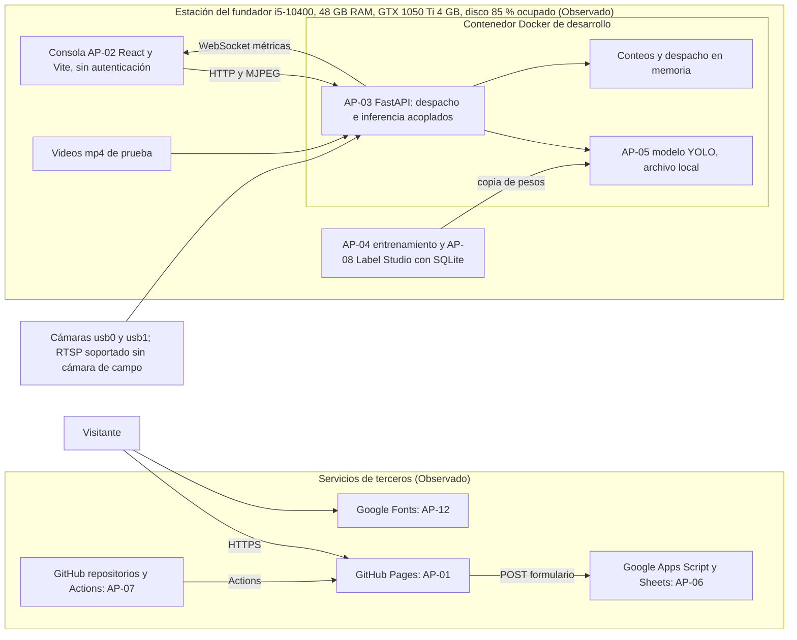
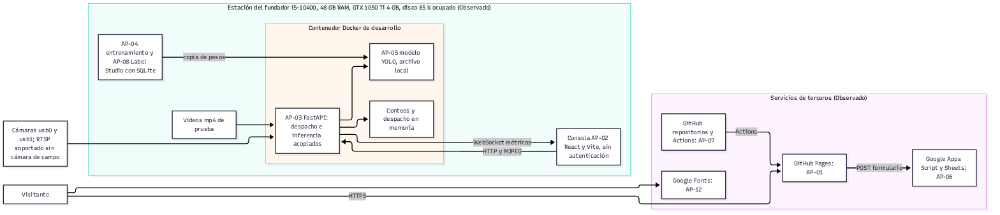
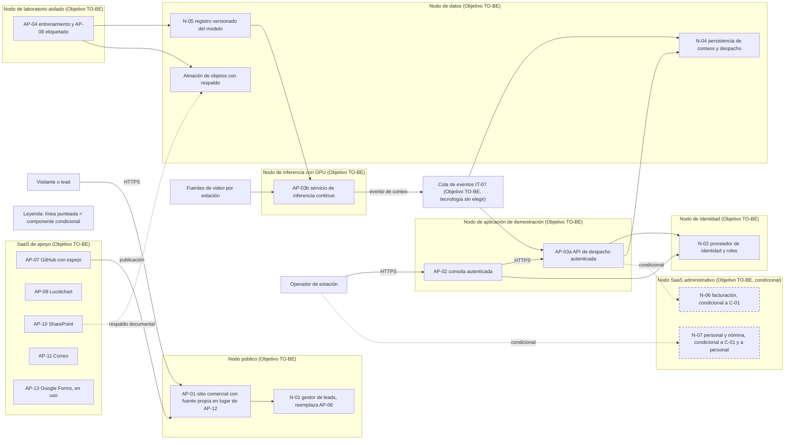
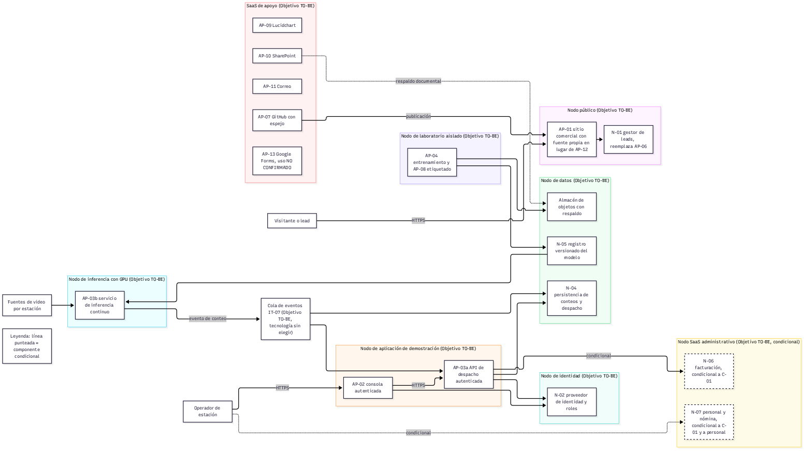

# Arquitectura Tecnológica de LIRN (proyectada LIRN S.A.S.) (Fase D del ADM, Punto 4 del taller)

## 1. Alcance y punto de partida

LIRN no opera servidores ni GPU de producción. TORNS es un prototipo que se ejecuta en la estación de trabajo del fundador y en servicios de terceros. Marca: Observado (el código no contiene despliegue de backend). La inexistencia de despliegues fuera de la estación y de respaldos: Observado por declaración del dueño (1 de noviembre de 2026).

La Arquitectura Tecnológica traduce las necesidades de la Arquitectura de Aplicaciones y de la Arquitectura de Datos en nodos de despliegue, de modo que cada componente TO-BE tenga dónde ejecutarse, con qué seguridad y con qué respaldo. Marca: Objetivo TO-BE.

## 2. Inventario tecnológico AS-IS

### 2.1 Servidores y equipos

| ID | Elemento | Descripción | Marca |
|---|---|---|---|
| IT-EQ-01 | Estación del fundador | Intel Core i5-10400 a 2,90 GHz, 48 GB de RAM, NVIDIA GeForce GTX 1050 Ti de 4 GB, 1,14 TB de almacenamiento con 975 GB usados (cerca del 85 %), Windows de 64 bits | Observado por declaración del dueño (1 de noviembre de 2026) |
| IT-EQ-02 | GPU de entrenamiento | La misma GTX 1050 Ti; la salida del cuaderno registra PyTorch 2.7.1 con CUDA 11.8 y Ultralytics 8.3.228 | Observado |
| IT-EQ-03 | Cámaras | Cámara integrada usb0 y cámara USB externa usb1 | Observado por declaración del dueño (1 de noviembre de 2026) |
| IT-EQ-04 | Pruebas con cámaras | Se han hecho pruebas con cámaras USB integradas en portátiles (usb0) y con cámaras USB externas (usb1) | Observado por declaración del dueño (2 de noviembre de 2026): pruebas con usb0 y usb1 los días 16, 17, 18 y 20 de noviembre de 2025, en varios portátiles y PC con cámaras externas; resultados NO CONFIRMADO |
| IT-EQ-05 | Servidores de producción | No existen | Observado |
| IT-EQ-06 | GPU de producción | No existe | Observado |

### 2.2 Redes

| ID | Elemento | Descripción | Marca |
|---|---|---|---|
| IT-RD-01 | Red local de la estación | La consola llama a la API en localhost por defecto (http://localhost:8000/api/v1) | Observado |
| IT-RD-02 | Puertos del contenedor | Puerto de la API por variable PORT y puerto de depuración 5678 publicado | Observado |
| IT-RD-03 | Puerto de etiquetado | 8080 para Label Studio | Observado |
| IT-RD-04 | Transporte de video y métricas | MJPEG sobre HTTP y métricas por WebSocket, sin cifrado propio | Observado |
| IT-RD-05 | Fuente RTSP | Soportada por el backend; no hay cámara de campo instalada | Observado |
| IT-RD-06 | Segmentación, firewall o VPN | No existen actualmente segmentación de red, firewall ni VPN | Observado por declaración del dueño (1 de noviembre de 2026) |

### 2.3 Plataformas y software base

| ID | Elemento | Descripción | Marca |
|---|---|---|---|
| IT-SW-01 | Contenedor del backend | Python 3.11 slim, FastAPI, Uvicorn con recarga automática, Ultralytics y OpenCV; paquetes de desarrollo incluidos | Observado |
| IT-SW-02 | Docker Compose | Un servicio, verificación de salud cada 30 segundos, depuración activa por defecto; nombre de contenedor y red residual de otro proyecto | Observado |
| IT-SW-03 | Consola de operación | React 19 con Vite, ejecución local | Observado |
| IT-SW-04 | Sitio comercial | React con Vite; pruebas y publicación con GitHub Actions en GitHub Pages | Observado |
| IT-SW-05 | Entrenamiento | Anaconda, Python 3.13, Ultralytics YOLO11, cuaderno | Observado |
| IT-SW-06 | Etiquetado | Label Studio en Docker con volumen local | Observado |

### 2.4 Bases de datos y almacenamiento

| ID | Elemento | Descripción | Marca |
|---|---|---|---|
| IT-BD-01 | Base de datos de producción | No existe | Observado |
| IT-BD-02 | Estado del backend | Conteos y plan de despacho solo en memoria; se pierden al reiniciar | Observado |
| IT-BD-03 | Base SQLite de Label Studio | Dentro del repositorio de entrenamiento, con cuenta de anotador | Observado |
| IT-BD-04 | Pesos, imágenes, exportes y videos | Versionados en repositorios; videos duplicados entre backend y entrenamiento | Observado |
| IT-BD-05 | Dataset preprocesado | Vive en la estación, fuera del repositorio, sin respaldo | Observado por declaración del dueño (1 de noviembre de 2026) |
| IT-BD-06 | Leads | Hoja de Google alimentada por Apps Script en la cuenta personal del dueño | Observado por declaración del dueño (1 de noviembre de 2026) |

### 2.5 Nube y servicios de terceros

| ID | Servicio | Uso | Marca |
|---|---|---|---|
| IT-NB-01 | GitHub, Pages y Actions | Repositorios y publicación del sitio comercial | Observado |
| IT-NB-02 | Google Apps Script y Sheets | Recepción de leads por POST desde el formulario | Observado |
| IT-NB-03 | Google Fonts | Tipografía del sitio comercial | Observado |
| IT-NB-04 | Lucidchart, SharePoint y correo | Apoyo documental | Diseñado AS-IS |
| IT-NB-05 | Nube de cómputo | Solo como idea, sin despliegue | Observado por declaración del dueño (1 de noviembre de 2026) |

### 2.6 Modelo de detección

Las dos mediciones se reportan por separado y no se combinan:

1. Recall 0,55 en la última época de entrenamiento (entrenamiento del 15 de noviembre de 2025). Marca: Observado.
2. Validación final de los mejores pesos: P 0,74, R 0,541, mAP50 0,635, mAP50-95 0,373. Marca: Observado.

El conjunto de validación es una muestra del mismo dataset genérico de personas, sin imágenes de estaciones; Observado por declaración del dueño (1 de noviembre de 2026). Ninguna de las dos cifras anticipa el desempeño en andenes.

## 3. Diagrama tecnológico AS-IS

Marca: Diseñado AS-IS sobre hechos Observados.

## 4. Riesgos tecnológicos

Escala de riesgos cualitativa: Alta, Media, Baja.

| ID | Riesgo | Causa | Probabilidad | Impacto | Marca de la causa | Tratamiento (Objetivo TO-BE) |
|---|---|---|---|---|---|---|
| RT-01 | Dependencia de una sola persona | El fundador concentra operación, desarrollo y credenciales | Alta | Alta | Observado | Documento de recuperación y segundo custodio |
| RT-02 | Brecha de respaldo | Sin respaldos de pesos, dataset, base de etiquetado ni videos | Alta | Alta | Observado por declaración del dueño (1 de noviembre de 2026) | Respaldo fuera de la estación con prueba de restauración |
| RT-03 | Disco cerca de su capacidad | 975 GB usados de 1,14 TB | Media | Alta | Observado por declaración del dueño (1 de noviembre de 2026) | Almacén de objetos y retiro de duplicados |
| RT-04 | Límite de medición del modelo | Recall bajo sobre imágenes genéricas, sin evaluación en estación | Alta | Media | Observado | Evaluación con fuente de estación antes de un piloto |
| RT-05 | Brecha de autenticación | La consola y la API no autentican | Media | Alta | Observado | N-02 en AP-02 y AP-03a |
| RT-06 | Configuración de desarrollo expuesta | CORS abierto, depuración y recarga activas, puerto 5678 publicado; sin segmentación de red, firewall ni VPN (IT-RD-06) | Media | Alta | Observado; IT-RD-06 Observado por declaración del dueño (1 de noviembre de 2026) | Imagen mínima y perfiles de entorno |
| RT-07 | Brecha de pruebas del backend | Configuración de pytest sin carpeta de pruebas ni integración continua | Alta | Media | Observado | Pruebas de contrato e integración continua |
| RT-08 | Estado volátil | Conteos en memoria | Alta | Media | Observado | N-04 |
| RT-09 | Datos personales en el laboratorio | Cuenta de anotador e imágenes de personas en repositorio | Media | Alta | Observado | Laboratorio aislado y tratamiento conforme a la Ley 1581 de 2012 |
| RT-10 | Dependencia de GitHub y Google | Publicación y leads en cuentas de terceros | Media | Media | Observado | Espejo de repositorios y N-01 |
| RT-11 | Cámara USB no equivale a cámara de campo | Solo usb0 y usb1 | Alta | Media | Observado por declaración del dueño (1 de noviembre de 2026) | Fuente de campo definida con un operador |
| RT-12 | Gestión de secretos | Plantilla presente; manejo real sin evidencia | Media | Media | NO CONFIRMADO | Gestor de secretos por entorno |
| RT-13 | Brecha: equipos obsoletos | GPU GTX 1050 Ti de 4 GB y disco al 85 % de ocupación en la única estación | Alta | Media | Observado | GPU bajo demanda para entrenamiento e inferencia y almacén de objetos fuera de la estación; costo estimado en el anexo de nube (VM con T4 en São Paulo, 0,894 USD/h en Azure y 0,781595 USD/h en GCP, precios de lista del 2 de noviembre de 2026) |

Las valoraciones son juicio de arquitectura y no medición. Marca: Diseñado AS-IS.

## 5. Propuesta tecnológica TO-BE

Marca de toda la sección: Objetivo TO-BE.

### 5.1 Modernización
1. Partición de AP-03 en AP-03a API de despacho y AP-03b servicio de inferencia continuo.
2. Imagen de ejecución mínima sin depurador ni recarga; pruebas e integración continua para backend y consola, con el patrón ya usado por el sitio comercial.
3. Persistencia N-04 según el modelo lógico de la Arquitectura de Datos.

### 5.2 Virtualización
1. Contenedores separados para AP-03a, AP-03b, laboratorio y demostración.
2. Entorno de entrenamiento y etiquetado reproducible, independiente de la instalación manual de la estación.

### 5.3 Cloud
1. Nodos de aplicación, datos e identidad alojables en nube; Azure y GCP se mantienen como alternativas, con decisión pendiente (Objetivo TO-BE, alternativas declaradas por el dueño el 1 de noviembre de 2026). Costos: el anexo «Anexo Punto 4. Comparativo de nube Azure y GCP para TORNS» los estima en São Paulo (Azure Brazil South y GCP southamerica-east1) como estimación a precios de lista de pago por uso consultados el 2 de noviembre de 2026: piloto de 1 a 3 cámaras, Azure 755,45 USD/mes y GCP 650,11 USD/mes; escala de 15 cámaras, Azure 3.096,77 USD/mes y GCP 2.864,32 USD/mes. El equipo recomienda GCP (Objetivo TO-BE); la decisión es de Santiago y sigue pendiente.
2. GPU bajo demanda para entrenamiento e inferencia, no permanente.
3. Almacén de objetos versionado para pesos, videos y exportes.

### 5.4 Seguridad
1. Autenticación con roles en AP-02 y en AP-03a mediante N-02 (cierre de DF-05).
2. Orígenes permitidos explícitos y cifrado de video, métricas y eventos.
3. Autenticación entre AP-03b, la cola y AP-03a.
4. Gestor de secretos, registro de accesos y retiro de datos personales de repositorios públicos conforme a la Ley 1581 de 2012.

La propuesta prioriza que el prototipo deje de depender de una sola máquina y una sola persona, antes que ampliar capacidad. Marca: Objetivo TO-BE.

## 6. Tabla de entornos

| Entorno | Propósito | Componentes | Datos | Acceso | Marca |
|---|---|---|---|---|---|
| Desarrollo | Cambios de código | Todos, en la estación | Videos de prueba | Fundador | Observado (único entorno actual) |
| Laboratorio | Entrenar, etiquetar, evaluar | AP-04, AP-08, N-05 | Imágenes y anotaciones con datos personales | Restringido al fundador | Objetivo TO-BE |
| Demostración | Mostrar medición y despacho | AP-02, AP-03a, AP-03b, N-02, N-04, cola IT-07 | Videos autorizados | Autenticado | Objetivo TO-BE |
| Piloto | Operar con un operador real | Igual a demostración con fuente de campo | Video de estación | Autenticado por roles | Objetivo TO-BE, condicionado a un acuerdo firmado |
| Público | Comercial | AP-01, N-01 | Leads | Visitantes y fundador | Observado (AP-01); Objetivo TO-BE (N-01) |

## 7. Mapeo de aplicaciones a nodos de despliegue

Cada componente TO-BE se despliega por separado. Sin cifras ni proveedores.

| Componente | Nodo AS-IS | Nodo TO-BE | Marca TO-BE |
|---|---|---|---|
| AP-01 Sitio web comercial | GitHub Pages | Nodo público de sitio estático | Objetivo TO-BE |
| AP-02 Consola de operación | Estación, ejecución local | Nodo de aplicación, autenticada por N-02 | Objetivo TO-BE |
| AP-03a API de despacho | Parte de AP-03 en el contenedor local | Nodo de aplicación, contenedor propio, autenticada por N-02 | Objetivo TO-BE |
| AP-03b Servicio de inferencia | Parte de AP-03 en el contenedor local | Nodo de inferencia con GPU, contenedor propio | Objetivo TO-BE |
| AP-04 Entrenamiento | Estación | Nodo de laboratorio aislado con GPU bajo demanda | Objetivo TO-BE |
| AP-05 Modelo de detección | Archivo local | N-05 en el nodo de datos | Objetivo TO-BE |
| AP-06 Hoja con Apps Script | Cuenta personal de Google | Se retira; lo reemplaza N-01 en el nodo público | Objetivo TO-BE |
| AP-07 GitHub | SaaS | SaaS con espejo de repositorios | Objetivo TO-BE |
| AP-08 Label Studio | Docker en la estación | Nodo de laboratorio aislado | Objetivo TO-BE |
| AP-09 Lucidchart | SaaS | SaaS de apoyo, sin cambio | Objetivo TO-BE |
| AP-10 SharePoint | SaaS | SaaS de apoyo y destino de respaldo documental | Objetivo TO-BE |
| AP-11 Correo | SaaS | SaaS de apoyo, sin cambio | Objetivo TO-BE |
| AP-12 Google Fonts | SaaS externo | Fuente servida desde el nodo público | Objetivo TO-BE |
| AP-13 Google Forms | SaaS. Sigue en uso. Observado por declaración del dueño (1 de noviembre de 2026). | SaaS de apoyo mientras se use | Objetivo TO-BE |
| N-06 Facturación (P-08, CAP-09) | No existe | Nodo SaaS administrativo, componente separado; se implanta después de C-01 | Objetivo TO-BE |
| N-07 Personal y nómina (P-09, CAP-10) | No existe | Nodo SaaS administrativo, componente separado; condicional a que haya personal que vincular y a C-01 | Objetivo TO-BE, condicional |

Fuentes normativas revisadas el 1 de noviembre de 2026 para N-06 y N-07 (Objetivo TO-BE, condicional a C-01): la Resolución DIAN 000165 de 2023 desarrolla el sistema de facturación electrónica y los proveedores tecnológicos; la Resolución DIAN 000013 de 2021 implementa el documento soporte de pago de nómina electrónica; la Ley 100 de 1993 hace obligatoria la afiliación al Sistema General de Pensiones de quienes tienen contrato de trabajo (art. 15) y responsabiliza al empleador del pago de los aportes (art. 22); el Decreto 1072 de 2015, Único Reglamentario del Sector Trabajo, compila las reglas de la relación laboral y prevé el pago de aportes mediante la Planilla Integrada de Liquidación de Aportes, PILA (art. 2.2.1.5.7, para teletrabajadores). Las resoluciones que modifiquen la 000013 de 2021 y el calendario aplicable a LIRN: NO CONFIRMADO.

## 8. Tecnología de cola para IT-07

Marca: Objetivo TO-BE. IT-07 lleva el evento de conteo de AP-03b a AP-03a y a N-04. Se elige un mecanismo de cola o publicación y suscripción, sin proveedor definido, porque:

1. Desacopla la inferencia de la consola: cerrar la vista no detiene el conteo (cierra PR-04).
2. Absorbe diferencias de ritmo entre la inferencia continua y la API.
3. Permite que N-04 consuma el mismo evento sin cambiar AP-03a.
4. Admite varias cámaras y estaciones agregando productores.

Requisitos: entrega al menos una vez, orden por estación, autenticación entre servicios, cifrado en tránsito y consulta REST del último conteo como respaldo. El producto concreto queda NO CONFIRMADO.

## 9. Diagrama tecnológico TO-BE

Marca: Objetivo TO-BE.

Leyenda: las líneas punteadas indican componentes condicionales. N-06 se implanta después de C-01; N-07 solo si hay personal que vincular y después de C-01. Marca: Objetivo TO-BE, condicional.

## 10. Trazabilidad

| Brecha (Observado) | Cierre (Objetivo TO-BE) |
|---|---|
| Brecha: sin autenticación (DF-05) | N-02 en AP-02 y AP-03a |
| Brecha: inferencia acoplada al video | AP-03b con cola IT-07 |
| Brecha: conteos en memoria | N-04 |
| Brecha: sin respaldos | Almacén de objetos y política de respaldo |
| Brecha: configuración de desarrollo expuesta | Imagen mínima y entornos separados |
| Brecha: leads en hoja personal | N-01 |
| Brecha: modelo copiado a mano sin versionado (DF-08, P-03) | N-05 registro versionado del modelo en el nodo de datos |
| Brecha: sin aplicación de facturación (DF-08, P-08) | N-06 en el nodo SaaS administrativo, Objetivo TO-BE, condicional a C-01 |
| Brecha: equipos obsoletos (RT-13) | GPU bajo demanda y almacén de objetos fuera de la estación, con costos estimados en el anexo de nube (sección 5.3) |
